# Spawriter MCP `navigate` / `execute` 卡死 Chrome 根因定位与修复方案

- **编写日期**：2026-11-25
- **分析基线**：`D:\dev\side\spawriter`（Git `HEAD`: `c811443`，Node.js `v26.3.0`）
- **取证范围**：
  - 运行日志：`%TEMP%\spawriter\relay.log`（9,941 行 / ~978 KB）、`%TEMP%\spawriter\cdp.jsonl`（文件大小 70,742,279 字节 / ~67.5 MB）
  - 核心源码：`extension/src/ai_bridge/bridge.js`、`extension/src/offscreen.js`、`extension/src/background_script.js`、`extension/src/content_script_main.js`、`extension/src/panel-app.js`、`extension/src/panel-app/import-map/*`、`spawriter/src/relay.ts`、`spawriter/src/cdp-log.ts`、`spawriter/src/pw-executor.ts`、`spawriter/src/mcp.ts`
- **现象**：通过 MCP 调用 `execute`（尤其内部执行 `navigate()`、刷新或加载本地开发态微前端页面）时，Chrome 浏览器无响应卡死，并伴随 `"Page.navigate" timed out`、`CDP connection timeout (15s)`、`Runtime.callFunctionOn` / `Runtime.terminateExecution` 延迟 20–80 秒返回、`Port already in use` 重复拉起 Relay 等级联故障。

---

## 1. 执行摘要（Executive Summary）

### 1.1 核心结论

`spawriter` 在通过 MCP 执行 `navigate` / `execute` 时导致 Chrome 卡死，**并不是单一导航命令超时的孤立故障，而是由“页面加载期高频大载荷 CDP 事件风暴 + 扩展端无过滤/无裁剪的广播式 IPC 洪泛 + 全量 UI/标题/Storage 轮询刷新 + Relay 事件双发与同步大文件轮转阻塞 + 执行器超时漏判与重连正反馈循环”共同引发的跨进程级联拥塞（Cascading Congestion）**。

具体因果链如下：
1. **源头洪泛**：目标页面导航加载开发态微前端包（现场为 `http://localhost:9960/app.js`）时，在数秒内高频喷出数千条 `Runtime.consoleAPICalled` 事件；每条事件携带约 **95–96 层调用栈**（实测单行 **12,005 字节**，其中实际日志消息仅 **93 字节**，调用栈占 **11,600 字节 / 96.6%**）。
2. **扩展 IPC 与 Chrome UI 线程过载**：扩展 `bridge.js` 在 `chrome.debugger.onEvent` 中对全部 CDP 事件**零过滤、零裁剪、零批处理**，逐条通过广播语义的 `chrome.runtime.sendMessage` 经由 Chrome Browser Process 转发给 Offscreen（及打开的 DevTools 页面）并等待回包；同时 `tabs.onUpdated` 与 5 秒定时器无防抖、无差量地全量遍历所有标签页刷新扩展图标与注入标题脚本，持续挤压 Chrome 主进程 UI 线程与 IPC 队列。
3. **Relay 事件循环阻塞与事件双发放大**：Relay 的 `cdp.jsonl` 日志器未屏蔽 `Runtime.consoleAPICalled`，在 Node.js 主线程同步遍历深层对象序列化大日志，并在达到 10,000 行（体积膨胀至 70–120 MB）时执行整文件 `readFile + split + writeFile` 轮转，直接导致本地回环 WebSocket 握手耗时高达 **6.319 秒**；更严重的是，Relay `routeCdpEvent()` 会向同一个 `pw-*` 客户端**连续投递两份完全相同的 CDP 事件**（并向其他 `pw-*` 客户端及泄漏的 `vps-*` 虚拟会话扇出），在 `relay.log` 历史中累计引发 **234 次** Playwright `FrameManager.frameAttached` 断言异常。
4. **超时漏判与重连雪崩**：`Page.navigate` 经 `withTimeout()` 抛出的普通 `Error` 未被 `isExecutionTimeoutLikeError()` 识别，漏走超时恢复；而 `Execution context was destroyed` 触发整段用户脚本**无条件重跑**（再次发起 `navigate()`）；每次重连又会触发扩展 `DOMAINS_TO_RECYCLE` 对正在卡顿的页面发出无超时的 `Runtime.disable` / `Page.disable`，引爆新一轮上下文销毁与事件重放；同时 MCP 2 秒健康检查超时误判 Relay 死亡并反复 `spawn` 新进程。

### 1.2 证据分级说明

为确保定位严谨、不臆断未采样数据，本报告所有结论按证据来源分为两类：
- **实证事实（Confirmed Fact）**：直接来自 `%TEMP%\spawriter\relay.log`、`%TEMP%\spawriter\cdp.jsonl` 的可观测记录，以及仓库 `c811443` 源码中静态可证的逻辑缺陷与无界路径。
- **进程模型推演（Architectural Inference）**：基于 Chromium 多进程架构（Browser Process UI/IO 线程、Service Worker、Offscreen Document、Target Renderer 之间的 IPC 机制）对“Chrome 浏览器本身出现界面卡顿”做出的归因推演。由于故障发生时未挂载 Chrome 原生 tracing（`chrome://tracing`）或 Windows ETW 线程栈采样，无法给出 Chrome Browser Process UI 线程 vs. Renderer 主线程的精确 CPU 时间占比，但这不影响源码级修复项的确定性。

### 1.3 根因总览矩阵

| 编号 | 所在层级 | 核心机制摘要 | 证据属性 | 严重度 | 优先级 |
|---|---|---|---|---|---|
| **RC-1** | 扩展 SW ↔ Offscreen (`bridge.js`, `offscreen.js`) | `chrome.debugger.onEvent` 零过滤、未裁剪 96.6% 冗余 `stackTrace`，逐事件广播 `chrome.runtime.sendMessage` 并等待回包，开启 `Accessibility`/`DOM` 后从不关闭 | 实证事实（日志+源码）+ 进程模型推演 | 极高 | **P0** |
| **RC-2** | 扩展 UI / 轮询 (`bridge.js`) | `tabs.onUpdated` 与 5s 定时器无防抖、无差量地全量遍历所有 Tab 调用 4×`chrome.action.*`、写 `storage.session` 并注入标题脚本（失败回退无超时 `Runtime.evaluate`） | 实证事实（源码）+ 进程模型推演 | 高 | **P0** |
| **RC-3** | 扩展 Content / DevTools (`content_script_main.js`, `panel-app.js`, `import-map-page.js`) | 导航期高频派发未防抖 `routing-event`，DevTools 面板打开时并发执行 `readImportMapSnapshot()` 并以 80ms 紧轮询 `inspectedWindow.eval` 抢占主线程 | 实证事实（源码） | 中高 | **P1** |
| **RC-4** | Relay 路由与日志 (`relay.ts`, `cdp-log.ts`) | `routeCdpEvent` 对同客户端重复双发事件、跨会话泄漏、`vps-*` 虚拟会话永久泄漏；`cdp.jsonl` 同步大对象序列化 + 百兆整文件轮转阻塞事件循环 6.3s | 实证事实（日志+源码） | 极高 | **P0** |
| **RC-5** | 执行器恢复与并发 (`pw-executor.ts`, `bridge.js`) | `withTimeout` 漏过 `isExecutionTimeoutLikeError`、超时未发 `Page.stopLoading`、非幂等重跑整段脚本、无超时 `DOMAINS_TO_RECYCLE` 正反馈循环、缺单会话互斥锁 | 实证事实（日志+源码） | 极高 | **P0 / P1** |
| **RC-6** | MCP 进程管理 (`mcp.ts`) | `/version` 2s 超时即误判重启反复 `spawn` Relay 进程；`/cli/execute` 无请求取消传播；存在冗余未用的本地 `executorManager` | 实证事实（日志+源码） | 中 | **P1** |

---

## 2. 现场取证与量化实证（Live Forensics）

### 2.1 `relay.log` 故障时间线实录（2026-11-25）

从 `%TEMP%\spawriter\relay.log`（共 9,941 行）提取的连续故障窗口（同时标注 UTC 与 UTC+8 本地时间）：

| UTC 时间 | UTC+8 时间 | 日志原文摘要 | 机制解读 |
|---|---|---|---|
| `05:43:53.922Z` | `13:43:53` | `Port already in use — another relay instance is running (uncaughtException). Exiting gracefully.` | Relay 阻塞导致 MCP `/version` 2s 健康检查超时，触发重复拉起撞端口退出 |
| `05:44:34.109Z` | `13:44:34` | `Error in playwright execute: Error: "Page.navigate" timed out after 23.748s` | `Page.navigate` 在预算（23.748s）内无响应，但因是普通 `Error` 未触发超时恢复 |
| `05:44:41.855Z` | `13:44:41` | `Playwright execution context stale, resetting connection and retrying once...` | 页面上下文失效触发连接重置，并准备自动重跑整段执行代码 |
| `05:44:45.607Z` | `13:44:45` | `CDP WebSocket disconnected: pw-1795585307568-jtjyuj` | 断开旧 CDP WebSocket（距重置开始约 3.75s） |
| `05:44:47.904Z` | `13:44:47` | `Playwright browser disconnected` | `browser.close()` 完成又耗去 2.30s |
| `05:44:50.474Z` | `13:44:50` | `Connecting Playwright over CDP: ws://127.0.0.1:19989/cdp/pw-1795585490474-i2fzjf` | 发起本地回环新连接 |
| `05:44:56.793Z` | `13:44:56` | `CDP WebSocket connected: pw-1795585490474-i2fzjf` | **本机 `127.0.0.1` WebSocket 握手竟耗时 6.319 秒**，证明 Relay 主事件循环严重阻塞 |
| `05:45:08.403Z` | `13:45:08` | `Error in playwright execute: Error: CDP connection timeout (15s)` | Playwright 在 15s 内未完成初始 Target/Page 握手（含被阻塞的初始化命令） |
| `05:45:10.260Z` | `13:45:10` | `Port already in use — another relay instance is running` | MCP 再次误判并重复拉起 Relay |
| `05:45:36.420Z` | `13:45:36` | `Late response for relay id 1190/1191: method=Runtime.callFunctionOn, deletedReason=client-disconnect, age=79.8s` | 原客户端断开近 80 秒后，Chrome/扩展侧才陆续吐出积压的 CDP 响应 |
| `05:45:44.397Z` | `13:45:44` | `Late response for relay id 1192/1193: method=Runtime.callFunctionOn, deletedReason=client-disconnect, age=65.5s / 62.6s` | 积压命令继续迟到返回 |
| `05:47:26.909Z` | `13:47:26` | `Error in playwright execute: CodeExecutionTimeoutError: Code execution timed out after 30000ms` | 执行总超时触发 `recoverAfterExecutionTimeout()` |
| `05:47:48.647Z` | `13:47:48` | `Late response for relay id 25: method=Runtime.terminateExecution, deletedReason=client-disconnect, age=21.2s` | 甚至用于止血的 `Runtime.terminateExecution` 都在通道中排队 **21.2 秒** |

> 注：`age` 表示命令从 Relay 发出到收到扩展响应的总历时，包含 Chrome 渲染/主进程排队、扩展 IPC、WebSocket 传输与 Relay 事件循环消费延迟。

此外，对 `relay.log` 全量 9,941 行的模式聚合统计还暴露了长期潜伏的高频异常：
- **479 次** `Error: No page found for owned tab N after 3000ms`（`waitForPageForTab` 找不到已认领 Tab 对应的 Playwright Page）。
- **234 次** `FrameManager.frameAttached` 断言错误栈（其中 **182 条**记录为 `Playwright duplicate frameAttached dropped (unhandledRejection)`）。
- **232 次** `Response for unknown/expired relay id N (client likely disconnected)`。

### 2.2 `cdp.jsonl` 流量与载荷实测剖析

对 `%TEMP%\spawriter\cdp.jsonl`（磁盘占用 **70,742,279 字节**，最新轮转窗口 `2026-11-25T06:08:14.445Z` – `06:10:04.666Z` 共 **5,042 行**）进行流式统计，结果如下：

| 方向与事件类型 | 行数 | 占日志字节量 | 平均单行字节 |
|---|---|---|---|
| `from-extension:event:Runtime.consoleAPICalled` | **2,497** | **29.34 MB** | ~12,320 B |
| `to-playwright:Runtime.consoleAPICalled` | **2,497** | **29.33 MB** | ~12,316 B |
| `from-extension:event:Log.entryAdded` | 22 | 0.01 MB | ~460 B |
| `to-playwright:Log.entryAdded` | 22 | 0.01 MB | ~460 B |
| `from-extension:event:Accessibility.nodesUpdated` | 2 | <0.01 MB | — |
| `to-playwright:Accessibility.nodesUpdated` | 2 | <0.01 MB | — |

**关键发现**：
1. **短时脉冲洪峰**：全部 2,497 对（4,994 行）`Runtime.consoleAPICalled` 几乎全部集中在 `06:08:14Z` – `06:08:18Z` 这 **4 秒窗口**内（`06:08:17Z` 单秒达 1,428 行/秒，`06:08:14Z` 达 1,288 行/秒，`06:08:18Z` 达 1,140 行/秒，`06:08:16Z` 达 1,050 行/秒），短短数秒向 `cdp.jsonl` 写入 **58.67 MB** 数据。
2. **96.6% 的带宽被无用调用栈吞噬**：抽样首条 `Runtime.consoleAPICalled`（总长 **12,005 字节**）：
   - `type`: `"warning"`
   - `args`: `[{"type":"string","value":"[intlify] Fall back to translate '提交上游失败' key with 'zh' locale."}]` —— 仅 **93 字节**；
   - `stackTrace`: **95–96 层 `callFrames`**（顶帧位于 `http://localhost:9960/app.js:11702`）—— 高达 **11,600 字节（占整条消息 96.6%）**！
3. **跨进程传输后几乎全量丢弃**：查阅 `spawriter/src/pw-executor.ts:662-672`，`PlaywrightExecutor` 的 `page.on('console')` 仅提取 `msg.type()`、`msg.text()` 和 `msg.location()?.url` / `lineNumber`（即仅使用 `stackTrace.callFrames[0]`）。其余 **94+ 层调用栈在穿越 Chrome Renderer → Browser Process → Service Worker → Offscreen → Relay → Playwright 后被直接丢弃**，完全属于零价值的协议垃圾载荷。
4. **“幽灵”事件与隐身流量**：在 `06:08:14Z–06:10:04Z` 窗口中，`Log.entryAdded` 每 5 秒固定出现一次，且正如第 4.4 节源码审计所揭示的，`routeCdpEvent()` 向同一个 `pw-*` 客户端发送的第 2 份重复事件绕过了 `logCdp()`，因此真实 WebSocket 实际发送量比 `cdp.jsonl` 记录的还要多一倍。

---

## 3. 全链路架构与“Chrome 本身卡死”的物理机制

### 3.1 Spawriter 全链路数据与控制流

```mermaid
flowchart LR
    MCP["MCP Server<br/>(mcp.ts)"] -->|"HTTP POST /cli/execute<br/>(无 AbortSignal 超时)"| Relay["Relay Server + PlaywrightExecutor<br/>(relay.ts / pw-executor.ts / cdp-log.ts)<br/>同进程共享 Node Event Loop"]
    Relay <-->|"WS /cdp/:clientId<br/>(routeCdpEvent 双发 + vps-* 扇出)"| Relay
    Relay <-->|"WS /extension<br/>(无背压检查)"| Offscreen["Extension Offscreen<br/>(offscreen.js)"]
    Offscreen <-->|"chrome.runtime.sendMessage<br/>(全扩展上下文广播 + 回包)"| BrowserUI["Chrome Browser Process<br/>UI / IO 线程 & IPC 路由"]
    BrowserUI <-->|"chrome.runtime.sendMessage<br/>chrome.action / tabs / scripting"| SW["MV3 Service Worker<br/>(bridge.js / background_script.js)"]
    SW <-->|"chrome.debugger.sendCommand / onEvent<br/>(无过滤 / 无裁剪)"| Debugger["DevToolsAgentHost<br/>(Browser ↔ Renderer CDP 通道)"]
    Debugger <-->|"页面导航 / JS 执行 / Console 爆发"| Renderer["Target Tab Renderer<br/>(目标业务页 + localhost:9960/app.js)"]
    Panel["DevTools Panel (若打开)<br/>(panel-app.js / import-map-page.js)"] -->|"80ms 紧轮询 inspectedWindow.eval"| Debugger
```



### 3.2 为什么卡住的是 Chrome 浏览器本身（而不仅仅是 MCP 超时）？

在 Chromium 架构中，普通 Playwright 直连 Chrome（`--remote-debugging-port`）时，CDP 客户端直接通过独立 Socket 与浏览器调试后端通信；而 `spawriter` 为复用用户可见浏览器，必须经由 **Chrome 扩展体系（MV3 Service Worker + Offscreen Document + `chrome.debugger` + `chrome.action` + `chrome.tabs` + `chrome.scripting`）** 中转。这使所有自动化流量直接耦合到了 **Chrome 主进程（Browser Process）的 UI 线程与扩展 IPC 系统**：

1. **单通道排队与广播放大**：每次 `navigate()` 加载目标页，Target Renderer 在主线程同步解析执行未压缩的开发态脚本，瞬间生成数千条 `Runtime.consoleAPICalled`（12 KB/条）及大量 `Network.*`、`DOM.*`、`Accessibility.nodesUpdated`。`bridge.js` 为每一条事件独立调用一次 `chrome.runtime.sendMessage`。在 Chromium 扩展实现中，`runtime.sendMessage` 会把整份载荷做结构化克隆序列化，经 Browser Process 路由并投递给所有扩展页面（Offscreen、Service Worker 其他监听器以及打开的 DevTools 面板），再触发 `offscreen.js` 的 `sendResponse({ sent: ok })` 回包。每条事件对应 **1 次结构化克隆 + 跨进程 IPC 广播 + 1 次异步回调应答**。每秒上千条、数十 MB 的一次性消息会在 Browser Process 扩展消息路由与 UI/IPC 队列中造成严重积压。
2. **UI 线程被 `chrome.action` / `tabs` / `scripting` 持续抢占**：在扩展 IPC 已经被 CDP 事件风暴堵满的同时，`tabs.onUpdated` 与 5 秒定时器仍在高频调用 `chrome.tabs.query({})`、全量 Tab 的 `chrome.action.setIcon/setTitle/setBadgeText/setBadgeBackgroundColor`（UI 线程重绘操作）、`chrome.storage.session.set` 以及 `chrome.scripting.executeScript`（失败后还会再塞入一条 `chrome.debugger.sendCommand("Runtime.evaluate")`）。
3. **控制面命令饥饿（Head-of-Line / Channel Starvation）**：`Page.navigate`、`Runtime.callFunctionOn`、`Runtime.terminateExecution` 与上述风暴共享同一条 `chrome.debugger` / 扩展通信链路，从而出现 `Page.navigate` 超时 23.7s、`Runtime.callFunctionOn` 延迟 79.8s、甚至 `Runtime.terminateExecution` 延迟 21.2s 的现象。
4. **DevTools 面板协同雪上加霜**：若用户同时打开了 `spawriter` 的 DevTools 面板，页面导航期派发的多次 `spawriter:routing-event` 与 `onNavigated` 会并发启动 `readImportMapSnapshot()`，以每 80ms 一次的频率向同一 Target Renderer 发送 `inspectedWindow.eval`，进一步阻塞 Renderer 主线程对 `Page.navigate` 与 `Runtime.evaluate` 的响应。

---

## 4. 逐层根因深度定位（精确到文件与行号）

### RC-1（P0，核心触发器）：扩展端 `chrome.debugger.onEvent` 零过滤、零裁剪，广播式 `runtime.sendMessage` 逐条往返

- **源码位置**：
  - `extension/src/ai_bridge/bridge.js:309-320`（`chrome.debugger.onEvent`）
  - `extension/src/ai_bridge/bridge.js:438-446`（`sendMessage`）
  - `extension/src/ai_bridge/bridge.js:741-747`（`attachTab` 预开启域）
  - `extension/src/offscreen.js:135-150`（`sendToRelay` 与 `ws-send` 处理）
  - `spawriter/src/pw-executor.ts:978, 1054-1055`（只开不关的 `Accessibility.enable` / `DOM.enable`）

- **关键代码证据**：
  ```js
  // extension/src/ai_bridge/bridge.js:309-320
  chrome.debugger.onEvent.addListener((source, method, params) => {
    const tabId = source?.tabId;
    if (typeof tabId !== "number") return;
    const tabInfo = attachedTabs.get(tabId);
    if (!tabInfo) return;

    sendMessage({
      method: "forwardCDPEvent",
      params: { method, sessionId: tabInfo.sessionId, params },
    });
  });

  // extension/src/ai_bridge/bridge.js:438-446
  function sendMessage(message) {
    try {
      chrome.runtime.sendMessage({ type: "ws-send", payload: message }).catch(() => {
        warn("Cannot send message, offscreen not available");
      });
    } catch (_) {
      warn("Cannot send message, offscreen not available");
    }
  }
  ```

- **缺陷拆解**：
  1. **过滤位置错误（在终点丢弃而非起点丢弃）**：`spawriter/src/cdp-log.ts:27-30` 明确注释 `Network.dataReceived` 与 `Network.resourceChangedPriority` 在大页面上会打爆 Relay，但该过滤只发生在 `spawriter/src/relay.ts:1242`（已经过 Chrome 扩展跨进程 IPC、Offscreen JSON 序列化和 WebSocket 传输之后）。扩展端 `bridge.js` 入口处完全没有过滤。
  2. **Console 事件携带巨型无效调用栈且无限流**：`Runtime.consoleAPICalled` 原样携带 V8 异步深栈（实测 95–96 帧、11.6 KB/条，占消息体积 96.6%），而消费侧 `pw-executor.ts:662-672` 只读 `msg.location()` 顶帧。页面出现循环 warning/log（如 i18n 缺 key、React/Vue dev warning）时，每秒产生上千条、数十 MB 的无效 IPC 流量。
  3. **CDP 重域只开启不关闭**：`attachTab` 预先开启 `Page.enable`、`Runtime.enable`、`Network.enable`；而 `snapshot()`（`pw-executor.ts:978`）与 `screenshotWithLabels()`（`pw-executor.ts:1054-1055`）开启 `Accessibility.enable` 与 `DOM.enable` 后从不关闭。一旦该 Tab 执行过快照或标注截图，后续每次 `navigate()` 都会额外喷出海量 `DOM.*`（`childNodeInserted`、`attributeModified` 等）与 `Accessibility.nodesUpdated` 事件。
  4. **逐条广播式 IPC + 无背压控制**：`sendMessage()` 为每条事件调用 `chrome.runtime.sendMessage`（向所有扩展上下文广播，包括 `background_script.js:75`、`offscreen.js:143`、`panel` 等），`offscreen.js:148` 还会对每条消息调用 `sendResponse({ sent: ok })` 完成一次往返。`offscreen.js:135-141` 直接调用 `ws.send(JSON.stringify(payload))`，未做任何批次合并（Micro-batching）或 `ws.bufferedAmount` 背压检查。

---

### RC-2（P0，Chrome UI 线程放大器）：`tabs.onUpdated` 与 5 秒轮询无防抖、无差量地全量刷新所有标签页图标/标题/存储

- **源码位置**：
  - `extension/src/ai_bridge/bridge.js:75-83`（`setTabState`）
  - `extension/src/ai_bridge/bridge.js:101-107`（`syncOwnershipStates`）
  - `extension/src/ai_bridge/bridge.js:147-179`（`applyTitleMarker`）
  - `extension/src/ai_bridge/bridge.js:219-300`（`updateIcons`）
  - `extension/src/ai_bridge/bridge.js:337-354`（`browser.tabs.onUpdated`）
  - `extension/src/ai_bridge/bridge.js:1115-1130`（`init()` 中的 5s `setInterval`）

- **关键代码证据**：
  ```js
  // extension/src/ai_bridge/bridge.js:337-354
  browser.tabs.onUpdated.addListener((tabId, changeInfo) => {
    updateIcons();
    if (attachedTabs.has(tabId) && (changeInfo.title || changeInfo.url)) {
      sendMessage({ method: "tabInfoChanged", ... });
    }
    if (attachedTabs.has(tabId) && (changeInfo.title || changeInfo.status === "complete")) {
      scheduleTitleMarker(tabId);
    }
  });

  // extension/src/ai_bridge/bridge.js:1115-1130
  setInterval(async () => {
    try {
      const resp = await fetch("http://localhost:19989/json/list", { signal: AbortSignal.timeout(2000) });
      ...
      syncOwnershipStates(); // -> setTabState() -> persistState() + scheduleTitleMarker() + updateIcons()
    } catch (_) {}
  }, 5000);
  ```

- **缺陷拆解**：
  1. **全量无防抖 `updateIcons()`**：`browser.tabs.onUpdated` 对浏览器内**任意标签页**（包括未附着标签页）的任意 `changeInfo`（`loading`、`url`、`title`、`favIconUrl`、`complete`，甚至 `applyTitleMarker` 修改 `document.title` 自身触发的更新）均立即调用 `updateIcons()`。每次调用都执行 `browser.tabs.query({})` 遍历全浏览器所有 $N$ 个标签页，并对每个 `tabId` 并发调用 4 个修改浏览器 UI 的 API（`setIcon`、`setTitle`、`setBadgeText`、`setBadgeBackgroundColor`）及逐 Tab 打印 `console.log`。一次普通导航通常触发 5–10 次 `onUpdated`，若有 30 个标签页即产生 **600–1,200 次工具栏重绘 IPC**。
  2. **无效状态写入与脚本注入风暴**：`init()` 中的 5 秒 `setInterval`（硬编码 `19989` 端口）在**所有权完全没有变化**时也会无条件执行 `syncOwnershipStates()` → `setTabState()` → `persistState()`（反复序列化并写 `chrome.storage.session`）+ `scheduleTitleMarker()` + `updateIcons()`。
  3. **危险的 Debugger 回退评估**：`applyTitleMarker()` 优先注入 `chrome.scripting.executeScript`，一旦失败（如导航过渡态、受限页或 `about:blank`）即回退到 **没有任何超时限制** 的 `chrome.debugger.sendCommand({ tabId }, "Runtime.evaluate", ...)`（`bridge.js:169`），在页面主线程卡死期间进一步堆积挂起请求。

---

### RC-3（P1，DevTools 协同放大器）：Content Script 路由事件无防抖 + DevTools 面板 80ms 紧轮询争抢主线程

- **源码位置**：
  - `extension/manifest.chrome.json:37-58`
  - `extension/src/content_script_main.js:78-104`
  - `extension/src/panel-app.js:122-150, 202-277`
  - `extension/src/panel-app/import-map/use-import-map-state.js:106-125, 267-323`
  - `extension/src/panel-app/import-map/import-map-page.js:15-108`

- **缺陷拆解**：
  1. `content_script_main.js` 注入在所有 `<all_urls>` 页面的 `document_start`，监听 `single-spa:routing-event`、`before-routing-event`、`app-change`、`app-change-error`、`no-app-change`、`pageshow` 和 `visibilitychange`，没有任何防抖合并。一次单页应用导航可连发多条 `spawriter:routing-event` 经由 `content_script.js` 唤醒或驱动后台。
  2. 当用户打开了 `spawriter` DevTools 面板调试微前端时，一次 `navigate()` 会同时通过三条路径触发面板刷新：`tabs.onUpdated(complete)`（`tab-updated`）、`devtools.network.onNavigated` 以及上述 `routing-event`。
  3. `use-import-map-state.js:106-125` 的 `refreshSnapshot()` **没有 Single-Flight 互斥锁**（`refreshVersionRef` 只在异步完成后丢弃过期结果，不阻止并发请求启动），会并发启动多轮 `readImportMapSnapshot()`。
  4. `import-map-page.js:50-79` 的 Phase 2 会删除并写入页面上的同一个全局变量 `window.__spawriter_mapResult`（并发调用会互相删除对方的结果导致超时），随后进入 **每 80ms 一次、最长 5 秒的紧轮询**（`evalCmd('window.__spawriter_mapResult || ""', { retries: 0 })`）。单次最多 62 次 `chrome.devtools.inspectedWindow.eval`，叠加 `panel-app.js` 的 6 秒突发轮询，与 MCP 的 `navigate()` / `evaluate()` 直接争夺同一 Renderer 主线程。

---

### RC-4（P0，Relay 事件双发 + 虚拟会话泄漏 + 日志阻塞）：`routeCdpEvent` 重复投递与 `cdp.jsonl` 卡死 Relay 6.3 秒

- **源码位置**：
  - `spawriter/src/relay.ts:133-210`（Playwright 断言升级与 `resetAll`）
  - `spawriter/src/relay.ts:1129-1172`（虚拟会话 `vbs-*` / `vps-*` 分配）
  - `spawriter/src/relay.ts:1526-1563`（`routeCdpEvent`）
  - `spawriter/src/relay.ts:1948-1951`（`/cli/execute` 绑定 `sessionToClientId` 与 `pwClientToSession`）
  - `spawriter/src/relay.ts:2227-2249`（`/cdp/:clientId` 断连清理）
  - `spawriter/src/cdp-log.ts:34-45, 88-138`（`NOISY_LOG_EVENTS`、`rotate`、`log`）

- **关键代码证据**：
  ```ts
  // spawriter/src/relay.ts:1540-1556
  const tabId = resolveTabIdFromSession(sessionId);
  if (tabId != null) {
    const owner = tabOwners.get(tabId);
    if (owner) {
      const ownerClientId = sessionToClientId.get(owner.sessionId);
      if (ownerClientId) {
        sendToCDPClient(ownerClientId, { method, params, sessionId }); // 第 1 份（且记录 cdp.jsonl）
      }
      sendToPwClients(sessionId); // <-- 致命缺陷：又向所有 pw-*（包含 ownerClientId 自己！）再发第 2 份，且不经过 logCdp！
      const virtualSessions = realToVirtualSessions.get(sessionId);
      if (virtualSessions) {
        for (const vpsId of virtualSessions) sendToPwClients(vpsId); // 向所有 pw-* 扇出全部虚拟会话事件！
      }
      return;
    }
  }
  ```

- **缺陷拆解**：
  1. **事件 100% 双倍投递与跨会话串扰**：在 `/cli/execute`（`relay.ts:1949-1950`）中，`sessionToClientId` 指向的正是当前 Playwright 客户端 `pw-<ts>-<rand>`。于是 `routeCdpEvent` 先通过 `sendToCDPClient(ownerClientId, ...)` 发送第 1 份事件，紧接着 `sendToPwClients(sessionId)` 遍历 `cdpClients` 中所有 `cid.startsWith('pw-')`（**既未排除 `ownerClientId`，也未校验 `pwClientToSession.get(cid) === owner.sessionId`**），向同一个 `pw-*` 客户端发送**第 2 份完全相同的事件**，同时泄露给其他并发 Agent 的 `pw-*` 客户端！
     - 这直接解释了 `relay.log` 中高达 **234 次**的 `FrameManager.frameAttached` 断言（Playwright 收到双份 `Page.frameAttached` 后，第二份触碰 `assert(!this._frames.has(frameId))` 抛出 `Assertion error`）。
     - 每条 `Runtime.consoleAPICalled` 也被 Playwright 消费并构造两遍；一旦 30 秒内出现 3 次非 `frameAttached` 断言（例如双份 `executionContextCreated` 或 `Duplicate target`），`shouldEscalateAssertRecovery()`（`relay.ts:164-172`）会直接调用 `relayExecutorManager.resetAll()` 团灭所有活跃会话。
  2. **虚拟会话 `vps-*` / `vbs-*` 永久内存泄漏与事件扇出膨胀**：`Target.attachToBrowserTarget` 与 `Target.attachToTarget`（`relay.ts:1129-1172`）分配了 `vbs-*` 与 `vps-*` 并写入 `virtualToRealSession` / `realToVirtualSessions`。但 `handleServerCdpCommand` **未处理 `Target.detachFromTarget`**（发向 Chrome 时因 `vps-*` 不是真实 CDP sessionId 而出错或静默失败），且 `/cdp/:clientId` 的 `ws.on('close')`（`relay.ts:2227-2249`）**完全没有清理该连接产生的 `vbs-*` / `vps-*`**。每次 `resolvePageTargetId()`（`pw-executor.ts:450-457`）创建临时 `newCDPSession()` 并 `detach()`，都会永久遗留一个僵尸 `vps-*`，使每次事件在 `routeCdpEvent` 中的循环扇出倍数持续增长。
  3. **`cdp.jsonl` 主线程同步序列化 + 百兆整文件轮转阻塞事件循环 6.3 秒**：
     - `NOISY_LOG_EVENTS`（`cdp-log.ts:34-45`）漏掉了 `Runtime.consoleAPICalled`、`Accessibility.nodesUpdated`、`DOM.*`、`Log.entryAdded`。在 2,497 条 Console 洪峰期间，每条 12 KB 事件在 Relay Node.js 主线程上被同步调用 **至少 4 次 `JSON.stringify`**（`logCdp('from-extension')` 中带递归截断 replacer 遍历 95 层栈、`logCdp('to-playwright')` 再次带 replacer 遍历、`sendToCDPClient`、`sendToPwClients`）。
     - 轮转阈值仅按行数 `DEFAULT_MAX_ENTRIES = 10_000` 控制，没有字节上限。当单行 12 KB 时，文件会膨胀到 **70–120 MB** 才触发 `rotate()`（`cdp-log.ts:101-114`），此时执行整文件 `fs.promises.readFile`（读入 70–120 MB 字符串）→ `split('\n')` → `join('\n')`（分配数万个字符串及巨型拼接字符串）→ `writeFile`（写回 ~60 MB），造成剧烈 V8 GC 停顿与事件循环卡死，直接对应 `relay.log` 中本机 `127.0.0.1` WebSocket 连接耗时 **6.319 秒** 的实证。

---

### RC-5（P0/P1，恢复失灵与重连雪崩）：超时漏判、非幂等重跑、`DOMAINS_TO_RECYCLE` 无界等待与缺单会话互斥

- **源码位置**：
  - `spawriter/src/pw-executor.ts:83-90`（`isExecutionTimeoutLikeError`）
  - `spawriter/src/pw-executor.ts:235-243`（`withTimeout`）
  - `spawriter/src/pw-executor.ts:446-463`（`resolvePageTargetId`）
  - `spawriter/src/pw-executor.ts:611-613`（`ensureConnection` 内 5s `domcontentloaded`）
  - `spawriter/src/pw-executor.ts:765-918`（`execute` 主流程、warmup、超时及错误恢复）
  - `spawriter/src/pw-executor.ts:2283-2306`（`navigate`）
  - `spawriter/src/pw-executor.ts:2460-2470`（`recoverAfterExecutionTimeout`）
  - `extension/src/ai_bridge/bridge.js:624-632`（`DOMAINS_TO_RECYCLE`）

- **缺陷拆解**：
  1. **`withTimeout` 错误类型漏判**：`sendCdp()`（`pw-executor.ts:751`）调用 `withTimeout()`（`L235-243`），超时后抛出 `new Error('"Page.navigate" timed out after ...')`，其 `err.name === 'Error'`。而 `isExecutionTimeoutLikeError()`（`L83-90`）仅识别 `CodeExecutionTimeoutError`、`NavigationBudgetError`、`TimeoutError`、`AbortError`。结果就是现场出现的 `Error: "Page.navigate" timed out after 23.748s` **完全绕过了 `recoverAfterExecutionTimeout()`**，既没有尝试停止页面加载，也没有清理连接。
  2. **恢复手段对导航卡死无效**：即使命中 `CodeExecutionTimeoutError`，`recoverAfterExecutionTimeout()`（`L2460-2470`）也仅发送 `Runtime.terminateExecution`（只打断同步 JS 死循环，对卡在网络解析/资源阻塞中的 `Page.navigate` 无效），**从不发送 `Page.stopLoading`**，随后直接 `closeQuietly()` 毁掉整个 Playwright 连接，迫使下一条指令完整重连。
  3. **自动重跑整段用户代码（非幂等雪崩）**：`pw-executor.ts:883-892` 只要捕获 `Execution context was destroyed`、`Cannot find context`、`Target closed`、`Protocol error`，就会关闭连接并**自动重执行整段用户 `code`**。若 `code` 中包含 `await navigate(url)`，则会在页面尚未加载完、上下文刚销毁的瞬间向同一个正在卡顿的 Tab **强行再发一次导航**。
  4. **重连引爆无超时的 `DOMAINS_TO_RECYCLE`（关键正反馈环）**：
     ```js
     // extension/src/ai_bridge/bridge.js:624-632
     const DOMAINS_TO_RECYCLE = ["Runtime.enable", "Page.enable"];
     if (DOMAINS_TO_RECYCLE.includes(method)) {
       const disableMethod = method.replace(".enable", ".disable");
       try {
         await chrome.debugger.sendCommand({ tabId: targetTabId }, disableMethod); // <-- 无超时！
       } catch (_) {}
     }
     ```
     每次 Playwright 重连发送 `Runtime.enable` / `Page.enable`，`bridge.js` 都先发出**没有超时保护**的 `Runtime.disable` / `Page.disable`。若目标 Tab 正卡在导航加载中，该命令直接把 `handleCDPCommand` 挂死；若成功执行，物理禁用再启用 `Runtime` 会摧毁并重建页面执行上下文、重放历史 Console/ScriptParsed 事件，直接诱发其他在途操作报 `Execution context was destroyed`，形成 **“超时/上下文销毁 → 断连重连 → `Runtime.disable/enable` → 上下文再次销毁 + 事件重放 → 再次超时”** 的死循环。
  5. **缺少同 Session 串行互斥与统一时间预算**：`/cli/execute`（`relay.ts:1953`）没有 per-session mutex，同一会话的并发调用只靠 `cancelActiveExecution()` 抢占同一个 `this.page` 与 `this.cachedCdpSession`；而 `ensureConnection()`（包含无超时保护的 `Target.getTargetInfo` 和 5s `domcontentloaded` 等待）与 3s warmup `page.evaluate('1')` 均发生在 `executionDeadlineMs = Date.now() + timeout` 计算之前（`pw-executor.ts:806`），导致实际总耗时远超用户传入的 `timeout`（默认仅 10s/30s）并最终撞上 MCP 120s 全局超时。

---

### RC-6（P1，进程级雪崩放大）：MCP 2s 健康检查误判拉起风暴 & 缺少请求取消传播

- **源码位置**：
  - `spawriter/src/mcp.ts:57-97`（`ensureRelayServer` / `doStartRelay`）
  - `spawriter/src/mcp.ts:159-165`（冗余的本地 `executorManager`）
  - `spawriter/src/mcp.ts:167-182`（`executeViaRelay`）

- **缺陷拆解**：
  1. **误判 Relay 死亡并重复派生进程**：`ensureRelayServer()`（`L59-61`）用 `AbortSignal.timeout(2000)` 请求 `/version`。当 Relay 因 `cdp.jsonl` 阻塞超过 2 秒（如现场 6.3s 卡顿）时，MCP 误以为 Relay 未启动，调用 `doStartRelay()` 派生新 `node relay.js` 并**在 10 秒内循环探测**，连续撞端口 `EADDRINUSE`（见 `relay.log` `05:43:53Z`、`05:45:10Z`、`05:45:42Z`）。
  2. **HTTP 调用侧超时与服务端不联动**：`executeViaRelay()`（`L170-174`）调用 `fetch('/cli/execute')` 时未携带 `AbortSignal.timeout`，仅靠外层 `MCP_REQUEST_TIMEOUT = 120000` 兜底；且 Relay 端未监听 HTTP 请求断开事件来中止执行。
  3. **冗余死代码与 Session ID 不一致风险**：`mcp.ts:159` 实例化了一个本地 `executorManager`，仅在 `tab list` / `switch` / `connect` 中维护本地 `activeTabId` 镜像（实际执行已全在 Relay 端 `relayExecutorManager`），且 `getOrCreateExecutor` 使用 `mcp-${agentId}`，与 `buildRelaySessionId`（`mcp-${MCP_CLIENT_ID}::${agentId}`）规则不一致。

---

## 5. 分阶段修复方案（P0 / P1 / P2）

设计原则：严格保留 `spawriter` 现有的多 Agent Tab 隔离机制（不抢占用户未托管 Tab、不恢复全局清缓存），优先切断跨进程事件风暴、消除 Relay 阻塞与双发、修补恢复死循环。

### 5.1 P0 修复项（立即止血，彻底消除 Chrome 卡死与级联雪崩）

#### 修复 1：扩展端源头事件过滤、调用栈瘦身与速率限制（`extension/src/ai_bridge/bridge.js`）
- **改动位置**：`ensureDebuggerEventListener` 内 `chrome.debugger.onEvent.addListener`（`L309-320`）。
- **具体方案**：
  1. **入口硬丢弃高频无用事件**：在 `onEvent` 第一行过滤：
     ```js
     const DROPPED_CDP_EVENTS = new Set([
       "Network.dataReceived",
       "Network.resourceChangedPriority",
       "Page.screencastVisibilityChanged",
     ]);
     if (DROPPED_CDP_EVENTS.has(method)) return;
     ```
  2. **`Runtime.consoleAPICalled` 就地裁剪 + 令牌桶限流**：
     - 保留 `params.stackTrace.callFrames.slice(0, 1)`（完整满足 `PlaywrightExecutor` 的 `msg.location()` 需求），删除其余帧与 `params.stackTrace.parent` 异步链。
     - 对 `params.args` 中超过 `2048` 字符的 `value` / `description` 做截断标记。
     - 按 `tabId` 维护滑动窗口限流（例如每秒最多透传 **50 条** `Runtime.consoleAPICalled`）；超出配额时在本地计数，窗口结束时仅发送 1 条摘要事件（如 `[spawriter] suppressed N console messages in 1s`）。
     - **预期收益**：单条体积从 ~12 KB 降至 ~300 B（削减 **97.5%**），洪峰期 IPC 与 WebSocket 字节量直接下降 **95%–99%**。

#### 修复 2：扩展 SW ↔ Offscreen 通信从广播 `sendMessage` 升级为专用 `Port` + 微批合并（`bridge.js` + `offscreen.js`）
- **改动位置**：`extension/src/ai_bridge/bridge.js:438-446`、`extension/src/offscreen.js:135-164`。
- **具体方案**：
  1. **专用长连接 `chrome.runtime.Port` 替代一对多 `sendMessage`**：Offscreen 启动后主动建立或接收 `chrome.runtime.connect({ name: "spawriter-cdp-bridge" })`（断线自动重连）。事件只走点对点 `port.postMessage`，不再广播唤醒 DevTools 面板等其他扩展视图，也不再产生每条事件一次的 `sendResponse` 回包。
  2. **16ms / 64 条 / 256 KB 有界微批队列**：在 `bridge.js` 中对 `forwardCDPEvent` 做 16ms（或达到 64 条 / 256 KB 立即 flush）批处理打包发送（`{ type: "ws-send-batch", payloads }`）；命令响应（带 `id` 的消息）保持高优先级直通。
  3. **WebSocket 背压检查**：`offscreen.js` 在发送前检查 `ws.bufferedAmount`；若积压超过阈值（如 `8 MB`），优先丢弃可丢失的遥测事件（如已限流的 Console 日志），保护命令响应通道不被堵死。

#### 修复 3：UI / Title / Storage 更新差量化与防抖（`extension/src/ai_bridge/bridge.js`）
- **改动位置**：`setTabState`（`L75`）、`updateIcons`（`L219`）、`tabs.onUpdated`（`L337`）、`init()` 5s 定时器（`L1115`）。
- **具体方案**：
  1. **状态幂等护栏**：`setTabState(tabId, state)` 先对比当前值，若 `prev === state` 则直接 `return`，禁止重复触发 `persistState()` 写 `chrome.storage.session` 和 `scheduleTitleMarker()`。
  2. **按 Tab 差量更新图标（150ms 防抖）**：维护 `lastIconSignatureByTab: Map<number | "default", string>`，仅当计算出的 `iconKey|title|badgeText|badgeColor` 发生变化时才调用 `chrome.action.set*`；移除 `updateIcons()` 内逐 Tab 的高频 `console.log`；`tabs.onUpdated` 对纯 `favIconUrl` 变更及无状态变更的 `title` 抖动直接跳过。
  3. **消除无意义的 5 秒全量拉取风暴**：`init()` 中的 5s `/json/list` 轮询改为仅在 WebSocket 刚连接/断连兜底时运行（或降频至 30s），且必须对比返回的所有权集合快照哈希；**所有权集合未变化时严禁调用 `syncOwnershipStates()`**。
  4. **`applyTitleMarker` 禁止无超时 Debugger 回退**：移除或为 `chrome.debugger.sendCommand({ tabId }, "Runtime.evaluate", ...)` 增加 `1500ms` 超时保护，且在页面处于 `loading` 阶段时跳过标题注入，等 `status === "complete"` 后一次性写入。

#### 修复 4：修复 Relay 事件双发、跨会话泄露与虚拟会话泄漏（`spawriter/src/relay.ts`）
- **改动位置**：`routeCdpEvent`（`L1526-1563`）、`handleServerCdpCommand`（`L1021-1229`）、`ws.on('close')`（`L2227-2249`）。
- **具体方案**：
  1. **统一单次投递路由，彻底根除双发与串扰**：
     重构 `routeCdpEvent(method, params, sessionId)`：
     - 收集合法的目标 `(clientId, deliveredSessionId)` 集合（按 `clientId + "::" + deliveredSessionId` 去重）：
       - 若 Tab 有 `owner`：仅投递给 `pwClientToSession.get(cid) === owner.sessionId`（或等于 `ownerClientId`）的客户端，**每个客户端只发 1 次**真实 `sessionId` 事件；
       - **禁止**遍历全部 `pw-*` 无差别发送；
       - 虚拟会话事件 `vpsId` 仅投递给创建该 `vpsId` 的所属 `clientId`（需在 `virtualToRealSession` 中同时记录 `clientId`）。
  2. **完整管理虚拟会话生命周期**：
     - 将 `virtualToRealSession` 升级为 `Map<string, { realSessionId: string; clientId: string }>`，同步维护 `clientVirtualSessions: Map<string, Set<string>>`。
     - 在 `handleServerCdpCommand` 中显式处理 `Target.detachFromTarget`：若目标 `sessionId` 为 `vps-*` / `vbs-*`，立即从映射表移除并直接返回 `{}`，不转发给扩展。
     - 在 `/cdp/:clientId` 的 `ws.on('close')` 中遍历并清理该 `clientId` 下的全部 `vbs-*` 与 `vps-*`。

#### 修复 5：消除 `cdp.jsonl` 主线程序列化与百兆文件轮转卡顿（`spawriter/src/cdp-log.ts`）
- **改动位置**：`NOISY_LOG_EVENTS`（`L34-45`）、`rotate`（`L101-114`）、`log`（`L129-138`）。
- **具体方案**：
  1. **扩大高频日志过滤集**：将 `Runtime.consoleAPICalled`、`Accessibility.nodesUpdated`、`DOM.childNodeInserted`、`DOM.attributeModified`、`Log.entryAdded`、`Debugger.scriptParsed` 加入 `NOISY_LOG_EVENTS`（或仅在开启 `SSPA_CDP_LOG_VERBOSE=1` 时记录截断后的 200 字符摘要）。
  2. **引入字节上限 + O(1) 双文件滚动替代整文件内存重写**：
     - 增加 `MAX_FILE_BYTES = 10 * 1024 * 1024`（10 MB），每次 `appendFile` 累加写入字节数。
     - 达到阈值后直接关闭/重命名 `cdp.jsonl` → `cdp.jsonl.1`（覆盖旧 `.1` 备份），再新建空 `cdp.jsonl`。彻底消灭 `readFile` + `split('\n')` + `join('\n')` 带来的百兆内存分配与数秒主线程阻塞。

#### 修复 6：修复超时分类、恢复策略、循环 `DOMAINS_TO_RECYCLE` 与非幂等重试（`pw-executor.ts` + `bridge.js`）
- **改动位置**：`withTimeout`（`pw-executor.ts:235`）、`isExecutionTimeoutLikeError`（`L83`）、`recoverAfterExecutionTimeout`（`L2460`）、`execute`（`L883`）、`handleCDPCommand`（`bridge.js:624-632`）、`snapshot` / `screenshotWithLabels`（`pw-executor.ts:978, 1054`）。
- **具体方案**：
  1. **统一超时错误类型**：`withTimeout()` 抛出带 `err.name = 'TimeoutError'` 的专用 `CdpCommandTimeoutError`，确保 `"Page.navigate" timed out` 100% 命中 `isExecutionTimeoutLikeError()`。
  2. **增强超时恢复能力**：`recoverAfterExecutionTimeout()` 增加 `1000ms` 短超时的 `Page.stopLoading` 调用（先中止卡住的导航加载，再视需要发 `Runtime.terminateExecution`）；对于仅单条命令超时但连接仍健康的情况，优先在超时后恢复而非盲目销毁重建 `Browser`。
  3. **禁止无界 `DOMAINS_TO_RECYCLE`**：移除 `bridge.js:624-632` 中在每次 `Runtime.enable` / `Page.enable` 前同步发送无超时 `disable` 的逻辑（或仅在物理 session 尚未启用过时启用一次，并在 Relay 侧按物理 `sessionId` 维护 `Runtime` enable holders 与 `executionContextCreated` 缓存，对新连接定向重放上下文而不重复敲击 Chrome `chrome.debugger`）。如保留防卡死保护，任何内部 `disable` 必须使用 `sendCommandWithTimeout(..., 2000)`。
  4. **禁止对有副作用代码自动静默重跑**：`pw-executor.ts:883` 的 `retryOnContextError` 仅允许发生在用户脚本尚未执行前的连接/预检阶段；一旦进入 `vm.runInContext` 且调用过 `navigate` / 点击 / 表单修改等副作用 API，直接报错提示重试，避免在卡顿期叠加二次导航。
  5. **按需关闭重域 & 补齐局部超时**：`snapshot()` / `screenshotWithLabels()` 在 `finally` 中视情况调用 `Accessibility.disable` / `DOM.disable`（或仅在首次调用按需开启并在导航前抑制高频通知）；`resolvePageTargetId()` 内的 `Target.getTargetInfo` 与 `detach` 增加 `2000ms` 超时保护。

---

### 5.2 P1 修复项（协议健壮性与并发治理）

1. **同 Session 串行互斥锁与统一时间预算（`relay.ts` / `pw-executor.ts`）**：
   - 在 Relay `/cli/execute` 中按 `sessionId` 维护轻量串行队列（Per-Session Mutex），防止重叠请求并发操作同一个 `page` / `cachedCdpSession`；同时将 `ensureConnection()` 与 warmup 计入统一的 `executionDeadlineMs` 剩余预算。
2. **HTTP 断连取消传播与修复 Relay 进程拉起误判（`mcp.ts` + `relay.ts`）**：
   - `mcp.ts:170` `executeViaRelay` 传入 `AbortSignal.timeout(timeout + 5000)`；Relay `/cli/execute` 监听请求中止信号主动触发 `executor.cancelActiveExecution()`。
   - `mcp.ts:57` `ensureRelayServer()` 在 `/version` 请求超时时，先用 `net.connect({ host: '127.0.0.1', port })` 检查端口是否已有进程监听：若端口已占用（说明 Relay 正在高负载响应慢），改为指数退避重试 `/version` 而不是 `spawn('node', ['relay.js'])`。
   - 清理 `mcp.ts:159` 未使用的本地 `executorManager` 状态影子，避免双份 sessionId 规则漂移。
3. **DevTools 面板与 Content Script 节流（`content_script_main.js` + `use-import-map-state.js` + `import-map-page.js`）**：
   - `content_script_main.js` 的 `dispatchStatusRefresh` 增加 `150ms` 防抖合并。
   - `import-map-page.js` 的 `readImportMapSnapshot()` 增加 **Single-Flight Promise 复用**；Phase 2 用唯一请求键 `window.__spawriter_mapResults[reqId]` 替代全局裸变量竞争，并将轮询间隔从固定 `80ms` 改为退避轮询（`150ms → 300ms → 500ms`）。
   - `use-import-map-state.js` 在页面处于导航态期间暂停 3 秒外部轮询，避免与页面加载争抢资源。
4. **改进 `navigate()` 就绪等待语义（`pw-executor.ts:2283`）**：
   - 使用剩余预算内的 `Page.frameStoppedLoading` / `DOMContentLoaded` 等待或结合 `Page.stopLoading` 兜底，替代单纯发完 `Page.navigate` 后仅做 1.2s `document.readyState` 探针。

### 5.3 P2 修复项（长期架构隔离）

- **Relay 路由与脚本执行进程/线程隔离**：将 `PlaywrightExecutor` + `vm.runInContext` 用户代码沙盒从 `relay.ts` 主进程迁出至独立 `worker_threads` 或独立子进程，使 Relay 仅专注轻量 WebSocket CDP 帧路由与 Tab 所有权状态机。即使某个会话的用户脚本或 Playwright 客户端出现内存抖动、同步死循环或大对象处理，也绝不会阻塞其他会话及扩展心跳通道。

---

## 6. 验证方案与量化验收标准

在实施上述 P0/P1 修复后，建议按以下矩阵完成回归验证：

1. **高强度 Console + 导航压测（合成复现）**：
   - **构造测试页**：页面加载期同步输出 3,000 条深栈（~100 帧）`console.warn`，并发加载 50 个脚本/资源，同时开启至少 20 个普通标签页（并测试打开 `spawriter` DevTools 面板的场景）。
   - **操作**：连续 20 次通过 MCP 调用 `execute` 执行 `await navigate(url); await snapshot(); consoleLogs({ count: 20 })`。
   - **验收指标**：
     - Chrome 主界面切换标签页/滚动/点击流畅，无假死无响应；
     - 20 次 `Page.navigate` 0 超时；
     - 扩展 SW → Offscreen 单次加载期间的 IPC 消息数与字节数均下降 **>95%**；
     - `%TEMP%\spawriter\cdp.jsonl` 体积严格控制在 `10 MB` 上限内，Relay 事件循环峰值延迟 `< 50ms`；
     - `%TEMP%\spawriter\relay.log` 中 `FrameManager.frameAttached` / `duplicate frameAttached` 断言出现次数为 **0**。
2. **故障注入与超时恢复测试**：
   - 对接一个挂起 40 秒不返回首包的慢响应路由，以默认 30s 超时调用 `execute(() => navigate(hangUrl))`。
   - **验收指标**：
     - `isExecutionTimeoutLikeError` 准确捕获超时；
     - 自动发送 `Page.stopLoading` 终止加载；
     - **不**触发用户脚本二次重放；
     - **不**触发 `ensureRelayServer()` 额外派生 `relay.js` 进程（`relay.log` 无新增 `Port already in use`）。
3. **单元与集成测试回归**：
   - 运行仓库现有全部单元测试（`spawriter/src/*.test.ts` 与 `extension` 相关测试），确保 Tab 所有权隔离（`MINE`/`AVAILABLE`）、Origin 作用域清理策略、`snapshot`/`interact` 等现有契约全部通过。
