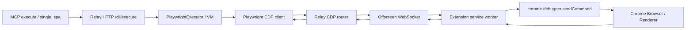
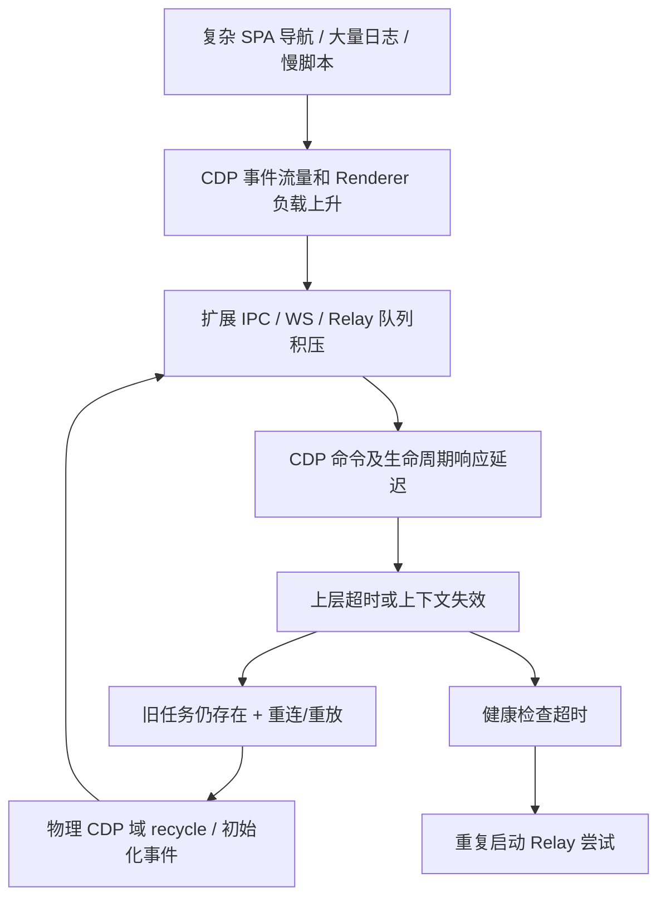
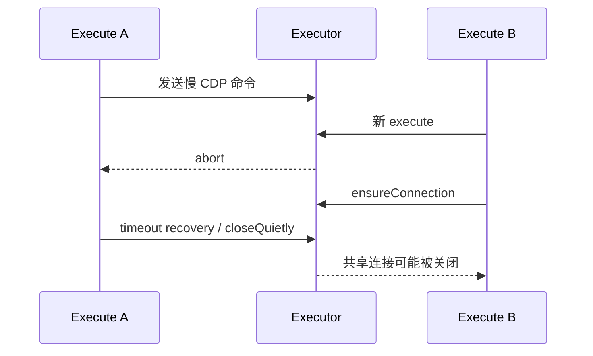
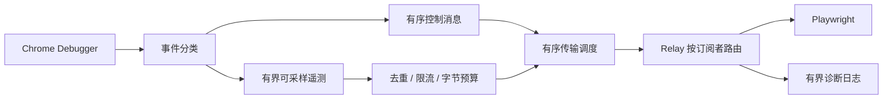
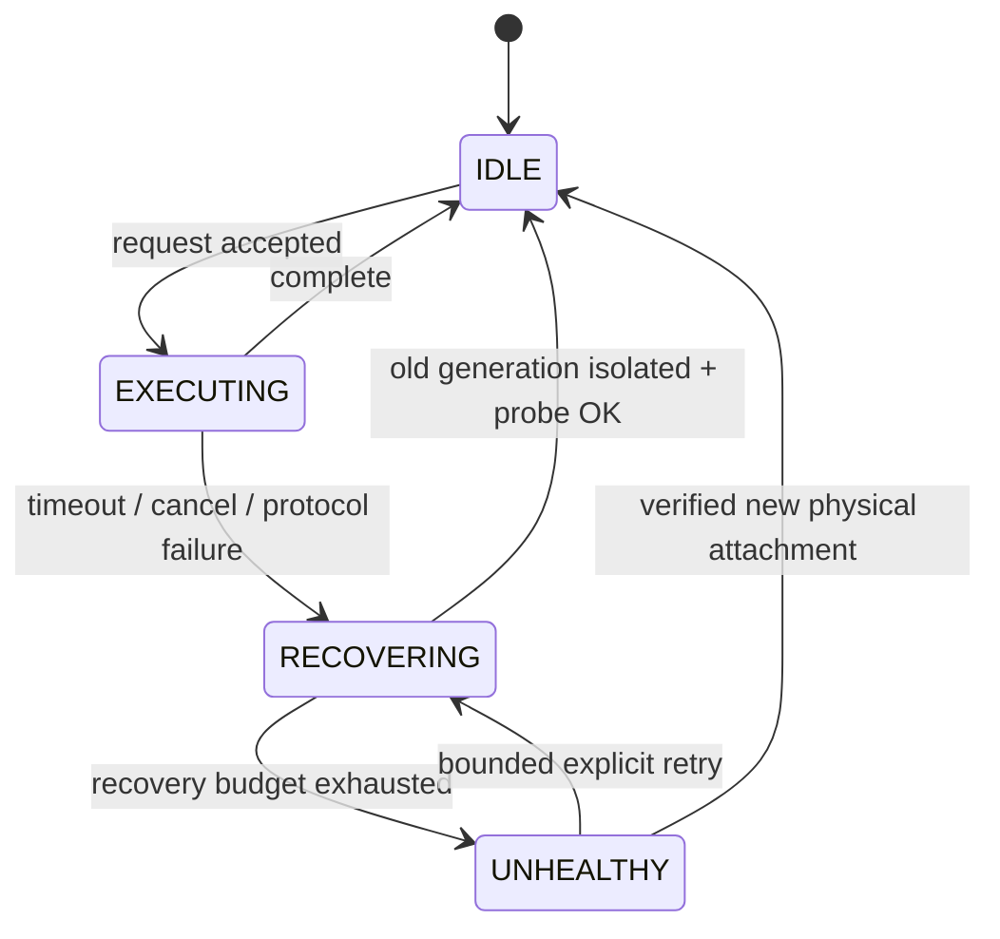

# Spawriter MCP navigate / execute 卡死专项技术审计与修复设计

> 日期：2026-11-25（故障时间统一使用 UTC+8）  
> 审计基线：Git commit `c811443`（refactor: update clearCacheAndReload functionality and documentation）  
> 范围：MCP → Relay → Playwright Executor → Chrome Extension / Offscreen → Chrome Debugger / Renderer  
> 状态：三份故障报告交叉验证及上游源码对照完成（修订 3）；修复待实施；首次卡死的原生进程级触发点待实验验证  
> 文档目的：为维护者提供可复核的证据、优先级明确的修复任务、可执行的实验及上线验收标准。

## 目录

1. [执行摘要与证据等级](#1-执行摘要与证据等级)
2. [运行现场及故障时间线](#2-运行现场及故障时间线)
3. [架构与故障传播机制](#3-架构与故障传播机制)
4. [根因及源码证据](#4-根因及源码证据)
5. [目标设计与实施细节](#5-目标设计与实施细节)
6. [分阶段实施计划](#6-分阶段实施计划)
7. [复现、故障注入和验收](#7-复现故障注入和验收)
8. [运行手册与临时止血](#8-运行手册与临时止血)
9. [兼容性、发布与回滚](#9-兼容性发布与回滚)
10. [证据索引与审计边界](#10-证据索引与审计边界)
11. [双报告交叉验证与上游研究后的修订决策](#11-双报告交叉验证与上游研究后的修订决策)
12. [第三份报告补充审计及最终裁决](#12-第三份报告补充审计及最终裁决)

---

## 1. 执行摘要与证据等级

### 1.1 核心判断

本问题不能归结为单一的导航超时。当前运行日志证实：导航命令超时、CDP 重连失败、旧连接断开后仍收到迟到响应，同时目标业务页存在短时高强度 Console 事件风暴。源码进一步确认，Spawriter 的通信链路缺乏有效流量上限、取消与故障恢复不完整，重连及并发控制存在竞争风险。

**确定的工程根因是执行生命周期和事件传输缺乏故障隔离；高频 Console 风暴是已观测到的主要负载来源，也是首要验证的触发/放大因素。尚不能证明其为第一次 Chrome 卡死的唯一触发原因，更不能仅凭 Relay 日志断言 Chrome Browser Process 主线程发生死锁。**

本次没有主动重现整机卡死，也没有采集故障时的 Chrome 原生线程栈、CPU profile 或 IPC trace。原始 CDP 明细在后续日志滚动/重启中已丢失。应将修复与根因验证并行推进，而不是把高可信假设写成已经完成的因果证明。

### 1.2 证据分级

- **E1：现场实测**——真实日志或只读命令得到的事实。
- **E2：源码确定性缺陷**——静态代码足以证明存在错误行为或无界路径，但不一定在本次现场触发。
- **E3：待验证假设**——机制合理，需要受控实验或运行时采样确认。

| ID | 问题 | 证据 | 修复优先级 |
|---|---|---|---|
| R1 | Console 风暴、整栈传输及日志过载 | E1 + E2；首发因果关系 E3 | P0 |
| R2 | CDP 命令 timeout 类型与恢复分类不一致 | E1 + E2 | P0 |
| R3 | Promise.race 停止等待而非取消底层操作；时间预算割裂 | E1 + E2 | P0 |
| R4 | Runtime/Page recycle 无界等待、物理域被重复操作 | E2；本次触发 E3 | P0 |
| R5 | 同 Session 并发、旧连接回调、自动重放脚本 | E2；本次触发 E3 | P0 |
| R6 | 事件广播重复、虚拟 Session 生命周期不完整 | E2；实际放大倍数待测 | P0（融合后提升） |
| R7 | 全局图标、标题和 Storage 高频刷新 | E2；CPU/IPC 占比 E3 | P0（融合后提升） |
| R8 | Relay 健康检查失败即尝试启动新进程 | E1 + E2 | P1 |
| R9 | navigate 成功语义不可靠 | E2 | P1 |
| R10 | VM 与 Relay 共享 Node Event Loop | E2；本次触发 E3 | P2 |
| R11 | 扩展逐事件 Offscreen IPC 及源头未过滤 | E2；原生线程负载比例 E3 | P0 源头治理 / P1 传输迁移 |
| R12 | Accessibility/DOM helper 重域生命周期无配对关闭 | E2；现场洪峰贡献 E3 | P0 有界 cleanup / P1 domain registry |
| R13 | DevTools 刷新重叠、共享结果槽、eval 无界等待 | E2；面板是否参与首次故障 E3 | P1 |
| R14 | 非 frameAttached registry 断言累计触发 resetAll | E2；本次全局升级未观测到 | P0 |
| R15 | MCP 本地 executor 镜像与 Relay authoritative state 分裂 | E2；现场是否致因 E3 | P0 身份修复 / P1 镜像清理 |

P0 指应优先修复的稳定性问题，不代表已经证实为本次故障的直接触发原因。P1 为下一阶段的协议/负载治理；P2 为长期隔离架构。修订 2 已将另一 Agent 的调用栈统计、源头过滤、Port 微批、UI 差量、虚拟会话清理建议纳入；本轮实施顺序以[最终优化设计](05-implementation-plan-spawriter-mcp-stability-20261125.md)为准，第 11 节详述交叉验证与分歧裁决。

### 1.3 不建议采取的措施

- 单纯增大 MCP、execute 或 Page.navigate 的 timeout。
- 每次失败后无条件 reset / relay --replace / 自动重放整段代码。
- 全量删除 Runtime.consoleAPICalled 或任意丢弃 Runtime、Page、Fetch、Network 等关键事件。
- 用 page.goto() 机械替换所有 navigate()，或删除 Runtime.enable 而不解决执行上下文初始化。
- 只修业务 i18n 警告而忽略 Spawriter 对其他高日志页面的通用鲁棒性。
- 关闭用户正在使用的 Chrome、清除全局浏览数据、主动抢占非本 Session 标签页。

## 2. 运行现场及故障时间线

### 2.1 环境和数据来源

- 仓库：`D:\dev\side\spawriter`；初始及写本文档前的工作区无未提交变更。
- Node.js：现场只读命令显示 v26.3.0。
- package.json / spawriter/package.json：版本 1.1.0；运行中的 Relay /version 返回 1.0.0，源码 utils.ts:4 的 VERSION 常量也是 1.0.0。**该差异本身不能证明正在运行旧构建**；发布时需补充 build SHA 和协议版本。
- 日志：`%TEMP%\spawriter\relay.log`、`%TEMP%\spawriter\cdp.jsonl`。
- 目标页：service.cstcloud.cn 的 SSL 订单页面；Console 警告来自本地开发脚本 http://localhost:9960/app.js。文档不复述具体订单 ID、认证数据、页面内容或完整 CDP payload。
- 代码位置以审计基线为准，后续变更应以符号名定位。

### 2.2 现场时间线

以下摘录来自 relay.log，末尾 Console 洪峰来自 cdp.jsonl。时间由 UTC 转换为 UTC+8，未补造缺失请求记录。

| 时间 | 现场事件 | 可得结论 |
|---|---|---|
| 11:26:44 | CodeExecutionTimeoutError: 30000ms | 更早已发生执行超时 |
| 11:26:46 | Playwright browser / CDP WebSocket disconnected | 超时后发生断开 |
| 13:41:47 | 新 Playwright CDP WebSocket connected | 建立新连接 |
| 13:43:53 | Port already in use; another relay instance is running | 新启动尝试遇到已占用端口 |
| 13:44:34 | Error: "Page.navigate" timed out after 23.748s | 导航命令未在调用侧预算内响应 |
| 13:44:41 | execution context stale, resetting connection and retrying once | 触发连接重置及脚本重试 |
| 13:44:45–47 | CDP WebSocket / Playwright disconnected | 旧连接关闭 |
| 13:44:50–56 | Connecting / CDP WebSocket connected | 重连过程耗时 |
| 13:45:08 | CDP connection timeout (15s) | 初始化未能在上层 15s 内完成 |
| 13:45:10 | Port already in use | 又一次启动失败 |
| 13:45:36 | Runtime.callFunctionOn，relay id 1190/1191，age=79.8s，deletedReason=client-disconnect | 原调用方已断开，响应迟到 |
| 13:45:44 | Runtime.callFunctionOn，id 1192/1193，age=65.5s/62.6s | 继续收到迟到响应 |
| 13:46:00 | Relay server started | 新 Relay 启动 |
| 13:46:31–32 | Shutdown requested，随后 Relay 再次启动 | 发生显式 shutdown/restart，发起者未确认 |
| 13:46:39 | Extension WebSocket connected | 扩展重新连接 |
| 13:47:26 | CodeExecutionTimeoutError: 30000ms，随后记录 timeout recovery | 30s 执行超时触发恢复 |
| 13:47:29 | CDP / Playwright disconnected | 恢复断开旧连接 |
| 13:47:31 | Runtime.callFunctionOn，id 24，age=18.7s | 迟到响应 |
| 13:47:48 | Runtime.terminateExecution，id 25，age=21.2s | 恢复命令自身也迟到 |
| 13:49:19–21 | Console 事件洪峰 | 直接观测到大量控制台事件 |

迟到响应的原始摘要：

```text
Late response for relay id 1190: method=Runtime.callFunctionOn, deletedReason=client-disconnect, age=79.8s
Late response for relay id 1191: method=Runtime.callFunctionOn, deletedReason=client-disconnect, age=79.8s
Late response for relay id 1192: method=Runtime.callFunctionOn, deletedReason=client-disconnect, age=65.5s
Late response for relay id 1193: method=Runtime.callFunctionOn, deletedReason=client-disconnect, age=62.6s
Late response for relay id 25: method=Runtime.terminateExecution, deletedReason=client-disconnect, age=21.2s
```

age 为 Relay 观察到的请求年龄，**不能直接视为 Chrome 命令 CPU 执行时间**。这包括 Chrome 执行、扩展排队、IPC/WS 传输、Relay 消费等延迟。无法根据现有数据确定是哪一层消耗了全部时间。

### 2.3 Console 事件现场量化

采样窗口的 CDP 日志从 13:49:19.669 起，统计了 from-extension 的 Runtime.consoleAPICalled 及对应 to-playwright 日志。

| 指标 | 值 |
|---|---:|
| from-extension Console 事件 | 2,497 |
| to-playwright Console 日志记录 | 2,497 |
| 13:49:19 秒桶 | 412 |
| 13:49:20 秒桶 | 1,681 |
| 13:49:21 秒桶 | 404 |
| from-extension Console 日志字符串长度合计 | 30,781,251 |
| to-playwright Console 日志字符串长度合计 | 30,776,257 |
| 两方向合计 | 61,557,508 字符（约 61.6M 字符） |
| 单条示例记录 | 约 12,000 字符 |
| 日志文件现场 stat（另一次采样） | 62,203,053 字节 |

注意：上述合计是 JavaScript 字符串 length，不是精确 UTF-8 字节数、WebSocket wire bytes 或独立内存占用；两方向是同一批事件的接收和转发日志，不能把它们当作 4,994 个页面独立事件。秒桶是自然秒，非严格连续 3s 负载测量。Relay 某些直接 ws.send 分支不经统一 logCdp，日志计数也不等于实际发送倍数。

主要警告为 Vue i18n（intlify）缺失翻译与 fallback：

```text
[intlify] Not found '创建订单' key in 'zh-CN' locale messages.
[intlify] Fall back to translate '创建订单' key with 'zh' locale.
[intlify] Not found '创建订单' key in 'zh' locale messages.
```

调用栈首帧：localhost:9960/app.js，warn，CDP lineNumber=11702（零基行号）。多个警告签名在采样中各重复约 32–33 次，附带很长的调用栈。绝大多数采样事件来自同一个目标标签页；另一个 attached Tab 也存在少量事件。

### 2.4 证据保全限制

cdp-log.ts:73–92 在 logger 创建时写入空文件；默认保留约 10,000 条并滚动到一半。原始 13:44–13:47 明细已不可从当时留存的 cdp.jsonl 查到。因此不能把 13:49 的 Console 洪峰时间倒推为 13:44 首次导航故障的直接证据。

现场 Relay /version 后来可以响应，简单 Runtime.callFunctionOn（evaluate '1'）在约 3–4ms 得到响应，并出现成功截图记录。这表明故障至少存在间歇性，不代表整段时间所有 Chrome 线程均死锁。

## 3. 架构与故障传播机制

### 3.1 命令路径



CLI 与 MCP 的执行主要共享 Relay 中的 PlaywrightExecutor，因而 CLI 并不是绕过全部故障链的独立实现。扩展维护实际 tab debugger attachment；Relay 模拟 CDP target、browser 和 virtual session；Playwright 依赖完整且有序的 frame、execution context、network、dialog 等事件。

### 3.2 故障正反馈（待实验证实具体先后顺序）



该图是根据源码及现场异常构建的机制模型，不是已经采集到的完整事件因果追踪。

### 3.3 区分四类“不响应”

| 类型 | 观测方法 | 不应直接得出的结论 |
|---|---|---|
| 页面 Renderer 忙或挂起 | 独立 Tab 响应、Renderer CPU、长任务和 Chrome trace | 不代表整个 Chrome 主线程卡死 |
| Chrome Browser Process / IPC 饱和 | Chrome UI、标签切换、Browser CPU/线程栈、IPC trace | 不一定由目标页 JS 单独造成 |
| Extension / Offscreen 传输积压 | 接收/发送时间戳、队列字节、bufferedAmount | 不代表 CDP 原生命令耗时同样长 |
| Relay / Playwright 过载 | Event Loop Lag、/health、Pending 年龄、CPU/RSS | 不代表 Chrome 本身无响应 |

## 4. 根因及源码证据

### R1 — Console 事件风暴与日志放大（P0）

**位置**：extension/src/ai_bridge/bridge.js:309–321、438；extension/src/offscreen.js:37、99、135–146；spawriter/src/relay.ts:84、1242、1526–1563；spawriter/src/cdp-log.ts:27–48、101–138。

扩展对 attached Tabs 的 debugger 事件直接调用 chrome.runtime.sendMessage，经 Offscreen JSON.stringify 和 WebSocket 转发。没有对 Console 事件的频率、调用栈长度、队列体积、闲置采集做明确限制。Relay 对事件解析、分发、序列化和日志再次处理。每条记录可能包含长 stackTrace、参数、RemoteObject；2,497 条事件已形成约 61.6M 字符的双向日志。

现有 DROPPED_CDP_EVENTS 只包含 Network.dataReceived、Network.resourceChangedPriority，NOISY_LOG_EVENTS 也未包含 Console。Logger 同步 JSON.stringify、异步批量写入，按条数旋转，旋转读取整个文件，缓冲区没有严格字节限制。异步写盘并不消除同步序列化和 GC 成本。

NetworkMonitor 的 MAX_CONSOLE_LOGS=1000（runtime/network-monitor.ts:37、47–50）只限制最终留存数量，不限制上游事件流量。Playwright 1.56 本地 crPage.js:641–650 使用 Runtime.consoleAPICalled 构建 console 事件，不能把整个事件类型永久删除。

**结论**：事件风暴存在且高可信地构成负载放大因素。首发 Chrome 卡死是否由该风暴引起，需要第 7 节 A/B 实验。

### R2 — navigate timeout 类型错误（P0，确定性 Bug）

**位置**：pw-executor.ts:83–91、235–243、748–751、877–899、2283–2307。

```typescript
// withTimeout 当前行为
reject(new Error(`"${label}" timed out after ${ms / 1000}s`));

// classifier 当前行为
return err instanceof CodeExecutionTimeoutError
  || err instanceof NavigationBudgetError
  || err.name === 'TimeoutError'
  || err.name === 'AbortError';
```

普通 Error.name 为 Error，不匹配超时分类。现场 13:44:34 的 Page.navigate 23.748s 错误未紧随对应的 timeout recovery 日志；13:47:26 的 CodeExecutionTimeoutError 则进入恢复。当前逻辑对 CDP command timeout 和连接 timeout 的处理不统一，可能继续使用不健康连接。

不能仅给所有 Error 加 TimeoutError 名称后就盲目 terminate；应记录超时阶段和命令副作用，采用不同恢复策略。NavigationBudgetError（尚未发送命令）也不应该默认终止页面 JS。

### R3 — 多层超时割裂、取消不完整（P0）

**位置**：mcp.ts:167–180、556–635；relay.ts:871、895–915、1860–1953、2227–2250；pw-executor.ts:547–616、732–751、758–841、875–918、2460–2484；bridge.js:527–558。

| 层级 | 当前配置 | 风险 |
|---|---:|---|
| MCP 全局请求 | 120s | Promise.race 不取消下游 HTTP 工作 |
| MCP execute 默认 | 30s | 不覆盖所有连接和 warmup 阶段 |
| Playwright connectOverCDP 外层 | 15s | race 失败后 connect 可能仍继续 |
| 等待 owned page | 3s（默认循环预算） | 某些内部 CDP await 仍可能超预算 |
| DOMContentLoaded stabilization | 5s | 连接初始化额外等待 |
| warmup evaluate | 3s | 超时仅停止等待 |
| navigate 命令 | 30s execute 下约 23.75s | 单独 command timer |
| Extension 普通 / 慢命令 | 30s / 60s | 不继承调用者 deadline |
| Relay pending | 90s | 上层已结束后仍可能留存 |
| terminateExecution 等待 | 1s | 仅 best-effort，不保证底层终止 |
| closeQuietly | 默认 5s；超时恢复 3s | 超时不保证底层连接已关闭 |

execute 的主要 deadline 在 ensureConnection、getCDPSession、warmup 后建立；HTTP fetch 没有贯穿调用者的 AbortSignal；Relay 删除 pending 或断开 socket 不等于 Chrome 已取消操作。vm.runInContext 的同步 timeout 不等于 VM 内所有异步 continuation 的取消。

Runtime.terminateExecution 只适用于某些 JS 执行情形，不是通用 CDP cancel；Page.stopLoading 也只是导航恢复手段之一。不能承诺任意已经产生外部副作用的命令可回滚。

### R4 — Runtime/Page recycle 和无界 attach（P0）

**位置**：bridge.js:624–645、733–783。

每当收到 Runtime.enable 或 Page.enable，bridge 先直接 await chrome.debugger.sendCommand(..., domain.disable)，不经过 sendCommandWithTimeout。attachTab 的 attach、三域 enable、getFrameTree 等也有直接 await。

在已有物理 Debugger attachment 上复用多个逻辑 Session 时，disable/enable 不是独立的客户端状态切换，而是对物理域的操作。可导致事件缺口、上下文重新报告，增加重连成本；Runtime enable 可能重放 Console 历史消息，具体 Chrome 行为应通过协议采样验证。

不能直接删除 recycle：Playwright 初始化需要 executionContextCreated、frame 等一致状态。应先有界化并串行初始化，再设计物理/逻辑域状态同步。已有 bridge 对 child target attach 的过滤也表明此实现不是原生完整 CDP，变更须验证 OOPIF、worker、iframe 等场景。

### R5 — 并发恢复竞争、连接代际和自动重放（P0）

**位置**：pw-executor.ts:547–616、758–773、833–918、2430–2484；mcp.ts:107–122、230、565、585。

execute 开始立即 cancelActiveExecution()，然后启动新任务；abort 只使旧任务上层 race reject，旧任务可能仍执行且进入恢复。A 的 closeQuietly 或旧 browser disconnected 回调可能破坏 B 新连接。



此外 browser.on('disconnected') 无身份检查。connectOverCDP 的外层 race 超时后，迟到成功的连接也没有明确销毁路径。activeAbortController 在部分初始化阶段可能先被 abort，而后才安装 abort listener，应检查 signal.aborted。

当前错误分支遇到 execution context destroyed、session/target/protocol error 会重连后递归执行整段用户脚本。若脚本先提交表单、发送请求或点击保存，再在后续读取时失败，重放可能重复业务副作用。默认应只重试显式声明为幂等的查询/初始化，不自动重放任意用户脚本。

MCP 使用全局 activeAgentId；await ensureRelayServer 期间其他请求可以修改它，executeViaRelay 再取 sessionId 时存在跨 Agent 路由风险。应在请求入口固定有效 Session ID，显式传递，不再跨 await 读取可变全局。reset 当前也涉及本 MCP 进程的多个会话，需明确单 Session reset 与全量 reset 的语义。

### R6 — Relay 事件路由及虚拟 Session 清理（P1）

**位置**：relay.ts:254–256、329–350、1130–1172、1526–1563、2227–2250。

routeCdpEvent 先向 ownerClientId 发送，再向全部 pw-* 客户端发送同一个 real sessionId，随后向 virtual session 映射发送。owner 若为 pw-*，存在重复发送；不相关客户端也会收到事件。实际发送量需用统一出口计数验证，不能仅凭日志中的一条 to-playwright 记录得出倍数。

virtualToRealSession、realToVirtualSessions 与 virtualBrowserSessions 缺少完整 client 归属；已检查的 CDP close 分支仅清理连接和 pending，未对每个虚拟 Session 做精确归属清理。部分 reset 路径有 clearVirtualSessionsForRealSession，但不能替代 detach/client close 生命周期。需审计显式 Target.detachFromTarget、物理 detach、session reset、lease release、extension reconnect 等路径。

### R7 — 全量 UI 更新和周期性重复写入（P1）

**位置**：bridge.js:23–31、75–107、134–179、219–298、337–353、1115–1131。

tabs.onUpdated 每次事件都调用 updateIcons()，后者 query 所有 Tabs 并为全局及每个 Tab 调用 setIcon/setTitle/setBadgeText/setBadgeBackgroundColor。以 N 个 Tab、每秒 U 次更新为例，理论调用量为 4 × (N+1) × U；N=30、U=20 时为 2,480 次/秒（示例，不是现场实测）。

每 5s 拉取 /json/list 后重建 ownership，syncOwnershipStates 无变化也 setTabState → persistState + scheduleTitleMarker。标题注入可能触发新 onUpdated，虽然 marker 写入本身幂等，仍产生 IPC/查询开销。部分 action API fire-and-forget 的异步 rejection 未被外围同步 try/catch 捕获。

### R8 — Relay 健康判断及启动风暴（P1）

**位置**：mcp.ts:57–98；runtime/ensure-relay.ts:1–65。

/version 2s 未响应就尝试启动新 Relay；MCP 进程内有 relayStartPromise，但不解决多个进程之间的启动竞争。现场 EADDRINUSE 表明当时端口仍被占用；不能仅据此证明原 Relay 一定因事件风暴阻塞，也不能推定重复启动造成首次卡死。应区分进程不存在、端口冲突、Event Loop 忙、Extension 断开、Tab unhealthy。

### R9 — navigate 返回成功的语义不可靠（P1）

**位置**：pw-executor.ts:267–279、2283–2307、965–971。

Page.navigate 返回值未检查 errorText 等字段；后续 document.readyState 可能属于旧文档，probe 超时被吞掉仍返回 Navigated to。没有区分导航已请求、已提交、DOM 就绪、业务稳定。fallback page.evaluate(window.location.href=...) 同样可能因上下文销毁而错误重试。

Page.reload、ensureFreshRender 等共享类似恢复需求；不能把导航超时一律归为 JS 超时。

### R10 — VM 与 Relay 共享 Event Loop（P2）

**位置**：relay.ts:1953；pw-executor.ts:806–841。

Node VM 的 timeout 不是所有异步 continuation 的硬隔离边界。同步循环、异步后续 CPU 密集任务、日志格式化等可能阻塞整个 Relay，连用于恢复的 timer 和 /health 都无法及时运行。当前没有现场证据表明这就是本次原因；应将其纳入独立进程/Worker 隔离设计，而非与第一轮最小修复混合实施。

## 5. 目标设计与实施细节

以下代码、阈值、接口均为设计建议，尚未写入产品源码，也未通过测试。

### 5.1 P0：Console 负载治理与可靠传输

优先在最靠近 chrome.debugger.onEvent 的位置实施：

1. 按 tabId + physicalGeneration + method/type + 首个文本参数 + top frame 生成有限长度签名。重复低优先级日志在 1s 窗口聚合。
2. 正常负载保持原始 CDP 事件语义；超过限额后仅对明确可采样的重复 Console 日志进行限流和栈压缩。不要任意改变 RemoteObject、contextId 或关键事件字段。
3. 优先保留首条 warning、error 和 exception；error 也需要有界上限，绝不能让“必须保留 error”成为无界内存漏洞。被采样/丢弃的数量通过独立 telemetry / consoleLogs 元数据报告，不伪造原生 CDP event。
4. 以 byte budget 而非只按条数限制队列；Offscreen 监测 WebSocket.bufferedAmount，runtime.sendMessage 也要做有界发送。关键控制消息不允许因 telemetry 堵塞而无限等待。
5. 对闲置 attached Tab 优先停止无业务价值的转发；不可未经状态同步设计就 disable Runtime/Page，避免破坏下次接管与事件完整性。
6. Relay 作为第二层保护，去除重复发送，默认不保存高频 Console 原始完整 payload。提供短期 opt-in 诊断模式和脱敏。
7. 日志采用固定字节预算、分段轮换、保留若干历史文件；不要每次启动清空上次故障证据。对写入队列加上限，按优先级保留 command metadata、错误和统计，避免同步大对象 dump。

初始试验配置（非最终生产参数）：

| 参数 | 建议初值 |
|---|---:|
| per-tab Console rate | 100/s |
| burst allowance | 200 |
| 聚合窗口 | 1s |
| 过载时栈保留深度 | 3–5 |
| per-tab telemetry buffer | 1–2 MiB |
| 日志分段 | 10–20 MiB |
| 日志保留 | 3–5 段，另设总大小上限 |

控制平面包含 command response、target/frame/context lifecycle、dialog、Fetch.requestPaused 等；这些消息不能随意丢弃、合并或重排。Network 事件也要按 Playwright 依赖分析后处理，不是一律低优先级。



先做同一连接上的逻辑队列；不能声称这样就能绕过已进入 TCP 队列的旧数据。如验证仍存在 head-of-line blocking，再评估独立控制/遥测通道，且必须保持协议必要的 happens-before 关系。

业务页面侧同步修复缺失 i18n key 和 fallback/render 重复触发；关闭开发 warning 仅适合受控 A/B 诊断或经业务团队确认的配置，不是 Spawriter 的唯一修复。

### 5.2 P0：统一错误与 deadline

定义 typed error，包含 phase、method、requestId、generation、timeoutMs、cause、是否已发送命令等字段。示意：

```typescript
class CdpCommandTimeoutError extends Error {
  readonly code = 'CDP_COMMAND_TIMEOUT';
  constructor(
    readonly method: string,
    readonly timeoutMs: number,
  ) {
    super(`${method} timed out after ${timeoutMs}ms`);
    this.name = 'TimeoutError';
  }
}
```

错误码至少包含 CDP_COMMAND_TIMEOUT、EXECUTION_TIMEOUT、CONNECTION_TIMEOUT、NAVIGATION_FAILED、TARGET_DETACHED、SESSION_BUSY、CANCELLED、TRANSPORT_OVERLOADED、INSUFFICIENT_BUDGET。

在 MCP/CLI 入口固定请求身份，启动统一 deadline，传递到 Relay/Executor/Extension：

```typescript
interface ExecutionContext {
  requestId: string;
  sessionId: string;
  tabId?: number; // acquire 后固定
  generation: number;
  deadlineMs: number;
  signal: AbortSignal; // 仅本进程对象；跨进程传 deadline/requestId
}
```

- 所有等待（包括排队、claim、connect、attach、warmup）计入预算；另明确有界 recovery grace，API 文档声明最迟响应时间。
- 跨进程传绝对 deadline 或剩余预算，结合本地单调时钟计时；不得跨进程序列化 AbortSignal 假装能够取消。
- MCP SDK 请求取消、HTTP disconnect/abort 与 Relay cancel API 建立明确关联。Relay 接收到取消后停止发新命令，标记旧 generation，并执行针对性恢复。
- Playwright connectOverCDP 使用原生 timeout（经当前版本 API 验证）及迟到连接清理，不仅依赖 Promise.race。
- withTimeout 始终释放 timer/listener，检查已 aborted 的 signal；不同超时阶段进入不同处理分支。
- validate timeout 为有限正整数并设最小/最大值；不允许 NaN、Infinity、负值导致无界等待。
- 统一结构化错误返回；MCP 非超时错误不应统一误报 120s global timeout。

### 5.3 P0：Session 与 Tab 生命周期、取消和熔断

每个 Session 串行执行（包括 tab switch、reset、release、recover）；不同 Session 在不同 Tab 可并行。对同一物理 Tab 的 attach/detach/recover 使用生命周期锁。不要对所有原生 CDP 命令全局串行加锁：Playwright 初始化会并行发命令，dialog、Fetch continue、终止执行等必须能打断等待，否则可能人为死锁。



并发请求默认返回 SESSION_BUSY，或使用有界 FIFO（建议每 Session 最多 1–3 个等待任务，排队时间计入 deadline）；禁止新 execute 自动 abort 旧任务而不等待恢复。显式取消应区分用户主动取消和超时。

核心约束：
- generation 单调递增；旧回调、旧响应、旧 timeout 不得影响新连接。
- browser disconnected 回调确认 this.browser === browser 且 generation 匹配。
- timeout recovery 只关闭该次执行捕获的连接对象；不要在旧任务里盲目关闭 this.browser。
- 未确认旧任务已停止前，不允许再次接受同 Tab 的副作用执行。
- 对已提交的操作返回 outcome unknown，而非自动重放。
- pending 在客户端断开、超时、取消时清理并保留有限 tombstone，以识别迟到响应；不能把 tombstone 清理描述为 Chrome 已取消。
- 对未能确认终止的任意 JS continuation，需要连接隔离、VM/Worker 隔离等更强手段；不能依赖 AbortController 宣称任意代码已经终止。

分级恢复矩阵：

| 阶段 | 建议恢复 | 不应做 |
|---|---|---|
| 尚未发送命令 / 预算不足 | 直接返回错误 | terminate 页面 JS |
| 导航/reload 超时 | 有界 Page.stopLoading，检查 frame/loader | 自动重复导航、无条件终止 JS |
| JS evaluate 超时 | 仅拥有 Tab 上尝试 Runtime.terminateExecution | 将其作为所有命令的通用 cancel |
| 已确认 debugger paused | 依据调试意图决定是否 Debugger.resume | 破坏用户有意设置的断点 |
| Context destroyed | 重新获取 context；只重试明确幂等操作 | 重放整段任意脚本 |
| 通道异常 | 限时关闭本连接、必要时物理 detach/attach | 无限重连 |
| 恢复命令仍无响应 | 标记 UNHEALTHY、隔离并告知用户 | 关闭整个 Chrome、抢占其他 Tab |

恢复预算初值 3–5s，有限重试（如一次），退避含 jitter；最终以测量校准。若原生 CDP 无法取消，不保证旧命令不会产生迟到副作用，必须阻断后续任务、明确结果未知。

### 5.4 P0/P1：物理 CDP 域与虚拟 Session 管理

短期：给直接 debugger.attach/detach/sendCommand 路径补充有界等待；对物理 attachment 初始化使用 single-flight 和 generation。所有迟到完成结果需按代际校验。超时 wrapper 本身不能取消 chrome.debugger 原生 API。

中期建立 registry：

```typescript
interface PhysicalTargetState {
  tabId: number;
  generation: number;
  realSessionId: string;
  enabledDomains: Set<string>;
  executionContexts: Map<number, unknown>;
  status: 'attaching' | 'ready' | 'recovering' | 'unhealthy';
}
interface VirtualSessionState {
  virtualSessionId: string;
  clientId: string;
  ownerSessionId: string;
  realSessionId: string;
  generation: number;
  subscriptions: Set<string>;
}
```

实现 connect-time 可靠状态同步，缓存/重建真实 execution context 和 frame 生命周期，避免假造未经验证的协议状态。Runtime/Page enable 重复调用应有明确策略（每代际一次或对新逻辑 client 重放一致快照），验证同一 Tab 的跨文档导航、iframe、BFCache、prerender、popup 与 reconnect。

routeCdpEvent 为每次发送生成唯一 (clientId, destinationSessionId) 集合，校验 owner、announcedTargets 和 virtual registry，只发给实际订阅者；所有发送统一走观测出口。detach/client-close/release/reset/extension disconnect 统一释放 virtual 映射、pending 和订阅。对 Target.attachToTarget / detachFromTarget 进行所有权验证，不能把虚拟 Session 当成跨会话访问漏洞。

### 5.5 P1：导航 API 语义

短期保持现有 navigate(url) 调用兼容，增加可选 options，解析 Page.navigate 的 errorText、frameId、loaderId 等，使用匹配的 frame/loader 观察 commit；同文档导航可能没有 loaderId，不能强制要求所有导航具有 loaderId。

```typescript
interface NavigateOptions {
  timeout?: number;
  waitUntil?: 'commit' | 'domcontentloaded' | 'load';
}
interface NavigateResult {
  status: 'committed' | 'loading' | 'completed' | 'failed' | 'timeout';
  requestedUrl: string;
  currentUrl: string;
  frameId?: string;
  loaderId?: string;
  readyState?: string;
  error?: string;
  elapsedMs: number;
}
```

建议默认 waitUntil=commit，业务稳定由 waitForPageLoad 或明确的 Locator/业务条件控制。保留旧字符串输出或增加 opt-in structured result；不要在小版本无提示破坏调用方。处理重定向、下载、同文档 URL 变化、beforeunload、网络失败、commit 后慢加载、context destroyed。

确保 readyState probe 对应新文档，并计入剩余预算；超时不得错误声明 Navigated。navigate / page.goto / reload 的共同取消与观测基础设施可复用，但应分别验证事件语义。

### 5.6 P1：UI 增量更新、健康检查与启动管理

- setTabState 仅当状态/attachment generation 真正变化时触发 persist 和 title marker；detach 清理等特殊路径单独处理，避免简单 early return 造成遗留状态。
- tabs.onUpdated 按必要字段过滤、按 Tab 合并；全局 badge 仅在全局计数变化时刷新。updateIcons single-flight + 100–250ms debounce + 结果缓存。
- Ownership push 为主；5s polling 作为不一致或失联时兜底，结果相同不写入。
- Title marker 保留幂等性；过载期暂停非关键注入；捕获 action API 的异步 rejection。
- 启动采用跨进程互斥/端口探测+有界重试，不将 HTTP timeout 等同于进程不存在；EADDRINUSE 时报告既有端口状态，不杀不明进程。

建议 /health 返回纯统计，不携带 cookie、认证头、完整 URL 或执行代码：

```json
{
  "status": "degraded",
  "buildSha": "<build SHA>",
  "extensionConnected": true,
  "eventLoopLagMs": 830,
  "pendingRequests": 42,
  "oldestPendingMs": 18000,
  "extensionBufferedBytes": 12582912,
  "activeExecutions": 1,
  "recoveringTabs": 1,
  "droppedConsoleEvents": 2480
}
```

上述 JSON 为示意，数字不是现场测量。/health 同一 Event Loop 上可能无法及时响应，因此 watchdog 应从独立进程测量 health RTT / 超时；不能只靠进程内部指标证明 Event Loop 没有阻塞。

### 5.7 可观测性和长期进程隔离

为每条命令建立贯穿各层的 requestId / relayId / clientId / physical generation；仅保留方法、阶段时间、字节和状态。示意：

```typescript
interface CdpCommandMetric {
  requestId: string;
  relayId: number;
  method: string;
  sessionId: string;
  tabId: number;
  generation: number;
  relayReceivedAt: number;
  extensionReceivedAt: number;
  debuggerStartedAt: number;
  debuggerFinishedAt: number;
  relayRespondedAt: number;
  payloadBytes: number;
  outcome: string;
}
```

每层使用本地单调时钟计算 duration，跨进程时间戳用于关联而非未经校准的精确耗时。统计事件 rate、队列 oldest age / bytes、send buffer、active/pending、late responses、重连次数、Event Loop delay、CPU/RSS、GC、日志写入与轮转耗时。

长期考虑将 Executor 运行到独立进程或 Worker（优先评估子进程硬隔离），Relay 专注路由、所有权和健康监控。Executor 失控时可以终止它并隔离物理 Tab，而非让所有会话共享一个失控 Event Loop。需要设计 scoped FS、state 生命周期、Playwright 连接、进程 IPC 及权限边界；Node vm 不是安全隔离的完整替代品。

## 6. 分阶段实施计划

推荐拆成小 PR，每阶段可独立构建、测试和回退。不建议同时重写协议、VM 和所有 UI。

| PR | 范围 | 主要文件 | 退出条件 |
|---|---|---|---|
| 0：诊断基线 | command phase metrics、字节统计、日志保全、build SHA | relay.ts、cdp-log.ts、bridge.js、offscreen.js | 可区分 Chrome 执行与传输排队 |
| 1：流量止血 | Console 去重/限流、字节上限、日志降载 | bridge.js、offscreen.js、cdp-log.ts | Console 压测中控制消息保持可响应 |
| 2：执行安全 | typed error、会话锁、旧连接身份检查、禁止任意脚本自动重放 | pw-executor.ts、mcp.ts、relay.ts | 超时进入正确恢复；并发无误伤/重复副作用 |
| 3：取消与恢复 | deadline、取消传播、generation、熔断、attach/init 有界 | mcp.ts、relay.ts、pw-executor.ts、bridge.js | 恢复失败隔离 Tab；无无限重连 |
| 4：协议生命周期 | virtual registry、去重路由、detach、domain 状态同步 | relay.ts、bridge.js | 事件路由与 context/frame 一致 |
| 5：导航与扩展优化 | navigate 状态、增量 UI、健康与启动 | pw-executor.ts、bridge.js、mcp.ts、ensure-relay.ts | 导航语义正确、空闲开销下降 |
| 6：隔离架构 | Executor Worker/子进程 | 新 runtime 模块、relay.ts | 一个执行器失控不拖垮 Relay |

PR 0 可先落地最小诊断字段，与 PR 1/2 并行；不要因完善所有监控而推迟确定性 timeout bug 修复。PR 1 与 PR 2 均为第一轮发布必选，PR 3 的最小有界恢复/串行初始化也应进入 P0 止血版本。真正完整的物理/虚拟 CDP 状态管理可在后续完成。

### 建议首轮任务拆分

- [ ] T01：补充实际 withTimeout → classifier → recovery 的集成测试，而不是仅测试人工创建的 TimeoutError。
- [ ] T02：修复 CDP/connection timeout 分类，区分未发送与已发送。
- [ ] T03：对 execute/reset/tab switch 添加 Session 锁与 generation 校验。
- [ ] T04：禁止默认整段脚本重放；MCP 请求入口固定 sessionId。
- [ ] T05：所有 debugger attach/disable/enable/detach 有界化，初始化 single-flight。
- [ ] T06：Console 去重、限流、统计和日志字节预算。
- [ ] T07：补齐实际请求阶段指标、保存故障日志和 /health。
- [ ] T08：执行合成负载与真实页面 A/B，确认 P0 补丁有效，再进入 P1。

## 7. 复现、故障注入和验收

### 7.1 实验环境

使用独立 Chrome profile 或明确授权、当前 Session 独占的测试 Tab；不得抢占用户浏览中的页面。业务页面实验使用只读测试订单或测试环境，不触发提交、删除、上传等副作用。保留原版与候选版 build SHA、Chrome/Playwright/Node 版本、扩展实际加载路径、页面 build 及 overrides、Tab 数、运行日志和测试开始/结束时间。

先做无浏览器的 mock Relay/Extension 测试，再做独立 Chrome 压力测试，最后验证真实 SPA。不要在日常用户 Chrome 中直接制造无限循环或持续洪峰。

### 7.2 关键 A/B 实验

| 组 | 页面 | Spawriter Console 策略 |
|---|---|---|
| A | 原始业务页 | 原始 |
| B | 修复/受控抑制 i18n warning | 原始 |
| C | 原始业务页 | 新限流去重 |
| D | 修复/受控抑制 i18n warning | 新限流去重 |

每组保持同一导航序列、缓存策略、扩展/Chrome/Node 版本及负载，分别测冷启动和热连接；初始每组至少 30 次，最终 100 次，随机化实验顺序并记录失败分布。不得把一次成功当作修复证明。

- B 明显改善：页面日志产生/渲染成本是重要因素。
- C 明显改善：转发和日志放大是重要因素。
- B、C 均改善：支持两者相互放大。
- 只有 B 改善：进一步采集 Renderer 与 debugger 生成事件成本。
- 均无改善：调查 native debugger、dialog、frame/loader、IPC、VM、其他网络或业务长任务。
- 不同组差异不稳定：提高样本数，排除缓存、网络、并发、背景 Tab 等混杂因素。

额外对照：仅关闭 CDP 详细日志（保持 Console 事件转发）vs 仅进行源头限流，可区分 Logger 与传输开销；无扩展 Chrome vs 附着但无 Agent vs MCP 导航，有助于区分页面自身负载与 Spawriter 额外成本。

### 7.3 复现矩阵

| ID | 场景 / 注入 | 必须验证 |
|---|---|---|
| F01 | mock CDP Page.navigate 延迟超过 command deadline | typed timeout、针对性恢复、迟到响应不污染新请求 |
| F02 | 延迟 Runtime.callFunctionOn / terminateExecution 60s | 超时后不无限等待，目标隔离，pending 有界 |
| F03 | mock attach/Runtime.disable 永不返回 | 初始化预算生效，不重复 attach |
| F04 | 同 Session 并发 A/B、同时 reset 或 switch | 串行/SESSION_BUSY；旧 recovery 不关闭新连接 |
| F05 | connectOverCDP timeout 后迟到成功/断开 | 迟到连接正确释放，代际校验 |
| F06 | Console 1,000–2,000/s、重复长 stack；持续 10–30s | 队列有界，聚合统计准确，命令仍响应 |
| F07 | Tab A Console 风暴，Tab B 执行 evaluate/导航 | 跨 Session 隔离、无越权事件 |
| F08 | 多 virtual sessions + reconnect/detach/client close | 精确去重、映射回收、无持续内存增长 |
| F09 | Chrome 扩展 WS 断开/消息延迟/发送缓冲饱和 | 控制消息处理或显式失败；不无限重连 |
| F10 | Page.navigate 返回 errorText、下载、redirect、same-document | 不虚报成功；frame/loader 语义正确 |
| F11 | beforeunload/dialog、network interception | 恢复不人为死锁；Fetch.continue 不被限流 |
| F12 | 先执行一次模拟副作用后 context destroyed | 不重放脚本，明确 outcome unknown |
| F13 | 两个 MCP agent 交错 session_id 和 await | 所有请求身份固定、无串 Session |
| F14 | idle attached tabs、多 Tab 高频 onUpdated | 无变化不写 storage、不全量刷图标 |
| F15 | 长时间执行 100 次 navigate/snapshot/evaluate + 重连 | RSS、pending、virtual registry 无持续增长 |
| F16 | 独立测试进程中 VM 同步/异步 CPU 失控 | 长期隔离方案可恢复 Relay，不影响他人 |
| F17 | Relay 端口占用、/version 慢响应 | 不重复启动、不杀未知进程、分类正确 |
| F18 | Logger 超大记录/慢磁盘/轮转/进程重启 | 字节上限生效，关键故障证据不被立即覆盖 |

### 7.4 测试落点与命令

现有基础：pw-executor.test.ts、relay-crash-fixes.test.ts、relay.integration.test.ts、refresh-session.integration.test.ts、ownership.test.ts、cdp-log.test.ts、mcp.test.ts、runtime/network-monitor.test.ts 等。现有部分测试仅模拟错误分类、timeout 公式和 Promise.race 模式，不能替代真实生命周期集成测试。

建议增设：
- `spawriter/src/execution-lifecycle.integration.test.ts`
- `spawriter/src/relay-event-routing.integration.test.ts`
- `spawriter/src/console-storm.integration.test.ts`
- `extension/src/ai_bridge/traffic-governor.test.js`
- 独立 E2E fixture（仅本地测试服务、模拟 console burst、无真实业务写操作）。

从仓库根目录执行现有命令（实施修复后）：

```powershell
npm run -w spawriter typecheck
npm test
npm run build:mcp
npm run build:ext
git diff --check
```

针对性测试命令可用当前项目的 tsx 运行，例如在 spawriter workspace 下执行：

```powershell
npx tsx --test src/pw-executor.test.ts src/relay-crash-fixes.test.ts src/cdp-log.test.ts
```

**本文档审计没有运行构建、单元测试或压力测试，以上命令是后续执行计划，不是已通过的结果。** Chrome 加载新扩展、Relay 构建/重启必须在专用测试环境实施并验证实际 build SHA。

### 7.5 验收指标（初始 SLO，须按本机基线校准）

| 指标 | 候选目标 |
|---|---|
| /health 空闲 P99 RTT | ≤100ms |
| /health 压力下 P99 RTT | ≤500ms |
| Relay Event Loop Lag P99 | ≤100ms |
| 健康 Tab 普通 CDP 响应 P99 | ≤1s（排除预期慢命令） |
| deadline 后进入已隔离/已恢复状态 | ≤5s recovery grace |
| 旧 generation 状态污染 | 0 |
| 自动重放有副作用操作 | 0 |
| 跨 Session 误路由/越权 | 0 |
| 连续 100 次导航不可恢复卡死 | 0 |
| Pending、虚拟 Session、遥测缓存 | 结束后回落到基线，无持续增长 |
| 重复事件 | 同一 client/destinationSession 的非预期重复为 0 |
| 过载事件丢弃 | 仅允许已声明的可采样事件，计数可核对 |

验收需同时记录 renderer/browser CPU、Relay RSS 和 GC、Extension/Offscreen send queue。100 次无失败只是发布门槛，不意味着真实失败率为零。至少一次较长 soak（建议 30–60 分钟）并通过正常 SPA/静态站点回归。

## 8. 运行手册与临时止血

### 8.1 故障发生时先保留证据

停止新增自动化任务，不要连续 reset/retry。若用户浏览器已不响应，先保全现有日志，不立即重启 Relay（当前 logger 启动会截断 CDP 文件）。以下 PowerShell 命令只读/复制日志，需在本机执行：

```powershell
$stamp = Get-Date -Format 'yyyyMMdd-HHmmss'
$src = Join-Path $env:TEMP 'spawriter'
$dst = Join-Path $env:TEMP "spawriter-incident-$stamp"
New-Item -ItemType Directory -Path $dst | Out-Null
Copy-Item (Join-Path $src 'relay.log') $dst -ErrorAction SilentlyContinue
Copy-Item (Join-Path $src 'cdp.jsonl') $dst -ErrorAction SilentlyContinue
Get-ChildItem $dst | Select-Object Name,Length,LastWriteTime
curl.exe --max-time 2 http://127.0.0.1:19989/version
Get-NetTCPConnection -LocalPort 19989 -State Listen -ErrorAction SilentlyContinue |
  Select-Object LocalAddress,LocalPort,OwningProcess
Get-Process chrome,node -ErrorAction SilentlyContinue |
  Select-Object Id,ProcessName,CPU,WorkingSet64,StartTime
```

CPU 字段是累计 CPU 时间，需要两个时间点或性能采样计算占用率。正在写入的日志副本可能不完整；保存多个时间点副本。日志可能包含敏感 URL、请求和页面数据，限制本地访问并脱敏后再分享。

若 Chrome UI 可用，在独立测试时使用 Chrome Task Manager 区分 Browser、Renderer、扩展进程；必要时采集短时 Chrome tracing/Windows ETW/WPR 与 Node CPU profile。不要在用户生产 Chrome 上无授权打开重负载调试或追踪。

### 8.2 现有版本临时使用约束

- 同一 Session 不并发 execute；显式传同一个 session_id。
- 将 navigate、waitForPageLoad、snapshot 分为可观测的短调用，且只有导航已确认成功才继续。
- 降低业务开发环境重复 i18n 警告；避免高频 console 输出。
- 使用已有 ownership 规则，仅操作自己的 Tab 或 AVAILABLE/新建 Tab。
- 不因单次 CDP timeout 自动重放业务提交代码；先核对业务状态。
- 若已经出现不响应，先停止请求并保存证据；有界探测、必要时按现有文档恢复 MCP，再在明确需要时使用 CLI。MCP/CLI 不并行，不盲目执行 relay --replace。
- relay --replace 是最后的显式维护手段，可能影响所有连接及会话；应在确认影响范围并保存日志后使用，不能作为常规 timeout 修复。

### 8.3 未来版本应提供的错误输出

```text
CDP_COMMAND_TIMEOUT
requestId=...
sessionId=...
method=Page.navigate
phase=debugger-command
elapsedMs=...
recovery=target-isolated
outcome=unknown
retryable=false
```

应提示下一步诊断或显式恢复，不建议默认增大 timeout 和盲目重试。

## 9. 兼容性、发布与回滚

- 保持正常流量下 Playwright console、network、dialog、frame、popup、screenshot、single-spa overrides、CLI/MCP shared state 的既有行为。
- 过载采样必须显式可见；原始日志模式为受限诊断选项，禁止默认全量大 payload。
- MCP 工具 schema 的 timeout、session_id、reset 等语义修改需更新 AGENTS_MCP.md、AGENTS_Unified.md、README 与 CLI 指南；旧参数尽量兼容。
- Extension / Relay 协议若增加 deadline、cancel、generation、health 字段，先支持向后兼容/协商，再启用强制策略。混合版本应明确报错，不隐式降级为不安全行为。
- 通过 npm build 生成扩展和 Relay，核对实际加载路径、/version、build SHA、协议版本；不要把 VERSION 常量 1.0.0 与 package 1.1.0 的差异单独当成故障原因。
- 发布建议先在独立测试 profile 验证，再小范围启用。流量治理可配开关，但硬字节上限和所有权隔离不应被普通用户开关关闭。
- 若出现 context 初始化缺失、跨 Tab 路由、Console API 回归、截图/网络事件不完整，停止扩大发布，按 PR 粒度回滚。回滚时保留诊断日志及安全隔离补丁，避免回滚导致再次无界重试。
- 不得擅自清理浏览器全局缓存/Storage 或变更用户登录态；继续遵守当前 clear-policy 与 Tab ownership 约束。

## 10. 证据索引与审计边界

### 10.1 源码索引（相对仓库根路径）

| 文件 | 行号 / 符号 | 相关问题 |
|---|---|---|
| [spawriter/src/mcp.ts](../spawriter/src/mcp.ts) | 57 ensureRelayServer；107 activeAgentId；167 executeViaRelay；420 releaseAllOwnedTabs；556 CallTool handler | R3/R5/R8 |
| [spawriter/src/pw-executor.ts](../spawriter/src/pw-executor.ts) | 83 classifier；235 withTimeout；267 computeNavigateCommandTimeout；547 ensureConnection；732 getCDPSession；765 execute；2283 navigate；2460 recovery | R2/R3/R5/R9/R10 |
| [spawriter/src/relay.ts](../spawriter/src/relay.ts) | 84 logCdp；329 clearVirtualSessions；340 resetRelaySession；871 pending timeout；1136 attachToTarget；1526 routeCdpEvent；1860 /cli/execute；2227 client close | R1/R3/R6/R10 |
| [extension/src/ai_bridge/bridge.js](../extension/src/ai_bridge/bridge.js) | 23 persistState；75 setTabState；219 updateIcons；309 onEvent；337 onUpdated；438 sendMessage；535 sendCommandWithTimeout；624 recycle；733 attachTab；1115 polling | R1/R3/R4/R7 |
| [extension/src/offscreen.js](../extension/src/offscreen.js) | 37 notifyServiceWorker；99 ws.onmessage；135 sendToRelay | R1 |
| [spawriter/src/cdp-log.ts](../spawriter/src/cdp-log.ts) | 27 DROPPED；34 NOISY；73 createCdpLogger；101 rotate；129 log | R1 |
| [spawriter/src/runtime/network-monitor.ts](../spawriter/src/runtime/network-monitor.ts) | 37 MAX_CONSOLE_LOGS；47 addConsoleLog | R1 |
| [spawriter/src/runtime/ensure-relay.ts](../spawriter/src/runtime/ensure-relay.ts) | ensureRelayServer / checkRelayRunning | R8 |
| [spawriter/src/utils.ts](../spawriter/src/utils.ts) | 4 VERSION | 构建识别 |

第三方依赖证据：本机 node_modules/playwright-core/lib/server/chromium/crPage.js:346、641–650（Console 事件消费）；types/protocol.d.ts 中 Page.stopLoading、Runtime.enable、Runtime.discardConsoleEntries 的协议定义。后续改动需以实际安装版本及实测协议行为为准。

历史相关文档（历史事实不是本次直接因果证据）：
- [relay-crash-analysis.md](archived/relay-crash-analysis.md)
- [xcai-upload-timeout-error-audit.md](archived/xcai-upload-timeout-error-audit.md)
- [spawriter-full-audit-20260612.md](archived/spawriter-full-audit-20260612.md)
- [PLAYWRITER_AUDIT_OPTIMIZATIONS.md](archived/PLAYWRITER_AUDIT_OPTIMIZATIONS.md)
- [AUDIT.md](../AUDIT.md)
- [RESEARCH.md](../RESEARCH.md)

### 10.2 尚未解决的验证问题

1. 首次无响应发生时 Chrome Browser Process、Renderer、Extension、Relay 哪一层先出现排队或 CPU 饱和？
2. Console 洪峰在首次故障前是否已经出现？现有明细已覆盖，需保全下一轮故障证据。
3. Runtime/Page recycle 是否实际重放了本次大批历史 Console？需记录每次 enable 前后原始事件计数。
4. 迟到的 Runtime.callFunctionOn 是 Chrome 原生执行延迟，还是 Extension/Relay 传输积压？
5. 本次是否有并发 execute、旧 generation callback 或 VM continuation 参与？缺 requestId 关联证据。
6. 当前实际加载的 extension build、Relay build SHA 和完整协议版本仍未独立确认。
7. 限流参数、SLO、恢复窗口均为待验证初始设计；未进行真实压力实验或测试执行。

### 10.3 最终结论与决策

可以立即修复 R2、R3、R5 的确定性错误与 R1 的无界高频事件路径，并有界化 R4；不需要等待再次发生完整卡死。与此同时，应先补齐命令时间分段和日志保全，再用 A/B 实验验证 Console 风暴对首发故障的贡献。

**本次工作的目标不是让 navigate 更能等待，而是让 Spawriter 在目标页面或底层通道不健康时仍能按时结束等待、明确告知结果未知、隔离故障，并保持其他 Session 和 Chrome 的正常可用性。**

审计阶段未改动产品源码、未重启 Relay、未修改 Chrome 设置、未执行构建或测试。本文档为专项审计与实施设计，不代表修复已经完成。后续每个 PR 都应附带实际测试报告、指标、失败案例与剩余风险。

---

## 11. 双报告交叉验证与上游研究后的修订决策

修订来源：[另一 Agent 的故障报告](01-original-rca-mcp-chrome-hang-20261125.md)、[上游学习成果](04-upstream-study-playwriter-browser-use-20261125.md)、[最终优化设计](05-implementation-plan-spawriter-mcp-stability-20261125.md)。原报告保留不改。本节对前文的建议作补充和优先级修订；若实施细节与最终优化设计不一致，以最终设计为准。

### 11.1 新增现场证据及其限制

另一报告记录 CDP Console 爆发窗口 05:49:19.669–05:49:21.936 UTC（13:49:19.669–13:49:21.936 UTC+8），跨度 2.267 秒；2,497 条 from-extension Console 事件，平均约 1,101 条/秒，峰值自然秒桶 1,681 条。报告给出单条平均载荷 12,327 字节，其中 stackTrace 平均 11,926 字节（96.7%），现场文件约 62 MB、5,114 行。该栈占比为另一 Agent 的历史统计，本轮不能从已经滚动的原始明细独立复算；与第一份报告观测的约 12k 字符记录及大量调用栈一致，但两者统计单位、样本时点不同，不强行拼成精确 wire bytes。30.8 MB 是量级估算，不是 Chrome IPC 实测流量。

13:44:50.474 开始连接至 13:44:56.793 Relay 记录 WS connected，间隔 6.319s；这是一段包含多层工作的连接建立间隔，不是单独测得的 Node Event Loop Lag 或纯 TCP 握手耗时。断开、回连、响应迟到的日志均支持系统过载假设，但不能推出某个线程被阻塞了精确的 6.32s。另一报告将 UI 线程饱和视为直接根因，本报告将其保留为 E3 高优先级假设：Chrome 消息发送经过扩展 IPC，有大量单次消息与应答开销，但具体序列化方式、进程路径和线程占用需要 trace/性能采样确认。

### 11.2 交叉验证与分歧解决

| 问题 | 另一报告补充 | 综合裁决 |
|---|---|---|
| Console 风暴 | 2.27s 窗口、栈占比 96.7%、扩展逐条 IPC | 首要负载嫌疑；先裁剪栈及过滤，仍需 A/B 证明首发因果 |
| Network 噪声 | Relay 丢弃前已穿过扩展 IPC | E2，立即在 debugger.onEvent 源头过滤两个已确认不需要的事件，同时保留 Relay 兜底 |
| Offscreen | persistent Port + 16–30ms/50 条微批 | 采纳为有界兼容迁移方案；优先验证 Playwriter 已使用的 SW 直连 WS；仅遥测可微批，不允许关键事件乱序 |
| UI 更新 | 导航任何属性变化全量刷新、周期注入 | E2；提升至首轮 P0 低风险止血；借鉴上游 per-tab store diff |
| Relay 扇出 | vps 残留 + owner 重复 | E2；提升至 P0；去重键为 (clientId, destinationSessionId)，而非仅 clientId |
| Logger | stack 占比、整文件轮转 | P0；字节上限、源头摘要、分段保留、敏感字段脱敏 |
| Timeout 错误分类 | 普通 Error 漏恢复 | 双报告一致；保留 P0，不延后到 P2 |
| Domain recycle | 重连触发二次事件重放 | E2 风险，现场实际重放 E3；上游已有 Runtime cache/holders/定向 replay，可借鉴 |
| 取消与自动重试 | 另一报告未展开 | 保留 R3/R5 P0；禁止任意脚本重放，区分结果未知 |
| 原生卡死定位 | 指向 Chrome UI 线程与 Relay 事件循环 | 证据不够支持唯一首因；以分段 trace、独立 watchdog 验证 |

原报告行号与当前基线有偏差，以第 10 节的实际源码符号/行号为准。Chrome 扩展的上游实现也印证了 source filter 与图标增量更新具有实际工程价值，但不能把上游修复直接视为本机已复现、已验证的结果。

### 11.3 新增根因 R11：传输架构的额外 IPC 放大

证据 E2：bridge.js:438 的 sendMessage 为每条 CDP event 调用 runtime.sendMessage；offscreen.js:135–146 再 JSON.stringify 并应答。两个已在 relay.ts 丢弃的 Network 事件仍经上述链路；过载时会产生额外消息创建、序列化及异步应答开销。Chrome 原生线程占用与积压比例仍是 E3。

优先顺序：
1. 源头直接丢弃 Network.dataReceived / Network.resourceChangedPriority；保留 Network ExtraInfo、webSocketFrame 等 Playwright 所需事件。
2. Console 正常事件保留 top-frame 定位；过载时去重/限流、限制 async parent 栈及 RemoteObject 摘要的诊断副本；不要将可用的 objectId 任意替换为伪对象。
3. 在支持的 Chrome 版本优先评估 SW 直连 Relay WebSocket（上游 background.ts:795–839）；协议版本和 keepalive、重连 inventory、ownership replay 都必须测试。
4. 若保留 Offscreen，使用持久化 Port，按 16–30ms 或 50 条或字节阈值（先到为准）对可采样遥测微批；控制消息、关键生命周期保持协议顺序。队列硬上限、generation、断线处理、批次 ACK/credit 均必需；仅将 sendMessage 换为 Port 不等于有背压。
5. 不承诺“IPC 降到 30–60 次/秒”或“导航 <3s”必然达成；应以计数器和独立压力测试测量。此为候选目标，网络/页面加载时间单独统计。

### 11.4 上游研究对修复优先级的影响

Playwriter aa87449 已有 per-session operationTail 串行、HTTP caller abort → Chromium fork runWithAbortSignal、Runtime holder/context replay、直接 SW WS、per-tab icon 更新、进程错误归属与 drain 升级。Browser-use 94784c1f7 的 REPL 有独立 Worker、超时 kill-and-restart、Windows Job Object 及父进程 watchdog；但它的 CLI-MCP _Cell 是允许任务继续运行的另一套线程模型，不能混为一谈。

这些源码证据使我们更有把握采取下列策略：

- P0：源头流量治理 + logger 字节上限 + UI 差量 + 严格路由/虚拟清理 + typed timeout + 会话串行 + 禁止自动重放。
- P1：统一 deadline、请求代际、生命周期状态机、物理 Runtime registry 与定向 replay；按明确协议验证 SW WS/Port 迁移。
- P2：独立 Executor 进程及 Windows 进程树监督。现有 stock playwright-core 1.56.x 不提供已核实的上游 fork 专用取消 API；第一阶段不能承诺仅 AbortController 即实现所有 running/later Playwright action 的取消。无法证实旧任务已停止时隔离 Tab，拒绝下一次操作。
- P0 最小执行隔离不能依赖 P2 才有效：对任意用户脚本必须在本阶段定义可验证的 capability revocation（撤销旧代际通过 Relay 发新命令的权利）和保守的 unhealthy 策略；对于仍持有直接引用的 JS/state 后续修改风险，要明确限制并在后续子进程中彻底收敛。

### 11.5 新增验收与取证

在原 F01–F18 之外：
- F19：比较 no extension / attached idle / MCP 三组，记录 Browser/Renderer/SW/Node CPU、独立探测 RTT、消息字节和 IPC 次数；故障时保存 Chrome trace，定位首次堆积所在层。
- F20：2 秒内 3,000 条深栈 warning，另并发另一 Tab 的轻量 evaluate，比较原实现、只关闭详细日志、只源头过滤/裁剪、完整治理。记录 p50/p95/p99 和峰值队列，不仅看工具是否返回。
- F21：30 个打开 Tab，稳定后至少 3 个轮询周期；无状态变化时 action API、title injection、storage write 应为 0；导航只更新相关 Tab（全局计数变化除外）。
- F22：重复 Runtime.enable 两客户端，检查已存在 context 的句柄和在途 evaluate 不被破坏；新客户端获得准确 context；child target detach/换进程后清理 cache。
- F23：Port/SW 断线、迟到批次、transport generation 切换、过载时对话框/Fetch 请求，验证关键消息不被遥测阻断、不会被旧批次污染。
- F24：断开 HTTP caller、过期排队任务、脚本先副作用后错误、迟到 locator click；确认过期任务未发新命令、旧任务不能误伤新会话。

最终设计文件承接以上证据，给出可实施协议、模块、验收门槛和迁移顺序。此次仍只读研究，未修改产品代码、运行上游 E2E 或复现 Chrome 假死。

---

## 12. 第三份报告补充审计及最终裁决

2026-11-25 再审查用户指定的 [01-original-rca-mcp-chrome-hang-20261125.md](01-original-rca-mcp-chrome-hang-20261125.md)：仍为 188 行、15,929 字节，已在修订 2 完整引用；同时在 docs 发现新增 [02-original-rca-mcp-chrome-freeze-expanded-20261125.md](02-original-rca-mcp-chrome-freeze-expanded-20261125.md)（47,663 字节），同一 Git 基线 c811443。为避免漏掉另一 Agent 最新成果，将第三份报告一并纳入。本轮重新读取源码和现存日志，不修改两份来源报告，不重现故障。

### 12.1 现场证据增补及统计口径

| 证据 | 第三份报告 | 本轮核查及结论 |
|---|---|---|
| owned tab 找不到对应 Page | 479 次 | 当前 relay.log 固定字符串匹配 479 行，E1；非独立 incident 数 |
| FrameManager.frameAttached | 234 次 | 当前日志匹配 234 行，E1 |
| duplicate frameAttached dropped | 182 条 | 本轮同名固定字符串匹配 234 行；统计窗口/规则不同或日志变化，保留原值作为历史报告，不将其合并或强行解释 |
| unknown/expired relay id | 232 次 | 当前日志匹配 232 行，E1 |
| repeated asserts, resetting executors | 代码有触发可能 | 当前日志未匹配该字符串；不能断言实际发生全局 reset |
| Console 深栈 | 06:08:14–18 UTC 的窗口、95–96 帧、样本 11,600/12,005 字节（96.6%） | 另一 Agent 的独立历史采样；与前报告 05:49:19–21 UTC 样本不能合并计数；当前 cdp.jsonl 已轮转/变化，未复算该历史样本 |
| Accessibility.nodesUpdated | 第三份报告窗口仅 2 条 from-extension | 不支持 AX/DOM 是这次 Console 洪峰主要来源；重域缺陷仍应修 |
| Log.entryAdded 每 5s | 第三份报告观察 | 可能与周期任务有关，但未按 requestId 证明关联 |

本轮读取 relay.log 时文件大小 978,436 字节；以上为全文件字符串匹配行数（非结构化去重），并非单次故障发生次数。Console 两个窗口来自不同历史采样，不能以相同 2,497 计数推断同一批事件，也不能据此证明两次独立卡死。第三份报告中“6.319s 证明 Relay Event Loop 阻塞”“79.8s 表示原客户端断开近 80s”等说法仍须纠正：前者是连接阶段间隔，后者为命令年龄。重复路由是确定的代码缺陷，不能把所有 frameAttached 断言唯一归因于它。

### 12.2 R12 — 重域开启缺少生命周期管理（新增）

**位置**：pw-executor.ts:978（snapshot Accessibility.enable）、1054–1055（screenshotWithLabels Accessibility.enable / DOM.enable）。全仓非测试源码检索未见配对的 Accessibility.disable / DOM.disable。snapshot 存在多个提前 return，screenshotWithLabels 后续还有逐节点 DOM.getBoxModel 和截图；异常/超时路径可能遗漏释放。attachTab 预开启 Page/Runtime/Network 也是持续采集来源。

静态证据 E2：helper 显式开启域且无配对释放逻辑。可能增加 Chrome 计算 AX tree、DOM/AX 通知及 IPC；但实际事件量取决于 Chrome 域语义、DOM 节点订阅和页面行为。第三报告样本只有 2 条 AX 更新，不能写成“每次 navigate 必然海量 DOM.*”，更不能把它提升为首次卡死已证主因。

采用 scoped domain lease：helper 获取域引用、在 finally 以独立 cleanup grace 释放，仅在当前代际且最后一个 holder、确认由本 helper/registry 开启时 disable；若物理状态未知则隔离或等待 reconcile。禁止无条件 disable 共享域，尤其 raw CDP 用户/Playwright 的订阅；需要先验证 stock 1.56.x 对 AX node IDs、backendDOMNodeId、interact/ref cache 的依赖。先测无需 enable 的单次 getFullAXTree/DOM.getBoxModel 能否满足功能，再决定是否省略 enable。cleanup 不得吞掉原错误或无限阻塞。增加 domain active duration / event count / release failure 指标。

### 12.3 R13 — DevTools 与 Content Script 的协同负载（新增）

**位置**：extension/manifest.chrome.json:37–58；content_script_main.js:78–104；content_script.js:7–21；background_script.js:75 起；panel-app.js:123–150、202–277；panel-app/import-map/use-import-map-state.js:106–125、266–323；panel-app/import-map/import-map-page.js:15–108；inspected-window.helper.js:13–18、44 起。

源码确认：
- MAIN world 在所有匹配页面 document_start 注入，single-spa routing/before-routing/app-change/error/no-app-change、pageshow/visible 事件均立即派发；isolated script 每次 runtime.sendMessage；background 按 sender.tab.id 转发已连接的 panel。
- panel 的 tab-updated、routing-event、panel-shown、devtools.network.onNavigated 以及周期任务均可能触发读操作。refreshVersionRef 仅防部分旧结果覆盖，不防重复启动；handleNavigationOrRefresh 还直接调用 readImportMapSnapshot，不经过该版本检查。
- Phase 2 将异步结果写入共享 window.__spawriter_mapResult；并发请求可删除/覆盖其他请求结果、读到其他文档/调用的数据；80ms 轮询最长目标 5s（理想瞬时 eval 下约 63 次，而非保证固定次数）。
- 新增发现：chromeEval 只等待 Chrome callback，无 timeout；evalCmd 的 retries:0 不限制单次 callback。5s while 检查发生在每次 await 前，因此真实总耗时可能超过 5s甚至挂起。默认 retry 也可能放大只读/写操作，不能盲目复用给 mutating override。
- panel-app 6s burst 每约 1.2s 拉取，另有 5s stale check；并非同一个 80ms loop。

结论：E2 确定性并发/有界性缺陷；E3 对当前故障的贡献，因为现场未确认 panel 打开、可见、附着目标或轮询计数。应以 panel closed/visible/hidden × SPA/普通页 A/B 验证。

修复：150ms leading/trailing coalescing 保留最终路由状态和错误标记；按 tabId/documentGeneration 统一所有 refresh trigger single-flight + one dirty rerun；panel hidden/dispose 停止非必要 polling；navigation 切换取消旧逻辑请求，结果必须核对 document identity；Phase 2 优先可行的单次 async read（先验证 inspectedWindow.eval API），否则唯一 requestId 的有界结果槽、TTL/cleanup、150/300/500ms 退避；每次 eval 与整体预算统一，callback 迟到忽略，不能保证 native eval 已取消；旧请求未结束时阻断新 poll 并显示 stale/unavailable，避免仅靠 race 启动更多请求。手动修改 override 是独立串行 mutation，避免被 refresh coalescing 或 retry 重放。

### 12.4 R14 — 断言恢复作用域过大（新增）

**位置**：relay.ts:133–210，isPlaywrightTargetRegistryAssert / isDuplicateFrameAttachAssert / shouldEscalateAssertRecovery / handleRecoverableProcessError。

现有代码识别 Duplicate target 或 Chromium 相关 Assertion error，frameAttached duplicate 分支单独 log-only（明确不计入 escalation）；其余 registry assert 在全局 30s 窗口 3 次会调用 relayExecutorManager.resetAll。代码自身注释已指出另一可能来源：Page.getFrameTree 初始化快照与 live frameAttached 事件竞态。因此应在重复路由修复之外补初始化 barrier 及 per-client frame state，不应仅吞断言或按 frameId 永久去重（合法 detach/reattach 会重用 ID）。

采纳 P0：用可归属 client/session/physical generation 的错误计数与受控局部恢复；旧代际、已识别无害 duplicate、未知内部不变量分开。没有身份的 registry assertion 不得盲目 resetAll；若 Relay 全局不变量确实破坏，停止接纳、保全日志并交由 supervisor 有界恢复。当前日志没有全局升级字符串，记录为潜在放大器而非已发生的原因。借鉴 Playwriter AsyncLocalStorage 但不宣称所有 driver callback 都自动带 owner，路由/连接层也要显式关联。

### 12.5 R15 — MCP 本地状态镜像与 Session 语义漂移（新增）

**位置**：mcp.ts:107–122、159–182、240、287–310、350–386、576；relay.ts:1860–1960、1999–2017；pw-executor.ts:429–538。

本地 executorManager 并非完全未用死代码：tab list 的 MINE ★、connect/switch/release 读写本地 active/owned Tab 镜像，reset/退出也调用 resetAll；但实际 execute 在 Relay manager 内运行。本地 getOrCreateExecutor 以 mcp-${agentId} / mcp-default 标识，Relay 使用 buildRelaySessionId 的进程/agent 复合身份。双份状态可能导致 list/switch 显示和实际执行目标不一致。**未在本次现场证明串 Tab 或错误目标执行**。

采纳 P0 固定身份及 Relay 为唯一权威状态，P1 删除本地 executor 镜像：先新增显式 Relay tab list/select/claim/release 状态接口，activeTabId/leaseEpoch 与 execute admission 原子一致；MCP 只读取 Relay 返回值，保持现有输出兼容，确保 switch 真正改变 Relay active target，而非仅本地标记；release 只在成功时更新 UI，失败不计成功。先验证现有 claim 路径如何影响 activeTab，不能直接删镜像或迁移后误操作用户 Tab。

### 12.6 其他细节及未采纳的建议

- applyTitleMarker 的 raw Runtime.evaluate 回退（bridge.js:169）应移除或纳入 1–1.5s 总预算 + 单 Tab in-flight guard，loading 跳过、complete 补偿；若 timeout 不能取消，不继续堆积重试。
- resolvePageTargetId（pw-executor.ts:446–463）临时 newCDPSession、Target.getTargetInfo、detach 均纳入阶段预算；每次 lookup 最多 2s 初值，优先 registry 缓存；迟到 attach/会话销毁做身份校验。不要仅为找 Page 无限创建 vps，也不要 URL 模糊匹配错误 Tab。
- 不直接新增 Page.screencastVisibilityChanged 到 drop 表：需先验证当前依赖和截图/录制语义。先保留已确认的两个 Network 事件。
- 不采用正常流量固定单帧栈、篡改 RemoteObject.value 或伪造 Console summary：上游消费能力不仅 consoleLogs helper；仅过载有明确降级，摘要独立 telemetry。
- 不对全部 forwardCDPEvent 微批再把 command response 抢先发送；只批可采样遥测，必须保留 frame/context/lifecycle 的协议因果关系。
- 不接受“>95% IPC 改善、峰值 lag <50ms、20 次导航零超时必然实现”作为已测事实；列为合成 fixture 候选目标，报告实际 baseline/分位数、消息数、字节数及失败数。
- Worker 隔离不能保证 Chrome 原生已发送命令终止、其他目标绝不受影响；CPU、内存、共享 Chrome IPC 仍须限额和探测。

实施更新见[优化设计修订 1.1](05-implementation-plan-spawriter-mcp-stability-20261125.md)：保留 W00–W12 阶段，W01/W02/W03/W04/W05 补重域/标题回退/断言局部恢复/target lookup；W06 补 authoritative Session 接口迁移；W07 扩展域生命周期；新增 W13 专项 DevTools/Content Script 调度治理（P1），新增 T31–T38 验收。上游学习报告补关联证据及未核实范围。全部仍待实施和实测。
