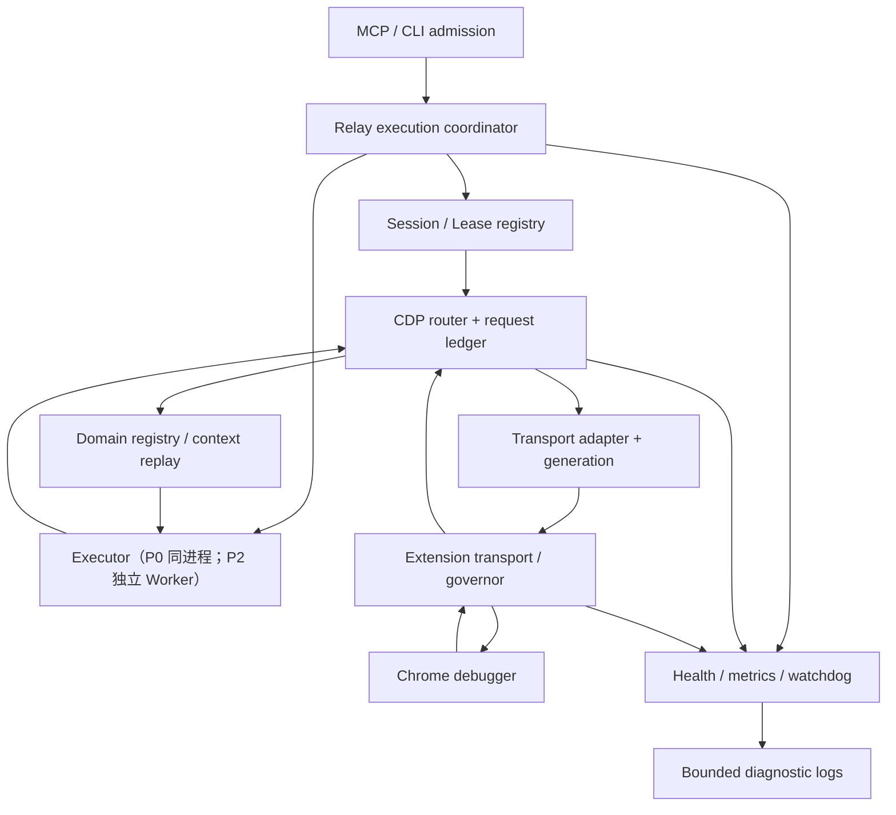
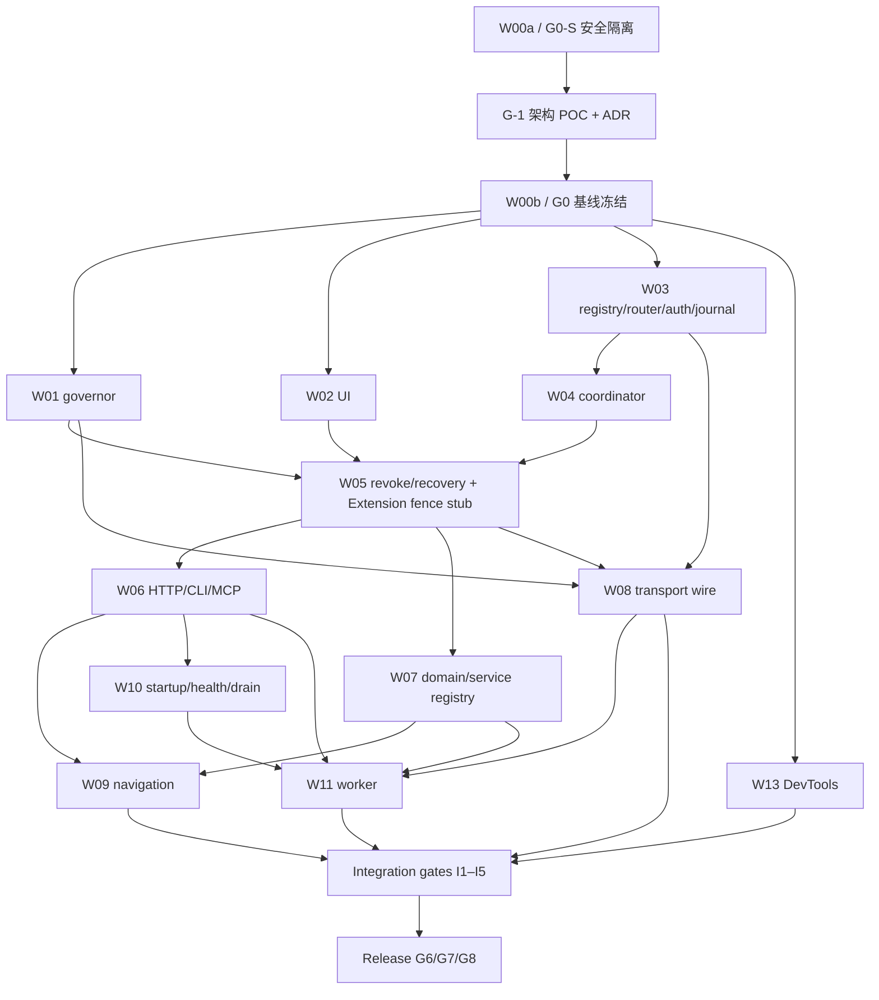

# Spawriter MCP 浏览器稳定性优化：完整实施规范与验收手册

> 日期：2026-11-25；设计版本：2.4（实施冻结候选、局部合同一致性修订、待 G-1 实验验证）；状态：待实施、待验证  
> 目标基线：Spawriter c811443；Playwriter aa87449；Browser-use 94784c1f7。  
> 输入：[融合故障报告](03-integrated-rca-spawriter-mcp-chrome-hang-20261125.md) / [另一 Agent 原报告](01-original-rca-mcp-chrome-hang-20261125.md) / [补充 RCA](02-original-rca-mcp-chrome-freeze-expanded-20261125.md) / [上游学习成果](04-upstream-study-playwriter-browser-use-20261125.md)。  
> 本文是实施决策的唯一主入口；01–04 号报告仅用于证据与研究追溯。用户接受一步到位：**P0、P1、P2 的必做项全部纳入一次完整交付，Worker 隔离最终默认开启**；但按依赖分批修改、逐门禁验证，禁止一次性盲目替换。W12 的定制 Playwright fork 仅为可选评估，不作为硬依赖。§16 是唯一接口/状态/协议合同，§10 是统一配置表，§17 是前置验证，§18 是唯一实施 DAG，§19–22 是唯一验收与交接规范。前文只保留功能设计与根因背景，不另立实施规则。所有性能数值均为待测的验收目标，不是实测结果。未修改产品源码。

## 0. 接手 Agent 阅读顺序与交付摘要

1. 先读本节、§15–22（执行边界、基线、安全、任务卡、测试和门禁），再按任务读 §3–14 对应设计。
2. 阅读仓库当前 AGENTS 指令、AGENTS_MCP.md / AGENTS_CLI.md / AGENTS_Unified.md，确认工作区和现有改动；以代码实际接口为准，不依赖历史行号。
3. 先做 W00a 安全隔离和证据保全，通过 G0-S；在隔离环境完成 G-1 架构可行性 POC，再完成 W00b 基线、配置和 G0。任何真实 Chrome 验证必须使用独立测试 profile 和专用 Relay。
4. 按 §18 DAG 与工作包逐步实现，先建测试后修复；Local Gate 通过即可进入依赖项，Integration Gate 在双方实现后联合验收。允许独立模块并行，不允许多个 Agent 同时改同一共享文件或使用同一浏览器 transport。
5. 最终交付可构建、可运行的完整代码、全部必做测试、可重复压力报告、发布/回滚手册和剩余风险说明。不能用设计文档、mock-only、跳过测试或 feature flag 默认关闭替代最终验收。

**最终交付约束**：保留标准 playwright-core（锁定当前版本，非必要不引入 fork）；优先验证每 Execute 独立 Node child process + 每任务 connection/capability + Session checkpoint，具体执行模型由 G-1 按 §16.6 的固定决策树冻结；Relay 持有 authoritative registry、transport、deadline、recovery；MV3 只支持通过门禁的一个正式默认 Transport，备用模式有真实兼容需求才支持；legacy v1 默认拒绝执行并提示升级。进程隔离、限额、取消后 capability revoke/quarantine 均必须启用。用户接受完整实施，不表示授权操作日常 Chrome、执行部署、破坏其他文件或擅自提交/推送。

## 1. 背景与决策摘要

实际故障日志有 Page.navigate 23.748s 超时、CDP connect 15s 超时、Runtime.callFunctionOn 响应迟到 79.8s、terminateExecution 迟到 21.2s。后续观察到 2.267s 内 2,497 条 Runtime.consoleAPICalled（单秒峰值 1,681），另一报告统计调用栈占事件载荷约 96.7%。现有源码确认源头未过滤、每事件 Offscreen IPC、全量 UI 刷新、重复 Relay 路由、超时漏分类、Promise.race 非取消、并发恢复与脚本自动重放风险。首发卡死的具体 Chrome 原生线程位置尚无 trace 证明。

### 1.1 设计原则

1. **先止血，再控制执行，再优化协议，最后做硬隔离**；不以引入新依赖为修复前置条件。
2. 正常业务保留 Playwright 能力；只对有明确语义的可采样事件限流。
3. 任何不健康目标不得无限阻塞其他目标或整个 Relay；拒绝新增任务优于无限积压。
4. 超时不是回滚。已发送命令的结果可能未知；禁止自动重放可能产生副作用的脚本。
5. 严格保留真实用户 Chrome、Tab ownership、origin-scoped clear、single-spa overrides、CLI/MCP shared state 等产品约束。
6. 只读诊断和旧故障证据不足以宣称某项已修复；每个 PR 必须有真实可复核测试。

### 1.2 关键架构选择（ADR）

| ADR | 决策 | 放弃/延期的备选 | 理由 |
|---|---|---|---|
| D01 | 双端过滤，Extension 先限流，Relay 防御 | 只过滤磁盘日志 | 无法减少 Chrome IPC |
| D02 | 默认保持当前 Offscreen 协议做 P0 止血；P1 优先验证 SW 直连 | P0 一次性移除 Offscreen | 避免把兼容与故障修复耦合；PW 已证明存在可参考实现 |
| D03 | Offscreen fallback 用长 Port + 仅遥测微批 | 所有 CDP event 按优先级任意重排 | frame/context/lifecycle 必须有序 |
| D04 | per-session 单执行 + bounded admission，物理 Tab 生命周期锁 | 全局单锁；直接 abort 前任务再开始 | 前者压低并发；后者引发 recovery 竞争 |
| D05 | stock Playwright 先做 capability revoke + 隔离；Worker 硬隔离为最终强保证 | 仅 AbortController；立即换整个 fork | stock 不具备已验证的 fork abort API |
| D06 | Runtime registry + 定向 replay | 每个 client 都物理 disable/enable；永远伪造 enable OK | 减少重放风暴，同时满足初始化 |
| D07 | 显式调用者取消、deadline、generation | timeout 后默默继续；重放整段脚本 | 保证操作语义、安全与可诊断性 |
| D08 | 字节分段日志 + 命令元数据 | 全量 JSONL 按行旋转 | 防内存、磁盘和 GC 过载，保留故障现场 |
| D09 | 版本/instance-aware drain + supervisor | /version 超时即杀进程 | 避免启动/重启雪崩、影响他人 |
| D10 | 严格 ownership 优于上游宽松 shared tab | 直接照搬 Playwriter ownerKey 回退规则 | 保护真实用户页面 |

## 2. 目标与非目标

### 2.1 功能目标

- MCP execute/navigate、CLI 同享执行生命周期；显式 sessionId，不随并发请求变化。
- 同一 Session、同一物理 Tab 恢复有确定边界；目标故障不扩大至其他会话。
- 正常流量 console、network、Playwright locator、截图、snapshot、dialog、single-spa 功能保持。
- 过载时 Console 等遥测有界降级，控制事件不被遥测队列挤死；无法安全传输控制消息则显式断开和隔离。
- 超时返回可诊断错误，区分未执行、已知失败、结果未知、已恢复、目标隔离。
- Runtime/Page 状态与 tab lease、physical attachment、logical session 分离。

### 2.2 非目标

不重写 Chrome、Playwright 或 Vue；不引入 Browser-use Python Agent、cloud、stealth 或屏幕录制；不承诺所有恶意/任意 JS 可安全 sandbox；不保证已提交的外部业务副作用可回滚；不改变用户 Chrome 登录态，不自动接管未 owned 的 Tab；不将首次故障主线程根因未经验证写成既定事实。

## 3. 系统架构与模块边界



拟议模块（新增文件名称可在实施中微调，但职责不要再次揉进 relay.ts）：

| 层 | 文件/模块 | 职责 |
|---|---|---|
| Extension | ai_bridge/traffic-governor.js | 事件分类、栈裁剪、重复计数、token bucket、字节上限 |
| Extension | ai_bridge/transport.js | SW WS/Port fallback，握手、generation、队列、ACK、reconnect |
| Extension | ai_bridge/tab-ui-state.js | per-tab dirty diff、持久化、title marker、icon 更新 |
| Extension | ai_bridge/debugger-lifecycle.js | attach/detach/init single-flight、有界命令、状态 |
| Extension | panel-app/import-map/refresh-coordinator.js（拟议） | 按 tab/document 的刷新单飞、dirty rerun、deadline、结果槽、可见性 |
| Relay | runtime/session-registry.ts | Session/Lease/Tab/physical/virtual registry，owner 校验 |
| Relay | runtime/cdp-router.ts | 指定订阅者发送、pending ledger、事件去重、旧 generation 丢弃 |
| Relay | runtime/runtime-domain.ts | Runtime holder、context cache、定向 replay；AX/DOM helper scope 与物理域状态（可拆 domain-leases.ts） |
| Relay | runtime/execution-coordinator.ts | admission、deadline、锁、cancel、状态机、恢复预算 |
| Relay | runtime/health.ts | 指标、独立 watchdog 接口、熔断 |
| Relay | cdp-log.ts | 有界日志、脱敏、分段轮转、故障保全 |
| Executor | pw-executor.ts + runtime/execution-errors.ts | 保留 globals，错误类型、导航结果、state/output |
| Executor P2 | runtime/executor-supervisor.ts / executor-worker.ts | IPC、Worker 进程生命周期、epoch、进程树监督 |
| Clients | mcp.ts、cli.ts、runtime/control-client.ts、runtime/ensure-relay.ts | 固定请求身份、超时/取消、状态、升级 drain |

P0 不必提前抽完所有模块，可先在现有文件内写小而可测试的纯函数，之后按职责迁出，避免大规模重构遮盖功能修复。

## 4. P0-A：扩展流量治理与 UI 止血

### 4.1 事件分类与保护规则

| 分类 | 例子 | 策略 |
|---|---|---|
| Command response | 所有带 id 结果/错误 | 必达或显式断连失败，禁止 telemetry 限流 |
| Protocol critical | Target attach/detach、Runtime contexts、Page frame/lifecycle、dialog、Fetch.requestPaused、必要 Network 事件 | 顺序保持；不可随意裁剪/合并 |
| Sampleable | Runtime.consoleAPICalled 重复 warning/log/debug/info | 默认保留；过载 token bucket / 去重 / 栈裁剪 |
| Diagnostic | 日志副本、metrics | 摘要、有界聚合 |
| Droppable | Network.dataReceived / Network.resourceChangedPriority | 源头丢弃；Relay 二次防御 |

对未知方法默认 protocol-critical，先审查当前 playwright-core 依赖再加入 drop 表。Network *ExtraInfo、webSocketFrame、Fetch 等不能仅因高频而删。Console exception / error 有更高保留优先级，但仍须独立硬上限；避免错误洪峰产生另一无界通道。

### 4.2 Console Governor（独立于 transport）

每个 (physicalTargetGeneration, tabId) 有 token bucket 和固定容量 signature map；再有全局 bucket，防多 Tab 合谋耗尽全局预算。采用单调时钟。策略：

- 初始 normal rate 100/s/tab，burst 200；global 500/s，burst 1,000；error 独立保留配额计入总字节预算。
- 前 1–2 条重复 warning 优先保留，1s 聚合窗记录 suppressed count；签名由 type、有限长度首个 primitive 文本、top frame、context identity 组成，不对完整 stack 先 stringify。
- 限流前先检查类别、去重/配额。保留转发事件 args、executionContextId、timestamp 等语义；对重复低优先级事件的 stackTrace 仅保留 top 3–5 frames，移除深层 parent/parentId；error 目标 10 帧。正常低负载允许原栈（仍有单事件字节保护）。
- CDP Console 参数可能是 RemoteObject，不能编造或截断 objectId；对极端大对象/字符串的**诊断副本**摘要；若原生事件超过允许负载，应显式采样而不是发送无效 CDP 字段。
- 聚合数通过独立 telemetry envelope 或 consoleLogs metadata 输出，**不伪造 Runtime.consoleAPICalled**。
- 每 Tab signature map 初始最多 1,024 项，LRU/TTL 淘汰，计数包含 eviction/drop；全局总预算限制。per-tab telemetry queue 1MiB、global 4MiB、每事件 payload cap 64KiB 为试验配置。
- 丢弃的 Console 事件、截断栈及原始/保留体积应可观测。对原始体积可使用估算或采样，不能为计算 dropped bytes 而重新 stringify 所有丢弃事件。

P0 保持现有 sendMessage/offscreen 结构但仅传必要事件，确保错误路径有界和 offscreen sendResponse 失败显式报告。P1 再迁移 transport，降低跨进程调用量。

伪代码（非可直接编译实现）：

```javascript
function onDebuggerEvent(source, method, params) {
  if (DROPPED.has(method)) return metrics.incDropped(method);
  const target = registry.resolvePhysical(source);
  if (!target || !target.isCurrent) return;
  if (method === "Runtime.consoleAPICalled") {
    const decision = governor.accept(target, params);
    if (!decision.forward) return;
    return transport.sendTelemetry(target, method, decision.params);
  }
  return transport.sendProtocolEvent(target, method, params);
}
```

优先读取 Console 的少量字段，避免 clone 原对象整棵 stackTrace。对 idle attached Tab，停止无用遥测但保留必要 lifecycle/state，除非已完成明确的物理 detach/re-attach 设计。

### 4.3 UI 状态差量

新状态源：authoritative ownership revision + attachment generation + URL restriction state。setTabState 只对实际变化写 dirty flag；定时 persist 合并写入；更新 UI 只取 dirty Tab，不循环 query 全部 Tab。启动/扩展替换/全局默认状态变化可做一次全量 reconcile。

- tabs.onUpdated：status/url 变化仅刷新该 Tab；title 变化只调度幂等 marker，不触发全量图标刷新。
- Chrome 新文档可能重置 Tab action icon，document generation 变化时使缓存失效。
- 100–250ms debounce + single-flight；期间新增 dirty key 在当前 flush 后再处理。
- 对 icon/title/badge/background 逐字段 diff；chrome.action Promise rejection 记录限频。
- ownership snapshot 采用 revision + 内容 diff；同 revision/同内容 no-op。5s poll 作为失联/不一致兜底，必要时 backoff，不能每周期注入所有标签页。
- 标记脚本只在必要 document 上运行一次；pendingTitleMarkers、cache、timer 在 detach/remove 清理。bridge.js:169 的 raw Runtime.evaluate 回退应移除或纳入 1–1.5s 总预算、按 Tab single-flight；loading 期延后至 complete，超时且原调用仍未完成时不继续堆积注入。capture identity 后才应用结果，不因 title 自身变更形成循环。

测试：30 个 Tab，稳定 15s 后无变更时 action、storage、script injection 均为 0；一次导航只更新相关 Tab，默认 badge 变更除外；title marker 写入不能形成重复 onUpdated 回路。

## 5. P0-B：Relay 路由、请求 ledger 与日志

### 5.1 Registry 模型

分离 Chrome tab、物理 debugger generation、逻辑 Session、CDP client 和虚拟 CDP Session，禁止互相混用 ID。

```typescript
type SessionId = string;
interface Lease {
  sessionId: SessionId;
  tabId: number;
  leaseEpoch: number;
  status: 'owned' | 'recovering' | 'quarantined' | 'released';
}
interface PhysicalTarget {
  tabId: number;
  targetId: string;
  realSessionId: string;
  transportEpoch: number;
  attachmentEpoch: number;
  owner?: Lease;
}
interface CdpClient {
  id: string;
  sessionId: SessionId;
  connectionEpoch: number;
  announced: Set<string>;
}
interface VirtualSession {
  id: string;
  clientId: string;
  parentVirtualBrowserId?: string;
  realSessionId: string;
  attachmentEpoch: number;
  leaseEpoch: number;
  kind: 'browser' | 'page';
}
```

上游 Playwriter 按 extensionId/ownerKey 组织 target；Spawriter 增强为强制 owner + epoch。不允许使用 pw-* prefix 当作身份校验，不允许 client attach 任意未声明的 virtual target。

### 5.2 路由算法

1. 解析 extension transportEpoch + event source physical target + ingress observedLeaseEpoch/ownershipRevision，检查当前映射；完整事件归属屏障见 §16.7.2，禁止按收到时的最新 owner 重标旧事件。
2. 对普通 target event 找到 owner 及实际已经 announce/subscribe 的 client；对 virtual page session 仅匹配所属 client 与 current epoch。
3. 创建目标集合，key=(clientId, destinationSessionId)，同 event 在同目的地只发一次。同一个 client 的真实 Session 和有效 virtual Session 是不同合法目的地，不能仅按 clientId 去重。
4. 使用统一 sendToClient 出口（记录 bytes/counter、readyState、错误）；按需要复用序列化结果，不向无关客户端广播。
5. browser-level event 用显式路由规则；detach 先冻结接收集合，再删 registry，发送有序 lifecycle event；unknown target 不默认全局广播敏感 payload。
6. Target.detachFromTarget 校验 virtual owner，删除正反向索引，返回正确协议响应；真实 target detach 才触发物理生命周期。client close、lease release、session reset/delete、extension reconnect 按同一清理函数处理。vbs/vps 和 cache 数量归零或回基线。

注意：现有 code 对 OOPIF/worker 的支持有限。P0 不强行重写全套 child-target 协议；明确保持原功能，P1 单独验证 child identity 与 attach/detach 顺序。

### 5.3 请求 ledger

```typescript
interface PendingCommand {
  relayId: number;
  requestId: string;
  clientId: string;
  clientMessageId: number;
  realSessionId: string;
  destinationSessionId?: string;
  sessionId: string;
  leaseEpoch: number;
  connectionEpoch: number;
  transportEpoch: number;
  executeEpoch: number;
  method: string;
  sentAtMono: number;
  deadlineMono: number;
  state: 'queued' | 'sent';
}
```

响应通过 relayId + transportEpoch 匹配，检查所有权/连接/执行代际。一次 settle + 清 timer；迟到响应仅记统计和 bounded tombstone，不能再次 resolve 新请求。transport close reject 本代际全部 pending；client close 取消其 pending 并撤销发新命令权限。初始 pending cap 64/tab、256/transport，按实测调整，并为 cancel/dialog/Fetch response 留独立保留配额（不能被普通命令占完）。超过 cap 返回 TRANSPORT_OVERLOADED，不允许无界排队。

队列按字节/年龄/条数硬限制；若 critical 消息无法可靠转发，标记 transport degraded 并有界断开，要求重新建立一致 inventory/context。不得静默丢失关键事件仍宣称连接正常。

### 5.4 断言与局部恢复（R14，P0）

relay.ts:133–210 的 frameAttached duplicate 分支是 log-only；其他 target-registry assert 全局 30s/3次触发 resetAll。当前 relay.log 有 234 行 duplicate frameAttached 告警、479 行 owned Page 缺失、232 行 unknown/expired response，但未查到 repeated asserts, resetting executors；计数是全文件匹配行数。不能把 234 条全部归因于路由双发，Page.getFrameTree 与 live event 竞态是源码注释明确的另一来源。

- 在路由出口记录 eventSeq、physical generation、client connection、frame identity，区分同目的地双发、旧代际、初始化 snapshot/live overlap。
- frame attach/detach 按 document/parent/frame identity 有界维护；不按 frameId 永久去重，合法 reattach 必须保留。Runtime replay 同样使用 snapshot/live barrier。
- 把 recentAssertTimes 由全局数组改成有界按 client/session/epoch 计数，单 Session 错误只 revoke/recover 归属连接；旧代际/已确认无害 duplicate 不升级，告警仍计数。
- 未能归属的内部不变量错误不盲目吞掉或 resetAll；停止接纳、记录必要 registry 状态，交 supervisor 有界恢复。不得仅靠 stack 字符串或 AsyncLocalStorage 推断所有异步 driver event 的 owner。
- 同一 client recovery single-flight，设窗口、冷却、有限次数；其他 Session 保持工作。保留显式全局管理 reset（有授权）与局部故障恢复语义区分。

### 5.5 Logger

默认只记录 command metadata、error、slow/late response、关键 lifecycle、聚合遥测。Console 原始详细日志仅短时显式诊断选项。先生成有限字段摘要，再 stringify；禁止 logger 遍历全量巨型对象。对 cookie、authorization、代理凭证、request bodies、敏感 URL/query、用户脚本内容默认脱敏；private ACL/权限；错误 stack 也应长度上限。

- 分段 ring：每文件 10MiB、最多 5 段、日志队列初值 2MiB。按 UTF-8 Buffer.byteLength 计，不按字符数。
- 滚动使用关闭/rename segment，再打开新文件，不 readFile+split 全文件。
- 串行 write loop，磁盘慢时只保留关键元数据、丢弃低优先级日志并计数；队列硬上限不得因 flush backlog 失效。
- 启动时新建带 instanceId 的 segment 或保留最近事故段，不截断上次证据。
- flush on graceful drain；fatal 时 best-effort 有界落盘，不同步写超大日志。
- 历史段/诊断文件可导出，默认不上传敏感内容。

## 6. P0-C：执行控制、超时分类、失败安全

### 6.1 错误类型与公共响应

现有 execute 返回 text/images/screenshots/isError。保持字段兼容，增添可选 errorCode、requestId、phase、outcome、recovery、retryable 字段或结构化元数据，CLI/MCP 文本中同步给出短提示。

| code | outcome | 默认动作 |
|---|---|---|
| SESSION_BUSY | not_started | 不执行；用户可等待或取消 |
| INSUFFICIENT_BUDGET | not_started | 不发命令 |
| CANCELLED_BEFORE_START | not_started | 删除排队项 |
| CDP_COMMAND_TIMEOUT | unknown（若已发送） | 进入针对性恢复 |
| EXECUTION_TIMEOUT / CANCELLED | unknown（若已操作） | revoke + recover/quarantine |
| CONNECTION_TIMEOUT | not_started/unknown 取决于阶段 | 清理迟到连接、熔断 |
| NAVIGATION_FAILED | failed/unknown | 返回 errorText、目标状态 |
| TARGET_DETACHED | unknown | 检查拥有的 Tab；不自动接管 |
| TARGET_UNHEALTHY | not_started | 拒绝后续，显式恢复 |
| TRANSPORT_OVERLOADED | not_started/unknown | 拒绝、隔离 |
| RELAY_DRAINING | not_started | 503，告知何时重新建 Session |
| EXECUTOR_RESTARTED | unknown | state 失效、浏览器保留 |
| INTERNAL_ERROR | unknown | 归属告警，必要时 fatal |

withTimeout 改为 typed timeout（区分 CdpCommandTimeoutError / ConnectionTimeoutError / ExecutionTimeoutError）；直接测试由真实 wrapper 抛出的错误是否走对恢复分支。NavigationBudgetError 发生在发送前不 terminate；普通 Protocol Error 不自动重放 code。MCP catch 不将任意错误都伪装为 120s timeout。

### 6.2 执行状态机、预算与取消

唯一规范见 §16.2–16.6、§16.8–16.10（principal、admission、deadline、Extension fencing、target health、resource lifetime）。原简化状态机已由这些契约替代。

### 6.5 恢复矩阵与 process guard

导航超时：短预算 Page.stopLoading + frame/loader 状态确认；JS evaluate 超时：针对对应 owned Tab 尝试 Runtime.terminateExecution；dialog：根据当前已知策略处理 beforeunload/alert，保留手动 debugger 意图；target closed/crashed：标记目标失效，显式选新 owned Tab，禁止 pages[0] 静默替换；通道异常：隔离本 generation、必要时 detach/attach 同 owned Tab，最多一次有界重试。对已产生副作用任务一律不自动重放整段 code；错误提示“先检查页面状态”。

借鉴 Playwriter process-guard：
- AsyncLocalStorage 记录 requestId/sessionId/executeEpoch，VM 文件名标识错误来源。
- unhandledRejection / throwing timer 的告警归属旧 task，限频（60s 5 条完整日志），不得污染新 session 输出。
- 仅能明确归属 Agent/driver 且状态仍可控的异常容错；不可识别 Relay 内部不变量损坏 -> fatal，由 supervisor 处理，先保全证据。
- guard 不是 CPU/内存隔离。不得捕获所有异常后继续服务损坏 registry。

## 7. P1：传输协议、Runtime registry 与导航

### 7.1 Transport adapter 与背压

唯一 Wire Protocol、握手、队列、ACK、credit 和版本兼容规范见 §16.7；W08 以该节及双端 contract tests 实现。

### 7.3 Runtime Domain registry（借鉴 Playwriter b8dba4f）

```typescript
interface RuntimeRecord {
  physicalKey: string; // transport + attachment generation + target sid
  enableState: 'disabled' | 'enabling' | 'enabled' | 'failed';
  inFlightEnable?: Promise<void>;
  contexts: Map<number, ContextDescription>;
  holders: Set<string>; // clientId + logical destinationSessionId
  eventSeq: number;
}
```

首次 logical enable：
1. 先登记 record 和事件监听，再触发物理 enable；必要 recycle 仅一次/代际，disable/enable 都有界。
2. 等待真实 main-frame default context（匹配 frameId / physical target），按剩余 deadline 设置 context readiness；缺失则明确失败/待同步，不假造。
3. enable 成功标记 holders；失败清理 in-flight，所有等待者得到同一结果。

第二 client：
1. 加入 holder，等待 shared enable Promise，不能再次物理 recycle。
2. 建立 frame snapshot / event barrier；可借鉴 Runtime.getIsolateId round trip，但要验证当前 stock Playwright 依赖顺序，不能假定一次 RTT 解决所有竞态。
3. 冻结 context snapshot 和 seq；仅向该 client 重放真实 executionContextCreated。重放期间增量事件暂存于有界队列，按 seq 接续；遇到 context destroyed/cleared 保证不重不漏；溢出重新初始化而非返回伪状态。
4. 最后返回 enable response，保留 client-specific subscription。

disable：移除 holder；最后 holder 是否物理 disable 由策略决定（idle保留 vs detach）；明确清理 context cache。client close、detach、transport reset、目标换进程清除对应 generation；Page/Network/Fetch 另行审计共享域，不能直接复制 Runtime reference counting。

Spawriter 当前真实 tab debugger session 与 vps/vbs 不同于上游。该模块在真实两 client、虚拟 Session、同文档/跨文档、OOPIF/worker、重连和快速导航下验证之后才能默认启用。

### 7.4 Accessibility / DOM scoped domain leases（R12）

现有 snapshot (pw-executor.ts:978) 显式 Accessibility.enable，screenshotWithLabels (:1054–1055) 另开启 DOM.enable，非测试源码无配对 disable。不能由此推断 AX/DOM 已造成此次洪峰，补充 RCA 样本只有 2 条 AX 更新；但 helper 留置订阅是可控风险。

P0：审查 getFullAXTree、DOM.getBoxModel 在 stock PW/Chrome 中是否无需持续 enable；若可行，移除不必要的 helper enable。否则引入 scope acquire/release（在 finally 执行，独立有限 cleanup grace），**仅释放本 helper 实际持有的、当前 physical generation 的最后引用**；不无条件关闭共享域或用户 raw CDP 订阅；状态不明时 quarantine/reconcile。禁止在 snapshot return、label injection failure、截图/cleanup timeout 之后泄漏 holder。cleanup 错误附加诊断，不覆盖原错误。标签 overlay 自身也必须在异常时有界清理。

P1：纳入 domain registry，key=(transportEpoch, attachmentEpoch, realSessionId, domain)，holders 包含 client/raw/helper identity；分别定义 Runtime/AX/DOM 生命周期。记录 enabled duration、by-method event count、acquire/release 及 timeout。验证 AX node ID 稳定性、backendDOMNodeId、snapshot ref、interact、标注截图与同时存在的 raw CDP client。Page/Network/Fetch 不机械套用此策略。无法可靠追踪外部 holder 时不强制物理 disable。

### 7.5 navigate / reload 状态语义

保持 navigate(url) 现有兼容输出；新增 options（可选结构化输出）：

```typescript
interface NavigateOptions {
  timeout?: number;
  waitUntil?: 'commit' | 'domcontentloaded' | 'load';
  structured?: boolean;
}
interface NavigateResult {
  status: 'committed' | 'loading' | 'completed' | 'failed' | 'timeout';
  requestedUrl: string;
  currentUrl: string;
  frameId?: string;
  loaderId?: string;
  errorText?: string;
  elapsedMs: number;
  documentGeneration?: number;
}
```

执行顺序：先绑定 owned target 和新 navigation token，注册事件 observer → Page.navigate → 检查 errorText/下载响应 → 匹配 frame/loader commit 或同文档事件 → 按 waitUntil 可选等待 → 在正确 document 采样 readyState → 归还结构化结果。重定向允许最终 URL 不同，明确最终 URL；同文档导航没有 loaderId 的情况使用 frame+document identity；下载不报网页 commit 成功。错误后不自动重放。reload/ensureFreshRender 共用时间预算、局部恢复，但保留现有 origin-scoped cache 清理语义。

Dialog / beforeunload：跟踪 Page.javascriptDialogOpening/Closed；有 dialog 时缩短诊断时间，依据现有自动 accept/dismiss 政策或明确用户/调试指令。不得在同一普通命令锁内等待 dialog response，否则自造死锁。

waitForPageLoad：借鉴 Browser-use network_idle 的 active session/frame tracking；按 request identity 与 frame/loader 跟踪，OOPIF swap / worker loaderId / redirect / failed / long-lived WS、SSE 做明确处理。避免旧 document 的 pending 延续到新 document；网络闲置只是辅助条件，不应替代 DOM 或业务期望。固定 deadline，返回 settled/timeout 与剩余请求摘要。

### 7.6 DevTools / Content Script 调度治理（R13，W13）

适用：single-spa 微前端面板与 MCP 同时操作 inspected tab。源码证实多个 trigger 并发读、共享全局结果槽及无界 callback；现场是否打开 panel 未知，因此为 P1 专项，不阻塞 P0。

**统一刷新入口**：以 tabId + documentEpoch 建立 RefreshCoordinator；routing-event、tab-updated、onNavigated、panel-shown、import-map periodic poll 和 panel-app burst/stale refresh 统一经过 scheduler。每文档最多 1 个 in-flight + 1 个 dirty rerun，导航/隐藏/dispose 取消旧逻辑订阅。不同模块可共享只读 snapshot 或明确预算，不能让两组轮询独立无界启动。content_script_main.js 对 burst 事件 150ms 合并（leading/trailing，保留最后状态/错误标记）；isolated script 与 background 仅转发必要状态提示。用户手动刷新可提升优先级，但不得绕开锁；override add/remove 与 reload 等写操作单独串行，不自动重放。

**Import map 异步结果**：优先验证 inspectedWindow.eval 是否支持直接返回异步结果的安全替代；若不支持，按请求 ID 使用 page-side result slots 替代 window.__spawriter_mapResult，限制数量、结果大小、TTL，清理时只删自身 key；先绑定 documentEpoch 与 origin/url，Phase1/2 及 saved override async read 返回时检查仍是同文档。防止旧 origin 的 saved overrides 覆盖新页面。导航或 panel hidden 后停止新 poll；待 complete/可见重新合并刷新，避免固定暂停掩盖状态变化。Phase2 polling 150→300→500ms 退避，整个 read 5s 初始预算，单次 eval cap 1–1.5s 并计入总预算。

**关键边界**：inspected-window.helper.js 的 chromeEval callback 无 timeout；retries:0 并不代表有界。补 signal/deadline wrapper，超时迟到结果只能丢弃；native eval 不能保证取消，未收到 callback 时不循环启动更多 poll，进入 degraded 状态，待旧调用结束/文档失效/显式受控恢复。只读失败可按预算重试，mutation 不盲目重试。输出 stale/unavailable，而不是空 defaultImports 伪装成成功。使用现有 inspected-window.helper.test.js 增加 callback 永不返回、迟到、并发刷新、跨文档、hidden/unmount 用例。

**验收**：panel closed/visible/hidden × SPA/普通页；多 trigger 同时发起仅 1 个 read + 至多 1 次合并补读；跨文档不串 map，正常 single-spa app 状态及 override 功能保持。记录 routing-event coalesce、eval count/duration/pending、refresh stale/timeout、Chrome/Renderer CPU。20–30 个 Tab 的深栈 Console 压测加开/关 panel 对照，避免将 panel 优化收益当作首因证明。

## 8. P1：健康、诊断和升级

### 8.1 可观测性

所有指标在正常路径低开销、过载时有界。用单调时钟测本地 duration，跨进程以关联 ID/同步标记定位时段，不直接相减未校准时间戳。

| 维度 | 指标 |
|---|---|
| Chrome | Browser/Renderer/SW/Offscreen CPU、memory、Chrome trace/IPC（独立测试时） |
| Extension | by-method events in/out/drop、栈裁剪、queue bytes/age、runtime IPC calls、icon/script/storage counts、AX/DOM active duration、panel eval/refresh pending/timeout/coalesced |
| Transport | epoch、bufferedAmount、pending credits、send/ack latency、heartbeat RTT、reconnect |
| Relay | EventLoopDelay p95/p99/max、CPU/RSS/GC、pending count/oldest、route fanout、late response、logger bytes/drop/rotation |
| Executor | queued/running/recovering count、stage durations、cancel、outcome unknown、generation revoke、worker restart |
| User-visible | MCP call latency/error、navigation commit latency、独立 Chrome UI/健康 Tab 响应 |

command trace 建议阶段 relay-recv → extension-recv → native-start → native-end → extension-send → relay-recv-result → client-send，配 requestId、relayId、method、tabId、lease/transport/execute epoch、payload size、outcome。采样正常高频事件，慢命令/失败保留完整阶段元数据，不记录敏感参数。

/health 分离 relayAlive、extensionConnected、transportHealthy、targetHealth、draining、buildSha/protocol；外部 supervisor 测 RTT，避免 Node event loop 阻塞时内部 health 仍看似健康。附加 /diagnostics 摘要必须经过现有 loopback/auth 约束，不泄露页面详情。

### 8.2 启动、drain、重启

CLI/MCP 共享 ensureRelayServer 逻辑，进程内 single-flight + 跨进程锁。先识别 /version/instanceId/buildSha；端口存在但无响应则进入 degraded，有限退避，报告 PID/端口状态，不启动无限竞争进程。不得杀未验证归属的 PID。

升级时经显式 /cli/drain（instanceId 匹配），拒绝新任务、等待 active executions（包括真实清理阶段）结束；default 30s、max 120s 候选。超出则返回明确待终止会话/提示，非用户授权不 force replace。Relay 进程重启后旧 Session 不应静默恢复任意 VM state；可重新确认 owned Tab / inventory，告知 state 失效并显式新建 Session。真实 Chrome tab 留开。日志 instance 段不覆盖。

## 9. P2：Executor 硬隔离设计（Browser-use REPL 启发）

### 9.1 Worker 架构与生命周期

独立进程是必做交付，而非可选灰度。唯一执行模型与进程监督规范见 §16.6、§16.10；先通过 §17.0 的 G-1 选型实验，再实现 W11。

### 9.3 是否采用 Playwright fork（可选 ADR）

Playwriter 已使用 chromium.runWithAbortSignal，且测试证明超时的 pending click 在元素出现后未触发。但该 API 来源于 @xmorse/playwright-core / patchright fork，当前子模块未审查，Spawriter 是 stock 1.56.x。单独 POC：
1. 固定上游 fork SHA，审计 client → server cancel/ProgressController 传播、patchright 路径及依赖差异。
2. 在原版 stock 和候选 fork 跑 same fixture（late locator click、evaluate、navigation、dialog、snapshot、OOPIF、网络捕获、single-spa）。
3. 评估 fork 升级维护、安全修复、API/协议兼容、包大小与构建。许可证/上游归属按文件核验。
4. 只有测试证明明显收益且维护成本可接受才采用；即使采用 fork，也不替代独立进程隔离。未通过则继续 stock + Worker/capability 方案。

## 10. 配置与兼容协议

所有参数集中定义并校验，禁止散落常量。以下是统一配置初值（未实现）；G-1 选择运行模式，G0 冻结与机器有关的参数。安全不变量不可配置关闭。

| Config | 初始建议 | 说明 |
|---|---|---|
| SSPA_CONSOLE_RATE_PER_TAB | 100 | 条/s |
| SSPA_CONSOLE_BURST_PER_TAB | 200 | token burst |
| SSPA_CONSOLE_GLOBAL_RATE | 500 | 条/s |
| SSPA_TELEMETRY_BUFFER_BYTES | 4194304 | 全局硬上限 |
| SSPA_CDP_LOG_SEGMENT_BYTES | 10485760 | 单日志段 |
| SSPA_CDP_LOG_SEGMENTS | 5 | 总保留段 |
| SSPA_EXEC_TIMEOUT_MS | 30000 | client 入口开始，总预算含正常 FINISHING，Relay 入站剩余预算裁决 |
| SSPA_RECOVERY_GRACE_MS | 5000 | 额外总恢复预算 |
| SSPA_SESSION_QUEUE_LIMIT | 1 | pending，不含 running |
| SSPA_SESSION_MAX / GLOBAL_QUEUE_LIMIT | 64/16 | logical session metadata 全局 cap；全局 queued task 含 raw reservation，不因 64 sessions 无界累积 |
| SSPA_EMPTY_SESSION_IDLE_MS | 1800000 | 仅无状态/租约/服务/在途请求的空 Session |
| SSPA_HTTP_HEADER_MS / BODY_MS | 5000/5000 | 入口上限，body 与剩余 deadline 取小 |
| SSPA_CONTROL_CONNECTION_MAX / PENDING_BODY_BYTES | 64/16777216 | 全 HTTP/WS 接入前有界，独立安全控制配额，慢请求限时 |
| SSPA_RESULT_PENDING_GLOBAL_BYTES | 67108864 | 已完成未发送结果、输出编码和慢连接 buffer 联合预算；计实际副本，独立于 transport 内存 |
| SSPA_RISK_PER_TARGET / GLOBAL | 32/512 | 含 task/service/recovery/maintenance 风险记录，独立安全清理预留；最终按 journal 字节预算校验 |
| SSPA_TRANSPORT_MODE | auto（冻结为 sw 或 port） | 正式仅一个经验证模式；legacy 只做升级识别 |
| SSPA_RUNTIME_REPLAY | on | 最终默认且必测；off 仅开发诊断 |
| SSPA_EXECUTOR_MODE | worker | inprocess 仅隔离开发诊断，非发布支持 |
| SSPA_CDP_DEBUG_FULL | off | 限时、硬字节预算、脱敏 |
| SSPA_EXEC_TIMEOUT_MIN/MAX_MS | 100/120000 | 拒绝非法；显式 MCP 窗口更短则收紧 |
| SSPA_PENDING_PER_TAB / PER_TRANSPORT | 64/256 | 含普通 command；独立 control reserve |
| SSPA_CONSOLE_GLOBAL_BURST | 1000 | error reserve 仍计入总 cap |
| SSPA_TELEMETRY_TAB_BYTES / EVENT_BYTES / AGE_MS | 1048576/65536/2000 | per-tab/single/age |
| SSPA_SIGNATURE_TAB/GLOBAL/TTL_MS | 1024/8192/60000 | LRU 有界 |
| SSPA_CRITICAL_BYTES / FRAMES / AGE_MS | 2097152/256/2000 | critical data queue |
| SSPA_CONTROL_BYTES / FRAMES | 65536/32 | 每方向发送/接收 cap；fence 16KiB/8 frame reserve |
| SSPA_CONTROL_RATE / BURST | 200/32 | frames/s、frames；另 256KiB/s、64KiB burst |
| SSPA_REVOKED_SCOPE_CAP | 1024 | 每 transport，满断代，禁止提前淘汰 |
| SSPA_PAYLOAD_MEMORY_TRANSPORT / GLOBAL | 67108864/134217728 | 大包复制/重组/解析估算预算，非物理 RSS 硬上限 |
| SSPA_WIRE_FRAME_BYTES / CHUNK_BYTES | 98304/49152 | UTF-8 frame/raw chunk |
| SSPA_WIRE_TELEMETRY_CREDIT / CRITICAL_CREDIT | 262144/524288 | 每方向初始 credit；不得超对应队列 |
| SSPA_WIRE_REASSEMBLY_BYTES / TRANSFERS | 33554432/2 | 全 transport cap |
| SSPA_HTTP_BODY_BYTES / CODE_BYTES | 1048576/524288 | preparse body / script |
| SSPA_LOG_QUEUE_BYTES | 2097152 | 两类 sink 各自 cap，总量另统计 |
| SSPA_WORKER_MAX / ACTIVE / IDLE_MS | 10/4/300000 | 全局，含 service budget |
| SSPA_WORKER_HEAP_MIB / RSS_SOFT_MIB | 384/768 | heap/采样软上限，不混称 hard |
| SSPA_WORKER_GLOBAL_BUDGET_MIB | G0 冻结 | available memory/Chrome headroom；含服务进程 |
| SSPA_WORKER_SAMPLE_MS | 250–500 | 独立监督 |
| SSPA_JOURNAL_MAX_RECORDS / BYTES | 1024/4194304 | 未解除 dirty 记录不得淘汰 |
| SSPA_LOG_DIR / SSPA_MCP_PORT | 用户数据目录/19989 | test 专用目录与随机端口；port=0 仅 harness |
| SSPA_RESULT_TEXT_BYTES / IMAGE_DECODED_BYTES / TOTAL_WIRE_BYTES | 65536/8388608/16777216 | 同 IPC/HTTP 限制 |
| SSPA_TASK_MODEL | per-execute（G-1 冻结） | 默认优先每任务进程；不运行未验证候选 |
| SSPA_STATE_SESSION_BYTES / GLOBAL_BYTES | 262144/4194304 | 已提交 checkpoint，内存，不含 secret |
| SSPA_STATE_TRANSIENT_GLOBAL_BYTES | 16777216 | 候选/副本/解析/序列化联合估算，独立于已提交 4MiB，含 service metadata 之外的 state 开销 |
| SSPA_INTERNAL_CACHE_SESSION_BYTES / GLOBAL_BYTES | 2097152/16777216 | 内部 snapshot/ref/content/override 数据，不含用户 state、monitor ring，另计服务预算 |
| SSPA_EXEC_ID_WINDOW_MS / PER_SESSION_CAP / GLOBAL_CAP | 600000/8192/65536 | admission nonce 有效窗、保留记录容量，按 §16.4 速率与保留期验证 |
| SSPA_EXEC_ID_RECORD_BYTES / GLOBAL_BYTES | 512/33554432 | 紧凑 metadata 编码上限；JS 实际对象 RSS 单列 |
| SSPA_OP_ID_CAP / BYTES | 4096/4194304 | control mutations 独立 ledger，不挤占 execute 或安全 cleanup |
| SSPA_RAW_CDP_SCOPE_MS / IDLE_MS | 30000/5000 | 外部 raw CDP 独占 Session admission；总预算与 idle 上限，§16.4 |
| SSPA_JOURNAL_QUEUE_TXNS / BYTES | 64/1048576 | 含 16 txns/256KiB 安全清理 reserve；普通 admission 不占 reserve |
| SSPA_JOURNAL_CLEANUP_RESERVE_BYTES | 1048576 | 4MiB journal cap 内预留的初值，按 active dirty/reservation 最坏终止记录容量计算；另计 compaction 临时盘预算 |
| SSPA_DATA_ROOT | 受保护 OS 用户数据目录 | journal/locks/credentials/pairing；测试必须专用根 |
| SSPA_TRANSPORT_HEARTBEAT_MS | 20000 | 失联规则 §16.7 |

硬上限、owner、epoch 校验不能因关闭诊断特性而取消；参数应验证有限正数、单位、最大值。新旧 extension/relay 混用按 §16.7.6 兼容矩阵 fail closed；不得降级绕开 fencing。重大语义变更（reset scope、state loss、navigate result）写文档与 release notes。

## 11. 实施顺序、依赖与工作包

唯一任务卡与 DAG 见 §18；Local / Integration / Release gate 定义见 §21.1。P0/P1/P2 仅为内部实现里程碑，不是分次正式交付。W12 可选，其余 13 项必做。

## 12. 测试、故障注入与发布门槛

### 12.1 分层测试策略

纯逻辑单测：token bucket、有限签名、UTF-8 byte cap、registry、typed timeout、generation、导航状态机。  
mock 集成：假 Extension WS/CDP、延迟响应、掉线、无响应、虚拟 Session、admission/HTTP cancel。  
真实独立 Chrome E2E：专用 profile，加载候选扩展、可控 localhost fixtures、多个 Session。  
真实业务 A/B：只读测试数据、相同 override/缓存/网络、保护用户日常 Chrome。  
长稳态：§20.5–20.6 唯一采样规范，正常 ≥60min soak，故障/超载独立；独立观察 Chrome UI 与健康 Tab。

### 12.2 验收矩阵（可直接转为测试任务）

| Test ID | 注入/行为 | 通过条件 | 参考 |
|---|---|---|---|
| T01 | 2s 内 3,000 条深栈 console.warn | 有界队列、可核对 dropped；轻量 CDP 不被挤死 | 双报告 |
| T02 | 正常 console error/object、page.on(console) | 不破坏参数/定位；过载采样明确 | PW Console 依赖 |
| T03 | Network.dataReceived / priority 高频 | Extension 源头不转发；ExtraInfo/WS frame 正常 | PW onDebuggerEvent |
| T04 | 30 Tabs，导航、title、idle poll | 相关 Tab 差量更新、稳态无效写 0 | PW icon test |
| T05 | 2 client + real + 多 vps | 每目的地 1 次、无跨 owner | R6 |
| T06 | virtual detach / client close / reset / transport close | 正反索引回基线、pending 清理 | R6 |
| T07 | 10MB log rotate、慢盘、重启 | 队列和总字节有界；事故段保留 | R1 |
| T08 | 真实 withTimeout Page.navigate | typed timeout，调用正确恢复，不虚报 120s | R2 |
| T09 | 同 Session A/B + reset/switch | FIFO 或 BUSY；不互相断连 | PW relay-core:1004 |
| T10 | HTTP caller abort / queue deadline | queued 不启动；running revoke | PW process-guard:79 |
| T11 | 慢连接在 timeout 后成功/旧 disconnected | 旧连接清理，不清空新状态 | R5 |
| T12 | 旧 locator click，超时后元素出现 | 候选强取消或隔离机制阻止旧副作用；若无法证明则保持隔离 | PW relay-core:1079 |
| T13 | 脚本先副作用后 context destroyed | 只执行一次，outcome unknown | PW 安全提示 |
| T14 | 两 agent 并发 session_id | 路由身份不跨请求 | R5 |
| T15 | attach/disable/enable 永不返回 | 有界退出、single-flight、unhealthy | R4 |
| T16 | 二 client Runtime.enable 与 in-flight eval | 新 client context 完整、旧句柄不失效 | PW b8dba4f |
| T17 | Runtime contexts cleared/created 在 replay 中交错 | 不重不漏、frame identity 正确 | R4 |
| T18 | SW 被回收、Port断开、batch旧epoch、混合版本 | handshake 重建 inventory，旧消息丢弃 | R11 |
| T19 | telemetry queue 满 + dialog/Fetch request | control 不丢失；不能可靠发送时显式失败 | R11/BU |
| T20 | errorText / redirect / same-document / download | 真实 commit 或明确失败/下载 | R9 |
| T21 | worker/OOPIF swap、WS/SSE/HMR | idle 不永久等待旧请求，timeout 有界 | BU network_idle |
| T22 | /version 超时而端口存在、多客户端 cold start | 单实例、未知进程不被 kill | PW relay-client |
| T23 | drain during execute/recovery | 新任务 503、旧任务有界清理、Tabs 保留 | PW drain |
| T24 | unawaited rejection/throwing timer | owner warning，健康 Session 正常，fatal分类 | PW guard |
| T25 | CPU loop before/after await（独立测试进程） | Worker 可终止；Relay health 不受阻 | BU REPL |
| T26 | Worker spawn cancel、进程树、parent death、PID reuse | 只清受控进程，不杀 Chrome/他人 | BU test_repl |
| T27 | 100 次 navigate / snapshot / evaluate / reconnect | 无不可恢复卡死，RSS/pending/registry 回落 | 综合 |
| T28 | 单 Session 过载，另一 Session 导航/轻量探测 | 无越权/明显饥饿 | 综合 |
| T29 | Chrome Tab crash/用户手动关闭、lease release | 不选 pages[0] 用户页，明确状态 | PW safety |
| T30 | 正常单 SPA override / reload / scoped storage | 原功能与 origin 安全约束保持 | Spawriter |
| T31 | snapshot/标注截图成功、异常、超时，另一个 AX/DOM holder 存在 | scoped lease 清理；共享域不误 disable；ref/interact 正常 | R12 |
| T32 | 重复 frameAttached、init snapshot/live overlap、合法 detach/reattach | 同目的地去重、合法事件保留，无重复断言 | R6/R14 |
| T33 | Session A 连续非 duplicate registry assert，B 正在执行 | 仅 A 局部恢复；无 resetAll；未知全局损坏安全停止 | R14 |
| T34 | routing/tab update/onNavigated/panel-show 同时触发 | 1 个 in-flight + 至多 1 次 dirty rerun | R13 |
| T35 | map Phase2 并发、切换 origin、callback 永不返回/迟到 | 有界、无串文档结果/全局槽竞争、无持续新增 poll | R13 |
| T36 | panel closed/visible/hidden + Console/SPA 压测 | hidden 无非必要轮询；visible 正常；记录增量负载 | R13 |
| T37 | MCP tab switch/list/execute 并发、release 失败 | Relay authoritative target 与 MINE ★ 一致；不执行错误目标 | R15 |
| T38 | title marker fallback、target info/detach 卡住 | 有界退出、单飞、旧连接隔离；不新增悬空 vps | R2/R4/R7 |

T12 必须按 §19 的 A/B/C 子断言分别记录：未发送零泄漏是硬门槛，native 已发送可撤回性是实测结果，未知时持久隔离是独立硬门槛。不得用隔离掩盖旧命令泄漏或正常路径失败。

### 12.3 根因验证、压力与发布门槛

唯一 A/B fixture、采样、性能 SLO、可用性指标见 §20；最终门禁见 §21。T01–T38 保留，T39–T73 与独立子断言见 §19。

## 13. 发布、回滚与运行手册

唯一发布及回滚规范见 §21.2–21.3；最终交付定义见 §22.5。不得把内部里程碑、开发模式或兼容拒绝误报为生产可用。

## 14. 完成定义与剩余风险（阶段定义；最终以 §22 为准）

### 14.1 DoD

唯一完成定义见 §22.5，所有必做项与 Gate 均通过才能标 READY；没有“明确延期即可通过”的例外。

### 14.2 风险登记

| 风险 | 控制措施 |
|---|---|
| Console 限流改变观测完整性 | 正常保真；过载计数、有限诊断模式 |
| 误丢关键 CDP event 导致 Playwright hang | 默认未知关键，协议测试、溢出显式重建 |
| Runtime replay 快照竞态 | barrier + seq + child/physical identity；灰度 |
| stock Playwright 无法真正取消 pending native action | revoke、隔离、结果未知；P2/fork 实验 |
| VM 仍可能阻塞同进程 | P0 明确限制，P2 硬隔离；独立 watchdog |
| SW lifecycle 与旧 extension 不兼容 | capability/Port fallback；分阶段迁移 |
| 重启丢 state / handles | 明确告警、只恢复可序列化 checkpoint |
| 进程树误杀用户 Chrome | 受控 process identity、Job 边界、禁止未知 PID kill |
| 日志中的敏感信息 | metadata-only、脱敏、权限、有限保留 |
| 根因假设错误 | 保留 trace，独立 A/B，不用结论倒推数据 |
| AX/DOM disable 破坏共享订阅或 refs | scoped holder、保守 release、真实 helper 回归 |
| 面板刷新被 coalesce 后丢最终状态 | dirty rerun、document identity、可见性恢复、显式 stale |
| 局部断言恢复误判或 activeTab 镜像漂移 | owner/epoch 归属、Relay 单一权威、故障注入 |

本设计基于已审查的应用层上游源码；Playwriter fork 内部及 browser-harness daemon 仍需独立审计。未初始化子模块、未安装依赖、未测试，不把上游代码存在等同于本机修复已经有效。最终工程目标是**让单个繁忙页面、失控执行或失效连接不能把整个 Chrome/Relay/其他 Agent 一起拖入不可恢复状态**，而不是让 navigate 多等几十秒。

---

# 第 II 部分：唯一实施合同、任务卡和强制门禁（V2.4）

以下章节是接手 Agent 的操作规范。设计章节给出 WHY，以下给出 HOW / WHERE / TEST / EXIT。V2.4 保留 B01–B06、M01–M08、C01–C13、D01–D14 修订，并收敛 E01–E10 实施合同；不宣称 G-1 已通过。新增机制以最小闭环为准，不建设账户平台、多浏览器调度或通用持久化框架。未实现的接口、文件和脚本均注明拟议；不得把示例当作已存在能力。对现有代码行号应使用 rg 定位符号，允许随实现变更。

## 15. 审计结论、基线与不可突破的边界

### 15.1 实际仓库清单（本次重新核实）

- HEAD c811443b9804916a3b90fead4968454096b1bcfb；根目录 package.json 1.1.0，workspaces 为 extension、spawriter；package-lock.json 已存在。
- 本机 Node v26.3.0、npm 11.16.0；根 package engines >=18，不能无声改最低版本；实际支持范围须通过依赖和 CI 验证，必要时有独立兼容 ADR。至少 Windows 当前 Node 与一个仍受支持 LTS（建议 Node 22/24）完成回归。
- spawriter playwright-core ^1.56.1；以 lockfile 实际版本为准（开工记录 npm ls playwright-core --all）；保留 TypeScript 5.9.x / ES2022 / tsx node:test。
- Extension 是 JS/React 17、webpack 5；Chrome manifest minimum_chrome_version=116；生产打包 npm run build:ext 临时替换 manifest.json 为 manifest.chrome.json，再恢复 Firefox manifest。不可直接把 extension 根目录 Firefox manifest 当 Chrome unpacked 测试包。
- 根 npm test 只调用 spawriter workspace 的测试，**不覆盖 Extension 的五个现有 JS 测试文件**。spawriter test 先 build-client-bundles，再 tsx --test "src/**/*.test.ts"；已有 relay.integration.test.ts、refresh-session.integration.test.ts、relay.test.ts、relay-crash-fixes.test.ts、pw-executor.test.ts、ownership.test.ts、mcp.test.ts、cli.test.ts、cdp-log.test.ts、cdp-clear-policy.test.ts、popup-relocation.test.ts 及 runtime tests。
- relay.integration.test.ts 使用 SSPA_MCP_PORT=0 启动真实 server，但 startRelayServer 固定写 os.tmpdir()/spawriter/relay.log、cdp.jsonl（有历史日志截断）；**随机端口不等于测试隔离**。refresh-session.integration.test.ts 自己 launch Chrome（非用户实例），找不到 Chrome 时会 skip。最终门禁不能以 skip 冒充 E2E 通过。
- extension/src/offscreen.js:21–22 硬编码 19989；bridge.js 中 /json/list 同样写死 19989。必须先实现测试/配置端口一致性，否则测试扩展会连到生产 Relay。
- Node MCP SDK 已安装声明 RequestHandlerExtra.signal: AbortSignal；可在 CallToolRequest handler 的第二参数取得，不能猜 SDK 接口。
- startRelayServer 自建 http.createServer → 缓冲 body → new Request(url, init) → app.fetch；**当前未将 req/res 生命周期传到 init.signal**。仅写 c.req.raw.signal 不会自动传播 socket abort。
- utils.ts:59–89 的 relay.log 使用同步 appendFileSync，启动大文件 truncate；必须与 cdp-log.ts 同时治理，不能只优化 JSONL。
- CLI executeCode 直接 fetch（失败 ECONNREFUSED 时自动 force ensure + retry）；runtime/control-client.ts 另有 executeCode；mcp.ts 又有第三套 fetch/start。统一到一个控制客户端实现，否则取消、错误码、重试策略继续漂移。
- relay.ts 目前全局 Map、startStaleSweep 在模块级执行、heartbeat/idle timer 多处；启动/停止及测试需要可注入 RelayRuntime 实例和可等待 close，不应在 import 时启动实际后台任务。
- extensionWs 旧 socket 的 onClose 即使不是当前 socket，仍 resetBridgeState 和清 pending；CDP client 同 ID 被替换后旧 onMessage 仍按 clientId 进入新 registry。两种都必须验证 identity + epoch 后再处理。
- RelayCdpSender 现有类型缺 caller 参数，ExecutorManager 给每个 executor 赋同一 relaySendCdp；后者 callerSessionId 省略时选择第一个 attached target，有 caller 时也选择第一个 owned target 而非 active target。该回退（截图、部分 helper、terminate）必须改为显式执行能力 + 固定目标。当前 checkOwnership 还允许未绑定 pw-*、未知/无 session、未 owned 目标；修复不可仅做事件路由。
- /extension-cmd、raw/wrapped CDP、/cli/cdp、Target.createTarget/closeTarget、browser-level server command、force claim 均在能力校验和清理审计范围内；不得只保护 /cli/execute。
- /cli/tab/claim 对已存在 executor 已调用 switchToTab；不存在时仅 claim ownership。不要重复造第二套 select 状态：把 active target 明确放入 Relay registry，无需提前创建 Worker。connect/create 现有 URL hint 可能先直接打开目标 URL 后用户代码又 navigate，造成双加载；需在受控 fixture 里查证并消除该行为（execute 隐式创建使用 about:blank，显式 connect URL 保持语义）。

以上是实际静态检查，不代表 baseline 测试已通过。§17 的基线命令由实施 Agent 执行；不得编造运行结果。

### 15.2 交付范围与禁止事项

必做 W00–W11、W13（共 13 项，W12 为可选 fork 评估/记录）。全部代码完成并开启默认模式、通过门禁才算完成。无需逐阶段再次询问用户；阶段失败应修复或在明确阻塞时提供证据与未通过状态，不能跳过。

不擅自：删除旧未提交文档/用户改动、git reset --hard/clean、杀占用默认 19989 的进程、操作日常 Chrome/profile、全局清理 cookie/cache、在用户业务网页执行破坏性测试、运行 npm run deploy/shipit、发布扩展、git commit/push（除非另有指示）。可在独立测试 profile/临时构建目录启动并关闭自己创建的测试进程；不改变用户 Chrome 启动参数、默认浏览器或登录态。

### 15.3 版本、兼容与授权（Release contract）

保留四个 MCP tool 名称 execute/reset/single_spa/tab，现有 CLI 命令和 text/images/screenshots/isError 格式。已授权 V2 client 的既有响应字段保留、新字段可忽略；旧 v1 未认证 wire/API 不保证可继续执行（§16.3/16.7.6）；涉及语义安全变化须写迁移说明。默认 execute timeout 统一 30,000ms（当前 raw /cli/execute / ControlClient 10s，MCP/CLI 30s；这是明确的设计决策），可配置下限 100ms、上限 120s（若 MCP client 已知窗口更短，服务端选择更短预算或明确拒绝，禁止脱离调用者继续执行）。CLI/API 可显式支持更长但本版不要求；保留 ms 单位、拒绝 NaN/Infinity/负数/非法字符串。DEFAULT_PORT=19989，仅测试可用 port=0（需通过实际 bound port 获取），公开参数 1..65535。不得把真实端口错误回退至 19989。

reset 兼容策略：带 session_id 的 reset 仅清当前逻辑 Session、释放其租约、使 state 失效；不带 session_id 的默认 reset 作用于该 MCP client 的默认 Session，不再跨 Agent 清理；新增显式 scope="client" 管理动作（仅当前 MCP client 所属 Session，需在 schema/prompt 文档明确，不能释放别的 client）。CLI reset/delete 仍以指定 session ID 为作用域。state 按 §16.6 checkpoint 事务合同；普通 Worker 正常或异常退出均不应丢失上一成功 checkpoint，未提交的修改回滚并明确 stateRolledBack；旧 Playwright handle 失效；Relay 重启/reset 才可能 stateLost。Session ID 不是秘密，内部 capability 才是授权凭据。

正常 execute 间 state、当前 Tab、cwd 及 §16.10 内部产品缓存/持久服务语义保持；切换 Tab 清理与 Tab 绑定的 console/network/debugger/intercept/ref cache，state 持久。修复后的 timeout/unknown outcome 绝不提示“reset then retry”作为通用策略；文档统一提示先检查当前页面与已提交副作用。已有 prompt/AGENTS 文本中有关全局 reset、retry 的旧描述必须同步更新。

## 16. 最终实现架构：统一接口和关键不变量

### 16.1 代码组织与迁移原则

允许在 runtime 下增加以下文件（建议命名；不同命名须在交接映射表说明），不要重新发明框架：

| 模块（拟议） | 负责 | 不负责 |
|---|---|---|
| runtime/execution-context.ts | deadline、abort signal、request identity、typed errors | 不持有浏览器 |
| runtime/session-registry.ts | session、lease、activeTarget、revision、生命周期 | 不执行用户代码 |
| runtime/cdp-router.ts | command/event 路由、capability、pending/tombstone、frame delivery | 不管理 VM |
| runtime/domain-leases.ts | scoped AX/DOM、Runtime replay、physical epoch | 不直接授予用户 Tab |
| runtime/execution-coordinator.ts | admission/queue、cancel、recovery、drain、结果状态 | 不解析业务 JS |
| runtime/executor-supervisor.ts | child spawn/IPC/exit、资源上限、watchdog、Worker state | 不拥有 Chrome |
| runtime/executor-worker.ts | PlaywrightExecutor、VM、scopedFS、output | 不维护 authoritative lease |
| runtime/process-guard.ts | fault ownership、限频、fatal 分类 | 不无条件吞异常 |
| runtime/health.ts + bounded-logger.ts | bounded metrics、日志、外部探测 | 不引入高基数无界 map |
| runtime/control-client.ts（已有） | typed HTTP、request ID、cancel、错误解析 | 不启动 VM |
| runtime/ensure-relay.ts（已有） | 单实例发现/启动/握手/drain | 不 kill 未知进程 |
| relay.ts | HTTP/WS 适配、依赖装配、兼容 endpoints | 不继续容纳所有状态和执行逻辑 |
| extension/src/ai_bridge/{traffic-governor,transport,debugger-lifecycle,tab-ui-state}.js | Chrome 事件源、传输、物理 attach、图标 | 不持有逻辑 Session authority |
| extension/src/panel-app/import-map/refresh-coordinator.js | 面板文档代际、single-flight、dirty rerun | 不重放 mutation |

以小步抽取、依赖注入、纯逻辑单测为主。RelayRuntime 可由 startRelayServer(options) 包装兼容：推荐返回 handle（server、actualPort、instanceId、close、diagnostics），保留既有返回 http.Server 的公共测试入口，或同步迁移所有调用方；不留下两个全局运行实例共享 registry。每个 timer/listener/socket 都有 owner 和 dispose。测试支持 fake clock/fake transport/fake child；生产不开放故障注入 endpoint。所有新增模块避免 import side effect。

### 16.2 统一执行身份（必须落地，不只是类型声明）

```typescript
interface ExecutionIdentity {
  relayInstanceId: string;
  principalId: string;     // authenticated, never from user body
  requestId: string;       // client-generated, opaque, bounded length
  sessionId: string;       // immutable effective ID
  workerEpoch: number;     // monotonically changes on restart
  executeEpoch: number;    // changes per admitted task
  connectionEpoch: number; // changes per CDP socket
}
interface TargetBinding {
  tabId: number;
  targetId: string;
  realSessionId: string;
  leaseEpoch: number;
  transportEpoch: string;
  attachmentEpoch: number;
  installationId: string;
  browserEpoch: string;
  documentEpoch?: number;  // required for document-specific operations
  childSessionId?: string;
}
interface CommandContext {
  identity: ExecutionIdentity;
  target: TargetBinding;
  deadlineMono: number;
  signal: AbortSignal;
}
```

每个控制请求先固定 Session/active target（允许合法 popup/新 Tab，由 registry 明确产生新的 binding，不靠 URL/首个 page 猜测）。所有 helper、CDPSession、wrapped CDP、direct CDP、截图、恢复命令、网络拦截响应均通过 coordinator/router 校验。relaySendCdp 不再允许省略 caller 或靠 first-target fallback；内部维护命令也须携带 explicit target + scoped internal permit，不能由用户代码冒充。getCdpClearDenial 在 raw、wrapped、helper、HTTP 全路径继续执行。

状态不变量（在 unit/mock/e2e 断言）：
- 一个 physical target（installationId+browserEpoch+tabId+targetId）同时最多一个有效 owner lease；physical target 可 unowned，不可被未授权执行。Tab lease 不等于共享 Origin/Profile 数据隔离，见 §16.11。
- 每个 logical session 最多一个正在执行或恢复的任务；active target 在 admission 后固定；switch/release/reset/delete 与执行互斥或先明确 cancel 并完成隔离。
- pending 请求精确匹配发起 socket 实例 + transportEpoch + relayId，settle 恰一次；未知/过期/重复响应不进入新任务。
- virtual session 只有所属 client 可使用/释放；vbs/vps/real 双向索引互相一致，detach/close/revoke 后清除。
- 无已撤销 capability 能发新命令；已发送 native command outcome unknown，不得将超时当成 not_started。
- stale socket onMessage/onClose、stale connect success、旧 worker exit、旧 timer 都先 identity 检查，不能清掉后继状态。
- queue、pending、context cache、tombstone、log、metrics、output、worker 数量均有限。超过硬上限明确拒绝/隔离；任何清理都有上限，不能无限持锁。

### 16.3 Principal、授权与 CDP 方法策略（B03/M03）

**威胁边界**：同一 OS 用户下的恶意本机进程不是本次可靠性隔离的安全边界（现有 VM 可访问 http/fs/timers）。但普通 MCP/CLI/Worker/Extension 误路由、旧任务、远端 token client、未经授权的浏览器页面必须被拒绝。不能把 sessionId、pw-* 前缀、query session 或 Origin 单独当作权限。现有 Sec-Fetch-Site、token、loopback、公网 bind 限制及 origin clear policy 保留。

**最小身份模型（C05）**：单 Relay、单已配对 Chrome profile、单 OS 用户信任域。逻辑 Session 隔离是可靠性边界，不建设账户体系、用户管理、任意跨 principal 分享、多 profile 路由或远端管理服务。多个 profile 同时连接时拒绝第二个，不能替换第一个已配对实例；确需多个 profile 则各自显式独立端口、data root、配对（不作为本次必须支持的自动调度）。

| 主体 | 凭据/建立方式 | 能力 |
|---|---|---|
| local operator | data root 内 OS 用户保护的 bootstrap secret，CLI/MCP 本地首次启动自动读取，显式管理命令才使用 admin scope | 注册本地 principal、配对、诊断、drain/恢复；不自动 force claim |
| MCP principal | MCP server 启动经 bootstrap 注册随机 principalId/secret（内存）；默认 Session 与 agent_id namespace 固定 | 自己的 Session；无 session_id 永远本 principal default；scope=client 仅自身 |
| CLI principal | 本地同一 OS 用户 CLI 持有受保护的 session credential store，按 endpoint realm + sessionId 查找；session new 返回 ID（stdout 只 ID）并在返回前安全保存 credential | 持有效 session credential 的会话；多个正常 CLI 调用可按现有 -s / SSPA_SESSION 使用；不凭 ID 获权 |
| remote client | 仅在明确配置的可信 HTTPS endpoint 或受信 loopback tunnel（SSH 等）经既有 SSPA_MCP_TOKEN enrollment，获取独立 session credential | 同一全局 token 不自动获得他人 session；不支持明文非 loopback HTTP 长期凭据；远端 raw WS 保持 loopback |
| Worker/driver | Supervisor IPC 下发一次性 32-byte capability，绑定 session、execute/worker/connection、目标、expiry | 仅本任务/服务方法，握手原子消费；不继承 operator/remote 凭据 |
| Extension | loopback + 固定/允许 extension Origin + 单 profile 安装配对 secret | inventory/event/明确 target dispatch；非 admin，不能自授 lease |
| admin | local operator 显式管理动作 | 仅 drain/诊断/受控恢复等；不能 force 接管 active/quarantined Tab |

crypto.randomBytes、constant-time compare、按认证主体/session/realm/instance/权限校验；凭据目录 OS ACL 或 0600、原子写、拒绝不安全路径，不在 project/shared TEMP；Worker 不继承管理环境/配置根，日志不记录 token。相同 OS 用户可绕过保护，不宣传恶意本机脚本沙箱。凭据记录有界（初值 128 principals/256 sessions credentials/1MiB，总 cap 与过期策略 G0 冻结）；过期、撤销、损坏拒绝使用，不自动降级到 ID-only。sessionId/requestId 不含 secret。外部 raw CDP 经已授权 session 发短期 target token，bind before replay；匿名 discovery 不泄露页面。

**迁移/恢复（本次必须支持的最小用户流程）**：
- 本地 CLI/MCP 首次启动：ensureRelay 在锁内创建 data root、realmId、bootstrap，CLI 自动完成 enrollment；session new 先持久化 pending credential+operationId，再发请求，收到权威 ID 后 finalize store 再输出 ID；保存/响应失败按 §16.4 查询或受控撤销，不创建重复 session；不需要每次 execute 手工登录。MCP 启动不等待用户交互，未配对时 tool 明确返回 PAIRING_REQUIRED 与本地操作说明。
- 配对仅一次：本地 CLI 建议 spawriter relay pair（生成短时一次性 code），Extension 现有设置/工具栏新增最小 pairing 输入与成功/失败状态；旧扩展升级提示明确配对；pairing secret 与 installationId 持久于 Extension 私有 storage 和 data root，SW 重启/Relay 正常重启无需再配对。凭据遗失由 operator 显式 revoke/re-pair；旧连接先 fence，journal 仍保留；不得因换配对 secret 清 quarantine。配对动作只限本地 operator；远端 client 不配对浏览器。G-1 验证 exact UI/命令、敏感数据不进入 stdout/日志（一次性 code 只在明确 pair 指令的交互输出）。
- 本版不做跨 Relay restart 恢复 Session/state/lease 的数据库：所有运行时 session credentials 绑定 instanceId。重启后 old -s 明确 SESSION_EXPIRED/STATE_LOST 并指示 session new/重新 claim 已验证 healthy Tab；不能偷偷以相同 ID 重建会话或 replay。MCP 可重新 enrollment 建立新的默认 Session，但当前失败请求不自动重跑，下一次显式执行提示 stateLost。已配对身份与 dirty journal 保留。旧版 sw-* / MCP session 不自动迁移，升级 release notes 明示 session 失效、Chrome/profile 保留。
- --host、--token、SSPA_SESSION 和当前 CLI 输出格式保留，明确 SSPA_MCP_TOKEN 为现有实际 token 环境变量（SSPA_RELAY_TOKEN 旧 help 不一致，文档修正或明确 alias 优先级）；远端 HTTPS 使用已有可信反向代理（不新建 TLS 服务），验证证书，拒绝 insecure fallback/跨 origin redirect 转发 credential；明文非 loopback 迁移需告知用户使用 HTTPS/tunnel。G-1 对远端配置做最小 contract test，不新增多用户账户。无 session-share API；同 OS 用户 CLI 复用同一 store 的既有 session 属明确支持，MCP 与 CLI 默认不互相接管。
- store 损坏/缺失：不覆盖 journal、不自动重配对；明确 AUTH/PAIRING_REQUIRED，用户可创建新 session 或显式配对；禁止仅凭旧 ID 恢复。realmId、endpoint normalization、instanceId、secret redaction、过期/revoke 一并测试。

统一 authorize(principal, action, session, binding, revision) 覆盖 /connect-tab、/trace、/json/list、/cli/session/activity/new/list/select/claim/release/reset/delete/cancel/cdp、/shutdown、/extension-cmd。公开 health 最小信息；list 按 caller 过滤、Extension 配对后专用 ownership snapshot；admin-only 诊断。/extension-cmd 若无真实消费者移除，否则限配对 + allowlist；mutating POST 校验 content-type/schema/权限/operationId（§16.4）；不能凭 body 的 principal 认证。

**方法级策略**（raw/wrapped/HTTP/helper/service/Extension 最后一跳共用）：

| 方法类别 | 策略 |
|---|---|
| Browser.getVersion、必要 bootstrap | Relay 合成有限只读响应，不向 Chrome 发无 target 命令 |
| Target.getTargets/getTargetInfo/discover/autoAttach | 按 owner/parent/epoch 过滤；virtual browser session 仅本 client |
| Target.attachToTarget/detachFromTarget | 有效 target lease；virtual detach 不物理 detach；拒绝伪造 sid |
| Target.createTarget/context.newPage | task capability + reservation；原子认领受控新 Tab，明确新增 binding |
| Target.closeTarget/page.close | 仅明确请求的 owned Tab；校验 scope/revision；不自动关闭 quarantine Tab |
| Browser.close/browser.close | 禁止关闭真实用户 Chrome；只断自己的 transport；stock close 行为真实测试 |
| Browser.setDownloadBehavior | per-target policy，禁止 applyDownloadBehaviorToAllPages；无等价实现返回 UNSUPPORTED_SCOPE |
| Storage.clearDataForOrigin/cache/cookies | 双端现有 clear policy，origin 与 document epoch 在 dispatch 时校验；拒绝 profile-wide |
| Page/Runtime/DOM/AX/Network/Fetch/Debugger/Emulation | 已审计支持的 method + explicit target/holder/permit；child sid 正确；recovery 独立授权 |
| 未知 target method | 未经 consumer audit 的 mutation/未知 scope 默认拒绝，测试后加入表 |
| 未知 browser-wide mutation/context create/dispose/权限 | 默认拒绝，除非可证明虚拟化等价并通过隔离测试 |

不能按 prefix 全放行。G-1 捕获 stock Playwright 初始化、导航、截图、下载所需 method，维护 allowlist 和 compatibility tests。Extension handleCDPCommand 不得在无 sessionId 时选 attachedTabs 首个目标；relaySendCdp caller/binding 必填。/connect-tab claim 失败明确 409，不得 success:true,claimed:false；晚到 create 按 §16.8。

### 16.4 最终 HTTP/MCP API 合同（新字段拟议）

| 路由 | 输入 | 行为/输出 |
|---|---|---|
| POST /cli/principal/enroll（新增） | operator bootstrap 或受控 remote credential + kind, operationId, admissionWindow, caller-generated credential | 返回 principalId 与 meta（不回显 secret）；仅授权 enrollment，不凭自报身份 |
| POST /cli/session/new（现有） | cwd?, operationId, admissionWindow, caller-generated session credential | 保留 id，credential 先在 ControlClient 安全持有，stdout 不输出，响应不回显 |
| POST /cli/execute（现有） | sessionId, code, timeout, cwd, requestId, remainingMs, admissionWindow | 原四字段 + meta；固定 deadline，requestId 必填、去重 |
| POST /cli/execute/cancel（新增） | sessionId, requestId, operationId | 同身份幂等取消；queued/running/already_finished/not_found |
| GET /cli/execute/status（新增） | sessionId, requestId | 同主体只读查询 queued/running/terminal/expired；不重新执行 |
| GET /cli/session/state?sessionId=（新增） | sessionId | owned tabs、activeTabId、leaseEpoch、status、revision、workerEpoch、stateKeys |
| POST /cli/tab/select（新增或兼容 claim） | sessionId, tabId, expectedRevision, operationId | 原子 select，返回权威 state；409 stale/busy |
| POST /cli/tab/claim, /release（现有） | sessionId, tabId, expectedRevision, operationId | 原字段 + state；明确失败，不本地乐观更新 |
| POST /cli/session/reset, /delete（现有） | sessionId, operationId | 先 revoke/cancel、有限清理；仅此 Session；保留真实 Tab |
| POST /cli/target/recover（新增） | target binding, expectedRevision, operationId | owner/admin 授权；bounded recovery 谓词，不绕过 quarantine |
| POST /cli/cdp/token（新增） | sessionId, target, scope, operationId, timeoutMs, caller-generated one-time token | 授权外部 raw CDP 单次连接/有界 scope，独占 Session admission，不能转授 admin |
| POST /cli/id-window（新增） | sessionId?, purpose（execute/mutation/enroll/session-new） | 受认证主体领取有限期 stateless server-signed admissionWindow；enroll 允许已验证 bootstrap/remote token 的 realm scope；不创建会话/业务执行、不持久化 per-window record；rate/size 限额，续期只换时间窗，不允许重签旧 requestId |
| GET /cli/operation/status（新增） | operationId | 按原认证主体/realm/window/credential hash 权限查询有界 mutation meta（不返回 secret，不重新执行） |
| GET /health（新增） | 无 | 最小公开健康字段；instanceId/build/protocol、alive/draining；不含页面数据 |
| GET /cli/diagnostics（新增） | authorized | bounded counters、registry census、pending ages、worker health、queue sizes |
| POST /cli/drain（新增） | instanceId, timeoutMs, operationId | 202 + drainId，拒绝新 admission；状态见下 |
| GET /cli/drain/status（新增） | drainId, instanceId | admin 查询 DRAINING/DRAINED/EXPIRED/FAILED；active/queued/recovery/response counts + reason |
| GET /version（现有） | 无 | version + buildSha + instanceId + protocolVersion + capabilities |

兼容状态码：已接纳 execution 的业务失败仍可 200 + isError=true，便于旧 client 解析；请求验证 400、认证 401/403、找不到 404、BUSY/lease conflict 409、超限 429、draining/unavailable 503，所有失败采用结构化 body 并保留 text/images/screenshots/isError（control 非执行接口保留原 error 字段）。不能把所有非 2xx 包成连接错误。示例：
```json
{"text":"Navigation timed out; inspect the current page before retrying.","images":[],"screenshots":[],"isError":true,"meta":{"requestId":"r-123","code":"CDP_COMMAND_TIMEOUT","phase":"navigate","outcome":"unknown","recovery":"quarantined","stateLost":false,"stateRolledBack":true,"stateRevision":3,"retryable":false}}
```
outcome: not_started / failed / succeeded / unknown；recovery: none / recovered / quarantined / released；phase 取有限枚举。meta 增加 stateRevision/stateRolledBack/stateLost（§16.6）。HTTP response 除专用 enrollment/credential route 外不泄漏 capability。新 V2 控制面 mandatory requestId（execute）或 operationId（其他 mutation）；ControlClient 自动生成随机 opaque ID，用户 CLI/MCP 命令不变。旧 v1 API client 缺认证/ID 明确 UPGRADE_REQUIRED，不把字段向后兼容误作授权兼容。session new/enroll 等无 session 的操作按 principal/realm + operationId 去重；cancel requestId 指向原任务，operationId 是本次取消请求。各 mutation 不得无 ID 自动执行；GET 及不修改业务/registry 的 /cli/id-window 无 operationId，后者仍强认证并限流。

**去重与取消归属（C10）**：key=(instanceId,authenticated principalId,sessionId,requestId)，登记 payload hash（code、cwd、原始 timeout 等稳定参数，不含每次变化的 remainingMs）。同 ID 不同 hash 409；同 ID running 返回 409 REQUEST_IN_PROGRESS + status 查询，不挂第二个执行 observer，不把重复连接绑定到原任务的 abort signal。仅原始 owner HTTP/MCP/CLI 调用断连自动取消；status 查询/重复请求断连不取消；同认证主体显式 cancel 可取消目标任务，terminal 后幂等 already_finished。**有界去重窗口与容量（D03）**：采用 Relay 签发的 admissionWindow（instanceId、principal/session、windowId、Relay monotonic expiry；MAC 或等价受控 opaque token，初值 600s；在 enrollment/session new 时附带，ControlClient 提前刷新并安全持有）。requestId = windowId + random nonce（128-bit），与原 window 永久绑定；新 window 不能重签旧 ID。Relay 拒绝过期/错误 instance/主体/签名的 ID；已知终态允许只读 status，不执行。终态 record 至少保留到原 window 不再可接纳且任务终态后的查询保留窗（初值 60s，二者取较晚）；principal/session 删除后仍保留原窗口失效证据（认证主体不可重用，旧 window 拒绝），不因 reset 复用 sessionId 重新接纳旧 requestId；active/queued 不按 TTL 清除。旧 ID 过期后的重复返回 EXPIRED/RESULT_EXPIRED，绝不再执行；大结果不缓存，仅有限 terminal meta+digest。不能使用客户端可回拨 wall clock 重新打开过期 ID。control mutation operationId 同样绑定窗口。**凭据建立的闭环（E08）**：为避免首次 enrollment 需要 principal/window、而 window 又需 principal 的循环，已验证 bootstrap/remote enrollment token 可调用 /cli/id-window 领取仅限 enroll 的 realm-scoped window；普通已认证 principal 可领取 session-new window。首次 enrollment/session new 采用 caller 预生成 32-byte random credential（经本地受保护通道或 TLS 发送，日志脱敏，Relay 只存验证用 hash；客户端在发请求前安全持有），Relay 原子提交 operationId→principalId/sessionId + credential hash + result meta，重复同 operationId 与同 hash 返回同 ID/状态、不同 hash 409，不返回/缓存明文 secret。对 MCP 内存 principal 同样先保留 pending credential；CLI pending entry 原子写 store（operationId、window、credential、endpoint realm），成功后 finalize；lost response 用同 operationId 查询受保护 status 或同 ID 重送，仅在原窗口/instance 内，不新建会话；窗口失效明确查已建立记录或受控撤销/重新 enrollment，不能静默重建同请求。pairing code 仍为短时一次性，绑定 installationId、双方 nonce 和期望 realm；两端持久化失败进入 PAIRING_REQUIRED（旧配对有效则保留，不同 secret 不自动信任），显式重配不清 journal。raw token issuance 原子 reserve scope+credential digest+operationId，重复不得新增 scope/重新打开已消费 token；客户端未收到 token 可查询/cancel reservation，等待 expiry 或显式 revoke 后再请求新 scope。可使用 caller 预生成一次性 raw token，Relay 仅存 hash。安全 cleanup operationId 采用单调状态幂等+专用 reserve，过期/已完成明确 no-op，不在普通 ledger 满时阻止取消。T52/T64/T72 覆盖 enrollment/session new 丢响应、CLI store 写失败/重启、raw token 丢响应/消费、pair 双端写失败与未认证拒绝。不承诺跨 Relay restart exactly-once。

容量按已冻结的负载模型计算，C_session ≥ ceil(R_session × T_maxRetention)+B_session；T_maxRetention 保守取 600s + 120s 最大执行预算 + 5s grace + 60s status 窗 = 785s；10 execute/s/session、burst 128 时需 7,978 records，初值 8,192。C_global ≥ sum(并发 Session 峰值速率 × T_maxRetention + burst)，初值 65,536 records（支持 4 个各 10/s 的持续 arrival stream 并留余量；不承诺所有 256 credential 同时满速）；每 record 紧凑编码 ≤512B、全局逻辑 32MiB，JS 实际 RSS/索引另测。W00a 在 F01–F07 之前按预登记负载固定容量公式和初值；G0 仅核对机器资源与配置，不能靠 TTL 提前淘汰、自动缩短查询窗、降低正常负载或隐式重放获得低 P99。满时拒绝新风险 admission 429，保留已有 active/terminal；不阻止 cancel/status/drain/fence/close（独立安全 control reserve）。Operation ID ledger、raw CDP pending、execute tombstone、revoked watermark 分离统计、分别 cap；安全 cleanup 不因普通去重 ledger 满而饥饿（幂等单调状态转移+独立预留）。T52 使用 fake monotonic clock 验证至少完整785s保留窗口+续期（≥2个窗口，含最大执行/grace/查询尾部），另用实际 HTTP 小规模验证，不能只测前10min未到 TTL 的情况；验证持续设计速率、窗口到期/换窗/重启、duplicate observer 与 cap，不只测单次重送。

**外部 raw CDP 生命周期（D11）**：仅本机已授权 consumer；/cli/cdp/token 必须经过 Session admission，固定 target/child allowlist、lease/transport/attachment/connection epoch 和总 deadline，不能与普通 execute 并发争用同 Session；只读 discovery 不取得 mutation 权限。token 单次消费、5s connect cap；scope 默认30s、idle5s、上限同 execute，连接/请求超时、socket close、reset/release/switch/drain、token revoke 均进入 §16.5/16.8 fence + recovery，确认 pending/ownership 后才释放 admission。未连接 token 到期自动回收 reservation；保留 durable dirty 与 pending risk，不能靠 socket close 宣称 native 停止。raw CDP 不承诺任意长期外部调试器 session；需要持续服务仅允许 §16.10 声明式 service。T44/T46/T52/T64 真实 raw/wrapped 连接覆盖 token 复用、执行并发、idle/absolute deadline、late native、revoke、重连与跨 owner。

**Drain（C11）**：单实例仅一个 active drainId，重复 operationId 返回同 ID；DRAINING 停止新任务/claim/create，已排队任务按策略取消 not_started（不得继续接纳），running/finishing/recovery 和 HTTP response write 在固定 drain deadline 内完成；只在 worker/service cleanup 与 journal durable、无 pending native risk 未保护时 DRAINED（quarantine 已持久化可保留，不关闭 Chrome）。超期 EXPIRED 或 fatal FAILED，保持拒绝 admission，绝不自动切回健康或强 kill；operator 显式确认后受控 restart/abort-drain（仅重新校验 health/registry 后允许，若实现此动作则需同授权/operationId）；没有安全恢复则停用执行。GET status 为查询不延长预算；/shutdown 仅接受同 instanceId 且 DRAINED 的授权请求，不能绕过。状态保留 bounded tombstone，重启旧 drainId 返回 INSTANCE_CHANGED。T23/T56 扩展验证。

### 16.5 唯一执行状态机、deadline 与取消传播（B01/B02/M01）

每 Session 1 running/recovering + 1 queued；全局 admission 见 §10；满则 409/429。**全链路资源所有权（E07）**：每次 admission 原子预留 Session slot、global active/queue slot、Worker/process budget、code/body/IPC/state/output 所需预算；raw scope 占同一 active slot（不占 Worker slot），service 有单独有界预算且计全局进程/内存。默认 4 active execute/raw、16 全局 queued、64 logical sessions，worker max10 包括 active/prewarmed/service 进程；不能用 Worker slot 代替 Session 数/HTTP body/queued code/result budget。全局 FIFO/round-robin fairness（同 Session FIFO，其他 Session 可运行；不跨 Session 等锁），queued timeout/cancel 删除且归还所有 reservation；达到任一 cap 按原因拒绝。Session reset 仅清状态/资源，不误删其 active fence/tombstone；delete/TTL 先确认任务/服务/租约清理，保留必要去重/撤销风险记录；registry metadata 满拒绝新 Session，不静默逐出仍拥有 Tab、checkpoint 或持久服务的 Session。idle sweep 与 admission 用同 revision CAS；默认仅回收无数据、无租约、无服务、无在途请求且超过 idle TTL 的空 Session（TTL 初值30min；旧 ID 失效明确 SESSION_EXPIRED），显式 delete/reset 另行。credential TTL 不得使正在运行的任务失去必要 cancel/recovery；权限到期阻止新 admission，已建立 task 按自身期限处理或明确 revoke。T28/T47/T48/T56/T66/T67 测多 Session queue 满、slow body/slow response、global memory cap、健康 Session fairness。状态：IDLE → QUEUED/ACQUIRING → EXECUTING → FINISHING → IDLE；任一阶段 cancel/timeout → CANCELLING → RECOVERING → IDLE 或 UNHEALTHY；IDLE/UNHEALTHY → DISPOSING → CLOSED。FINISHING 必须完成 task fence、pending/资源清理才允许 B；成功返回不允许未授权后台任务。UNHEALTHY 只接受显式 recovery/reset/delete，不能解除独立 target quarantine（§16.9）。锁顺序 session admission → tab lifecycle（多 Tab 稳定排序）→ registry 短同步操作；不跨 Session 等无界 I/O。cancel/recovery 不被普通 task 队列锁住；仍校验目标代际及独立配额。idle sweep 不清理 active/queued/finishing/recovery。active binding 固定；合法 popup/newPage 由 coordinator 增补 binding，不动态选首个 page。

**时间裁决**：client 从入口 monotonic clock 计时（含 ensureRelay/传输），发送 remainingMs；Relay 入站建立 authoritative deadline，始终用自身 monotonic clock，不能因 Worker/Extension 回复或重试重置。跨进程只传剩余预算 + requestId，不比较绝对 monotonic 值。客户端独立硬截止含通信时间；服务端不能知道远程单程延迟，不能承诺全局时钟同步。每次入队/出队/dispatch/副作用前重新扣除 Relay 实际耗时；Worker/Extension 局部 budget 只能缩短，依靠 revoke/ACK barrier；传输延迟时已提交 native 结果 unknown。HTTP body/IPC 排队/结果序列化均计入。**正常成功预算（D07）**：执行预算含 startup/queue/用户代码/正常 FINISHING（fence、Worker tree exit、必要 journal/commit、结果编码）；coordinator 在 admission 按剩余时间保留 finish slice，初始 min(1s,max(20ms,总预算×20%))，G-1 实测校准；用户代码到达 finish 起点仍未完成即 timeout，不继续消耗正常提交预算。正常 success 必须在原 deadline 内完成 terminal commit；若 FINISHING 过期不得延长后报 success，进入 timeout recovery、保留旧 checkpoint，已发生浏览器副作用照实报告。对极短预算无法完成必要前置/收尾则 not_started 或明确 timeout，不假装 100ms 足以启动进程。client 硬响应窗 = 执行预算 + 仅异常 recovery grace 5s + 有限传输余量（初值 1s）；MCP 已知窗口更短则收紧/拒绝。Relay 自己无响应由独立 watchdog 有界报告/恢复。

| stage cap（min(remaining, cap)） | 初值 |
|---|---:|
| queue/startup | 总预算内，无预算不 dispatch |
| connect/attach | 15s |
| resolvePageTargetId / 临时 CDP/detach | 2s |
| warmup | 1s（必要时） |
| ordinary CDP | 20s |
| navigate | 30s，保留后续预算 |
| screenshot/AX/awaitPromise | 30s 或显式配置，仍受总预算 |
| recovery | 整体 5s，不逐步骤重置 |

**入口与结果保留（E07）**：HTTP 在读取 body 前检查 connection/global body budget、Content-Length/streaming cap、header/body timeout（初值 header5s、body5s 或剩余 caller budget 取小），超限413/429/408，拒绝后不无限 drain；认证前不解析大 body 或分配 Session。预留有限安全控制连接/字节/handler slots，状态/health/cancel/fence/drain 不与普通 body/result pool 争用；对未认证洪峰限流/关闭，不声称能防恶意同 OS 用户。结果 encoding 在 terminal commit 前准备 bounded payload 并原子预留 pending output 全局预算（64MiB 初值，包含兼容双字段/JSON 与 HTTP socket buffer 估算；每调用占用独立 reservation）；终态成功但 response write 超时/断连，保留 terminal meta+digest、delivery=unknown，既不能撤销已提交 state，也不能重跑。pending output 只在 write completion/close/error 与实际引用释放时归还，不能在 task slot 释放时提前归还；写入使用 backpressure 与独立有限传输余量，慢客户端不得无限持有 Session/内存。MCP SDK stdout/CLI 同样有界，不能承诺远程客户端实际读到结果。T47/T50/T51/T65/T66 测多个慢连接/大结果、client 断连竞态、正常小任务健康、post-commit cancel 幂等。

HTTP adapter：req aborted/error、res close 且 !writableFinished 汇聚 AbortController；业务前注册并检查已 abort；正常 req end 不误 cancel；new Request(...,{signal}) 传 Hono；socket 已关不再 writeHead；finally 移除监听器。streamed body cap §10。MCP SDK handler 第二参数 extra.signal，CLI Ctrl-C/ControlClient signal；显式 cancel API 兜底，不是唯一停止路径。入口统一 createRequest；禁止非幂等自动重放；跨 Relay 重启结果 unknown。

**取消顺序**：(1) 原子 terminal-intent，停止 admission/revoke task token；(2) 删除 Relay 未发送命令，sent unknown；(3) 下发 §16.8 CANCEL_EPOCH，等待有限 fence ACK；(4) cooperative cancel，必要时 terminate Worker/tree；(5) 按方法签发独立 recovery permit（绑定 target/lease/transport/attachment/old task，allowlist、单次用途、grace 余量），不复用普通 execute capability 或已 abort signal；(6) 满足 §16.9 恢复谓词才重新 admission，否则 quarantine；(7) 返回 meta/outcome/recovery/stateLost；late response 仅 ledger。所有阶段共享一个 5s grace；ACK 丢失/断连不等于 native 停止。C09：从 cancel 时刻 t0 起，0–1s 并行发送 fence 与停止/终止 Worker（正常 FINISHING 使用原执行 deadline 内的 finish slice，先取 result candidate；仅进入异常 recovery 后允许额外 5s）；1–4s 在 fence/exit 证据满足后按 method 执行有限 native recovery/target probe，不能因等待未返回 ACK 阻塞 Worker kill；4–5s 保留最终 journal/结果提交及返回。阶段使用 min(remaining,阶段 cap)，未用额度可留给后续但总计≤5s；在 t0 已有 durable dirty 时 journal clean 超时则保持 dirty、标 quarantine 并及时返回，不为了写 clean 等无限时间；没有既有 durable dirty 的命令不得曾被 dispatch。若 Worker/tree 未确认退出，则该 Session 继续封锁并由 supervisor 有界后续清理，不能宣称已恢复；旧进程未退出前不启动同 Session 新任务。正常 FINISHING 也需 fence，持久服务资源按 §16.10 授权。

sendCdp/sendExtensionCommand/bridge sendCommandWithTimeout 统一 typed timeout；仅明确未执行用户代码的只读预检可有限重试，禁止 recursive execute。Runtime.terminateExecution 只对明确归属旧 task 的 JS 风险使用；Page.stopLoading 只用于对应导航；Debugger.resume 需策略/用户授权，保留手动断点。

### 16.6 最终 Worker 执行模型与监督（B01/M04）

**冻结决策树（C01，G-1 实测，不允许实施后期随意挑选）**：

1. 默认设计基准为 **每 Execute 独立 Node Worker + 独立 driver connection/token + Session 数据 checkpoint**。这是能直接以进程退出约束任意 Node 异步 continuation 的最小可靠性边界。G-1 同时测 per-session Worker + per-execute connection 的对照成本；不因复用连接更快就优先采用它。
2. 每任务进程仅服务一次用户脚本；正常完成也执行 fence、关闭连接、终止/回收受控进程树，确认 exit 后才让下一任务开始。不得复用运行过任意用户 JS 的 Worker；可预启动有限数量的尚未运行用户代码的空 Worker，但必须先归属 Job/进程组且计入全局预算。
3. 仅当 per-task 模型不满足冻结的必要功能或性能初始目标时才研究 per-session 复用或 W12 fork。复用必须证明所有暴露异步资源、旧 state 引用、模块回调和 driver command 均具有可撤销 task scope；有限几个 timer 测试通过不构成证明，必须列出完整可达异步 API/资源表及可执行边界。不能证明就保持 per-task 或报告 BLOCKED；不以退化 quarantine 掩盖正常功能失败。
4. G-1 冻结实际 mode、checkpoint contract、service lane、driver adapter、进程树方案、性能对照及不支持项；W03/W04/W07/W11 使用同一 ADR。改变 ADR 重跑 G-1 与受影响 gate。生产 execute 必须独立进程，Relay 不执行任意 VM。

**State checkpoint 合同（默认模型）**：Session registry 持有最后一次已提交的不可变 checkpoint（内存、每 Session 初值 256KiB UTF-8，全局 4MiB；不承诺 Relay 重启后 state 持久）。Worker 启动时以副本注入 state，记录 baseStateRevision；只允许 plain JSON data：null/boolean/finite number/string/array/plain object，拒绝 undefined/NaN/Infinity/BigInt/函数/handle/循环引用/访问器/自定义 prototype；不得静默丢字段。支持类型变更须在 G-1 明确 ADR。深度≤32、节点≤10,000；在 Worker 内有界验证、编码，Relay 在 size cap 后用安全 parser 验证 schema，禁止反序列化执行代码/合并污染 prototype。拒绝非序列化数据返回 STATE_UNSERIALIZABLE / STATE_LIMIT，旧 checkpoint 保留，明确业务副作用不回滚。用户脚本内 Page/Locator 仍可正常使用，跨 execute 保存 handle/callback 不支持并写迁移说明（保存 selector/data，下一次重新获取）。

提交顺序：用户代码返回 → Worker 输出有限 result + checkpoint candidate → Relay 进入 FINISHING，停止普通 task command、执行 fence 并终止/确认本次 Worker 全树退出 → 核验 request/epoch、baseStateRevision、目标健康及终态 → 在 Session 锁内一次性提交 checkpoint revision+1、合法内部 cache candidate 与 terminal result（同内存事务；先验证并准备最终 bounded 输出，再 CAS；不能先向调用方返回成功；commit 后网络发送失败属于结果未交付、不能重新执行）。cancel 与 commit 以 coordinator CAS terminal-intent 为裁决，提交前 cancel 胜出则丢弃 candidate；提交后 cancel 返回 already_finished。普通异常、timeout、进程崩溃、checkpoint 无效、FINISHING 未能确认 exit/fence 时一律保留上一成功 checkpoint，返回 stateRolledBack=true（若本次无有效 candidate 也明确 state 未提交）；stateLost=true 仅表示旧已提交数据实际不可用，如 Relay 重启/reset。业务副作用与 state 是不同事务，不宣称 Chrome/HTTP/文件操作回滚；脚本成功但 checkpoint 失败时 outcome 根据实际浏览器命令确定，附明确 checkpoint error。正常 Worker 退出是预期生命周期，不计异常 restart，不丢已提交 state。Session reset/delete 明确清除 checkpoint；空闲 Worker 回收不得清除 registry data。

**Checkpoint 全局预算（D08）**：Relay 在 admission 预留该任务的输入副本、candidate、编码/解析临时空间及 commit 净增量；已提交 4MiB 是独立 cap，所有 transient 额外预算初值16MiB（含 concurrent workers 内估算的 state 副本及 IPC copy；计量是逻辑预算而非瞬时 RSS）。每 Session candidate 256KiB 编码上限、深度/节点 cap；commit CAS 同时检验全局净增量，旧 checkpoint 不可为了腾空间提前丢弃；失败 STATE_LIMIT/RESOURCE_LIMIT，保留旧数据。不在 Relay 执行 getter/toJSON/proxy trap 等任意用户代码；Worker 内的序列化受 task deadline/进程监督。所有 reservation 在 cancel/error/exit/commit 后 exactly once 释放；测试并发 4 task 同时 near-limit state、late candidate、全局满与 reset/delete。T73。

**IPC**：child_process channel；schema ready(version,workerEpoch)、run(identity,binding,code,remainingMs,cwd)、cancel、cdpCommand/cdpResult、result、warning、shutdown、heartbeat。验证 type/identity/size/state；控制帧 64KiB、code 512KiB、text 64KiB（展示 10,000 chars）、单图片 decoded 8MiB、总返回 wire 16MiB 含 base64/metadata（最终兼容输出优先于单图片上限，见下）。Node IPC 不保证 deserialize 前硬拒绝超大消息；受管 sender 先限额，监督 RSS/IPC backlog，异常 worker 断开杀树；需要严格 preparse cap 时用 framed pipe。stdout/stderr drain；MCP stdout 仅 JSON-RPC。raw helper 经 IPC router，不能调用管理 API。ready 超时/迟到回收；实际 exit 确认才 replacement；stateLost 明示，真实 Chrome/文件/登录态独立。

**Worker IPC 与预算线性化（E09）**：任意 JS 执行结束的 result candidate 不等于已完成 task。Supervisor 单独的 trusted adapter 接收 candidate 后同步停止新用户调用入口、进入 FINISHING；Relay 从此停止普通 task permit 受理（已经入队或 native in-flight 分别按 ledger 裁决），Worker 只允许有限 result/cleanup channel，不能借 driver close 发未经授权的 native mutation。进程树 exit 由独立 Supervisor 的 OS 证据确认，不能接受 Worker 自报 exited。使用单一 terminal CAS：RUNNING→FINISHING（仍可 cancel）→COMMITTED 或 CANCEL_WON/FAILED；已到 normal deadline 或 cancel 先发生不得提交，所有候选内部 cache/state/output 共享校验，serviceRevision 独立提交不参与回滚；临时内存/输出 reservation 在真实引用/进程释放后回收，不能仅因 promise reject 提前扣账。IPC schema 分 control/code/state/cache/result lane，包含 task identity、message seq/size、chunk 或 bounded payload；state/cache candidate 不塞入64KiB control frame，read/update RPC 必须带 task binding 与 revision，RPC 预算/在途数量有界。明确 result 中三种不同事实：outcome（原用户请求是否开始/完成/unknown）、stateCommit（committed/rolled_back/not_applicable）、delivery（server 写入完成/unknown）；HTTP/SDK 失败不等于业务失败，客户端未收到结果时查询 status，不能凭 200 或 isError 推断副作用。正常 success 的 Relay commit 在原 deadline 内，网络尾部最多有限传输余量，client E2E SLO 仍含实际返回；非故障超时不得以 recovery grace 掩盖。T48/T50/T57/T59/T73 测 result candidate vs cancel/deadline/exit、lost response、late IPC、close 发旧命令、large cache/state payload，记录每个 terminal CAS 唯一胜者。

**进程监督**：G-1 实证 Windows Job Object kill-on-close 或等效受控树；锁定 helper/库版本、许可证、构建/打包。Worker 加入 Job 前仅 ready/handshake，不运行脚本、不派生业务子进程；父进程持不可继承 job handle，测父进程 abrupt death、Worker 自死而 descendants 存活、spawn cancel、PID reuse；Windows Job commit/process limit 若支持应设置。POSIX 独立 process group + parent-death pipe/watchdog。仅 kill 已登记 PID+start identity；Chrome、Relay、其他 Worker 不入 job；taskkill /T 仅受控补救，不单独证明 parent-death。

**资源监督**：配置 §10。V8 heap flag 只限制部分 heap，RSS 非 heap；Supervisor 独立 250–500ms 采样 Worker 与 descendants RSS/commit/CPU；global budget 计所有 workers + service processes，不 kill Chrome。超限先拒绝新 admission，再回收 idle（LRU，默认 5min；仅回收尚未运行用户代码的预启动/闲置受控进程或无 active service 的空闲资源，已提交 checkpoint 始终留在 Session registry，不因 idle eviction 丢失），再 revoke/terminate 超限 active task，报告 RESOURCE_LIMIT。OS 硬限额优先，RSS 采样软上限，不能宣称瞬时 hard cap；记录检测间隔/峰值。G0 按 available memory + Chrome headroom 冻结全局预算；不足 BUSY/429，不无限 spawn。独立 watchdog 不依赖 Worker loop；Relay 自身故障见 W10、§16.9。inprocess 仅隔离开发诊断。

**结果表示与字节预算（D06）**：内部单份 binary/base64 blob + imageId 引用，screenshots metadata 只引用 blob，不让 Worker/Relay/IPC 各持两份完整 payload；只在最终兼容 HTTP adapter 需要时展开 images[].data 和 screenshots[].base64，MCP content 只发实际需要的 image 项、CLI 保持原文本/图片输出合同。按每个实际输出通道最终 UTF-8 序列化大小预留预算，包含重复字段、base64 4×ceil(decoded/3)、JSON escape/metadata/state candidate/协议 envelope 等实际开销；内部 IPC 不为兼容重复字段预展开。单图8MiB是 decoded 上限而非保证可返回的尺寸，两份 base64 的 8MiB 图约21.33MiB 超16MiB wire cap，若兼容字段需双份，动态求更低 decoded 上限（严格小于6MiB 并留 metadata），复用现有 captureWithSizeGuarantee/quality tier 有界压缩或返回 RESULT_LIMIT（已执行的浏览器动作不重放；checkpoint 提交与否按 §16.6，输出限制在成功 commit 前判定）。不静默丢截图、不返回截断无效 base64、不把相同数据重复记成两次独立图片；IPC、HTTP、MCP 最终 wire 分别记录 actual bytes，测试 8MiB single/dual field、multi-image、labels、Unicode metadata、过限压缩/拒绝及慢客户端背压。T40/T55/T65。

### 16.7 Transport V2 Wire Protocol（B02/M02/M07/C02/C07/C08）

本节为 Relay/Extension 的唯一 wire 合同；W08 先实现共享 JSON schema/validator 与 golden vectors，再实现两端 adapter。首选 SW direct WS（Chrome 116+），G-1 验证失败则选择专用 Port + Offscreen（Port 和 WS 每跳都遵循有界流控）；最终只交付一个默认正式模式。另一模式仅经明确兼容需求、完整 G5/G6/G7 验收后列为支持，不能自动降级到旧消息洪泛路径。

#### 16.7.1 握手、代际、序号

JSON UTF-8；每个 connection 的 transportEpoch 由 Relay 随机 instanceId + monotonic counter 唯一确定，不能由客户端选择。握手未完成前只允许 HELLO/CHALLENGE/AUTH/WELCOME/ERROR，不接受 CDP。E→R HELLO={type:"HELLO",minVersion:2,maxVersion:2,installationId,extensionBuildSha,clientNonce,capabilities}；R→E CHALLENGE={type:"CHALLENGE",version:2,relayInstanceId,transportEpoch,serverNonce,capabilities,limits,heartbeatMs,serverProof}；E→R AUTH={type:"AUTH",clientProof}；R→E WELCOME={type:"WELCOME",version:2,relayInstanceId,transportEpoch,limits,capabilities,heartbeatMs}。两 nonce 为 32-byte random base64url，单次、5s 过期。proof=HMAC-SHA256(pairingSecret, UTF-8 canonical JSON array [role,version,installationId,extensionBuildSha,relayInstanceId,transportEpoch,clientNonce,serverNonce,sortedCapabilities,canonicalLimits,heartbeatMs])，role 分 server/client 防反射；canonicalLimits 固定数值数组 [maxFrameBytes,maxChunkBytes,maxTransferBytes,maxTransfers,maxReassemblyBytes,telemetryCreditBytes,criticalCreditBytes,controlReserveBytes,controlReserveFrames,inventoryMaxTargets,inventoryMaxNodes,inventoryMaxBytes]，必需字段按此顺序编码；所有数值必须为有限安全整数且不超过本地硬上限，双方先验证 serverProof/clientProof，再打开 inventory；constant-time compare、禁止 URL secret。初次配对采用一次性高熵 pairing code（本地 operator 明确授权、60s TTL、单次消费），生成独立配对 secret，Extension 私有 storage 与受保护 Relay store 保存；失败不自动信任未知扩展。G-1 固定 golden vector 和凭据恢复/撤销流程。必需 capabilities：epoch-fence, inventory-v2, bounded-frames, byte-credit, chunk-v1。缺一 fail closed。握手 5s cap，失败关闭，拒绝命令，返回 UPGRADE_REQUIRED/AUTH_REQUIRED；指数退避 250ms→5s 带 jitter，连续失败熔断/用户可显式恢复；20s heartbeat，连续 2 次缺失或 45s 无有效活动断开。每次重连必须新 epoch，旧 handler/Port callback identity check；旧 native command 不 replay。

握手后每帧统一 envelope：
```typescript
interface WireFrame {
  v: 2;
  epoch: string;           // WELCOME transportEpoch
  seq: number;             // 每方向从 1 开始，严格递增，包含 ACK/心跳
  type: WireType;
  lane: "control" | "critical-data" | "telemetry";
  orderSlot?: number;      // only unchunked critical-data or CHUNK_BEGIN; monotonic per direction
  body: unknown;          // 按 type 验证；禁止未知字段冒充授权
}
interface WireBinding {
  sessionId: string; tabId: number; targetId: string; realSessionId: string;
  leaseEpoch: number; attachmentEpoch: number;
}
interface WirePermit {
  kind: "task" | "service" | "recovery" | "maintenance" | "raw";
  permitId: string; scopeKey: string; scopeEpoch: number;
  sessionGeneration: string; // immutable logical session incarnation
  workerEpoch?: number; executeEpoch?: number; // task only
  connectionEpoch: number;
  originTask?: {sessionGeneration:string; executeEpoch:number}; // recovery audit, not authority
}
```
seq 仅本 transport 方向、全消息按实际提交发送队列顺序分配，不在入队时分配；收到 seq<=last 仅允许已识别的幂等 ACK/重复帧丢弃，绝不重做命令；seq>last+1、非法 frame、未知 type、epoch mismatch（当前 socket 内）→ protocol error，断开本代际、quarantine affected targets。旧 socket frame 直接 ignore，不断新连接。WebSocket 本身有序，缺口是协议错误。Port fallback 各跳独立 seq/credit，Offscreen 转发保留 end-to-end relayId/permit/epoch，不能重新赋权。关键事件和 response 的因果序列在同一 critical FIFO；只有互不依赖的 telemetry 允许延迟；不得按方法任意排序。

#### 16.7.2 消息类型与 body 必填字段

| type | direction | body / 语义 |
|---|---|---|
| INVENTORY_BEGIN | E→R | inventoryId, browserEpoch, revision, count；开始临时快照，不公开 target |
| INVENTORY_ITEM | E→R | inventoryId, target identity（tabId/targetId/realSessionId/attachmentEpoch/parent/URL 摘要/health）、documentEpoch |
| INVENTORY_END | E→R | inventoryId, count, revision；校验完整后原子 commit，增量 critical 事件 barrier |
| INVENTORY_ACK / OWNERSHIP | R→E | inventoryId, acceptedRevision, leases[], target health；更新本地 ownership | 
| OWNERSHIP_APPLIED | E→R | inventoryId/revision, applied lease epochs, rejected[], fence watermark, per-target ingressBarrierEventSeq；Relay 收到匹配确认且合法 replay 完成才开放新 permit |
| LOCAL_INTENT / ATTACHMENT_CHANGED | E→R | localIntentId, physicalBinding, old/new attachment epoch, intentKind, result；用户 detach/attach、受控 popup 变更，不能自授 lease |
| PERMIT_OPEN | R→E | permit + binding/reservation + remainingMs + allowedMethods/scope；Extension 原子登记；不能仅凭 CMD 自报许可 |
| PERMIT_ACK | E→R | permitId,scopeKey,scopeEpoch,bindingRevision,status=applied/rejected,reason?；Relay 核验匹配后才 dispatch |
| CMD | R→E | relayId, requestId, permitId, binding, method, params, remainingMs；严格目标及 permission。create 使用下述 reservation union |
| RESULT | E→R | relayId, permitId, binding, status=ok/error/unknown/not_sent, result/error, nativeDispatched；精确 ledger |
| EVENT | E→R | physicalBinding（installationId/browserEpoch/tabId/targetId/realSessionId/attachmentEpoch/parentChildId/documentEpoch）, observedLeaseEpoch, ownershipRevision, eventSeq, method, params；归属由 Extension ingress 捕获、Relay 核验历史 revision，不信任页面声明 |
| TELEMETRY_BATCH | E→R | batchId, events[]（每项含 immutable physicalBinding/observedLeaseEpoch/ownershipRevision/eventSeq，或同一不可变 scope 分组）, dropped/trimmed counts, sampledBytes；不伪造 CDP event |
| CANCEL_EPOCH | R→E | fenceId, scopeKey, revokedThroughEpoch, permitIds[], binding/reservation, reason；§16.8 不可逆 fence |
| SCOPE_RETIRE / SCOPE_RETIRED | R→E / E→R | scopeKey,scopeEpoch,retireId,barrierSeq；仅已 fence、终态风险已移交且 sender 无未来帧的历史 scope；双方确认后回收 watermark |
| CHUNK_ABORT / CHUNK_ABORTED | 双向 | transferId,scopeKey,scopeEpoch,abortId,barrierSeq；sender 已停止并清除该 transfer 后续帧；释放对应 tombstone/orderSlot/实际已占用内存 |
| FENCE_ACK | E→R | fenceId,scopeKey,appliedWatermark,binding/reservation,removedCount,inFlightCount,completedCount,lastNativeDispatchSeq,ledgerComplete,compactRiskIds[]；固定小控制帧，不表示 native 停止 |
| CREDIT_ACK | 双向 | lane, ackSeq, releasedBytes；累计确认接收并已转移出该 lane 的 bounded receive queue |
| CHUNK_BEGIN/CHUNK_DATA/CHUNK_END | 双向 | BEGIN: transferId,innerType,orderSlot,scopeKey,scopeEpoch,permitId?（CMD 必填）,totalBytes,chunkCount,sha256；DATA: transferId,index,dataBase64；END: transferId；重组后仅 dispatch 一次 |
| PING/PONG | 双向 | nonce；仅通道 liveness |
| ERROR | 双向 | code, offendingSeq/relayId?, fatal, bounded detail；无敏感 params |

R=Relay，E=Extension。每个 type 严格 schema、direction、phase、大小、有限枚举；R/E 各自仅接受列出的方向；缺必需字段/未知 type 拒绝。lane 由 schema 决定而非 sender 任意提权：telemetry batch/其 chunks→telemetry；CMD/RESULT/EVENT/inventory/其 chunks→critical-data；PERMIT/CANCEL/FENCE/SCOPE_RETIRE/SCOPE_RETIRED/CHUNK_ABORT/CHUNK_ABORTED/CREDIT/PING/PONG/ERROR/OWNERSHIP_APPLIED/LOCAL_INTENT/ATTACHMENT_CHANGED→control（超限 snapshot/ownership 用 data lane），另仅白名单 recovery、dialog/Fetch response 小 CMD 可用 control 且保持 per-target fence 顺序。create 是唯一未有 target 的例外：PERMIT_OPEN/CMD 使用 {kind:'create',reservationId,sessionId,leaseEpoch,installationId,browserEpoch} 而非普通 binding；只允许创建新受控 Tab，结果返回 reservationId+actual physicalBinding，经 Relay 原子登记再发普通 permit。绝不走 first-target fallback。PERMIT_OPEN 通过 authenticated transport 发出，Extension 不接收来自 content script/page 的伪 permit；service/recovery/maintenance scope 单独绑定 method 和目标。INVENTORY 暂存有界（初值 128 受管 attached targets/512 受管 child nodes/2MiB/5s；不包含全部 Chrome 用户 Tab），END 数量/身份/parent/epoch 一致才 commit，期间增量 critical buffer 有界；溢出断代重同步，不部分生效。lease revision 变化只应用更新版本；先撤销旧 lease permit，再原子应用新 revision 并返回 OWNERSHIP_APPLIED；Relay 核验 inventory/transport/revision/lease epochs 后才 PERMIT_OPEN。ACK 超时/拒绝部分 lease 时受影响目标不可 admission；不得把发出 OWNERSHIP 当作应用成功。重连旧 lease/health 按 §16.9 reconcile，不自动宣布 AVAILABLE。

**Event delivery barrier（D04）**：Extension 在 debugger.onEvent/本地事件入口同步捕获 immutable physical identity、当前已应用 lease epoch/revision 与 per-attachment eventSeq，先于过滤、批处理、async stringify、Port/WS 排队；不能在 flush 时读取最新 owner。Relay 按 captured revision 的授权接收集合验证，不向当前新 owner 重标历史 payload。切换顺序：冻结旧 lease admission→fence old task/service→清除或按旧归属 settle 所有旧队列（包括 telemetry、partial chunk、pending replay）→在 Extension 原子切换 lease 并返回 OWNERSHIP_APPLIED+ingressBarrierEventSeq→新 owner 定向重建物理 frame/context snapshot 和 holder→允许普通新 task permit。**Bootstrap barrier（E02）**：OWNERSHIP_APPLIED 后仅允许 coordinator 发窄 maintenance/bootstrap permit（明确 target/lease、独立 scope epoch、只允许初始化所需 domain enable/getFrameTree/getIsolateId 等已审计命令，仍按风险 journal），完成 replay 才开放用户 task；不要求用户 task permit 先于 replay，不以页面 evaluate 成功作为暂停目标的通用前提。旧 owner 释放后未交付的 Console/Network/Debugger/Fetch 等 Session 专属事件丢弃或仅保留受控诊断计数，不给 B；Fetch paused/dialog 等不能简单丢弃，先按旧 scope 清理、无法证明则 quarantine 不交接。物理 lifecycle 必须按 attachment/eventSeq 更新 registry，但不得泄露旧 payload；新 owner 只接收合法 replay 的当前物理状态；event barrier 与 domain replay 共用 generation。Chrome 自身可能在 lease 切换后才向 Extension 交付旧页面产生的事件，ingress stamp 不是 Chrome 原生因果时间证明：关联旧 requestId/context/paused ID 的事件保持旧归属；无法证明归属的敏感历史事件丢弃/不重放，在 transfer barrier 内禁用旧订阅并重建必要域，不能证明安全则不转交该目标。新 owner 后续页面自主状态仍受 §16.11 共享资源边界约束。测试 T05/T45/T65：A event 排队→release→B claim→旧 batch/critical event/partial chunk 晚到、old context destroyed、旧 Fetch/Debugger pause、同 attachment 重租；零跨 owner payload、合法物理 lifecycle 不丢、B 初始化正常。

**Inventory 范围（D10）**：128 上限仅计受管 attached targets（含 quarantine/unowned attached/创建 reservation，child 独立计数），不因用户打开数百未托管 Tab 拒绝整个握手。未托管 discovery/工具栏列表用受授权、有限分页/摘要（stable cursor+revision，默认≤50 条/页），不 attach/evaluate，不批量传原始业务 payload；共享 origin 冲突检查使用本地 bounded chrome.tabs 查询，结果不完整或不确定则拒绝共享 mutation，不能以分页截断假装无冲突。达到受管 cap 时只拒绝新 attach/create/claim，优先保护既有风险记录、detach/close/recovery；若遗留 inventory 已超 cap，进入受控只读/恢复而非静默截断后宣布 healthy。T18/T54/T65 测 128 管理边界与大量未托管 Tab。

#### 16.7.3 ACK、credit、队列与大包

**跨 lane 撤销与顺序合同（C02）**：task watermark key=(relayInstanceId,sessionGeneration)，executeEpoch 在该不可重用 logical Session incarnation 内跨 Worker 单调递增（workerEpoch 独立校验）；reset 若保留 sessionId 也必须保持该代际计数或原子更换 sessionGeneration 并封禁旧 generation；避免每次创建 Worker 都新增不可淘汰 scope，service scope 使用 session+target+serviceKind+attachment epoch（revokedThroughServiceEpoch），lease scope 使用 target identity（revokedThroughLeaseEpoch）。reservation/create 同一 task scope。**独立撤销域（E03）**：raw 使用同一 Session admission 计数但 kind=raw 的明确 scope；recovery/maintenance 使用独立 scopeKey（固定 sessionGeneration+physical target+kind，不以每请求随机 ID 做 scopeKey）、单调 scopeEpoch、固定 method/binding/期限，originTask 仅审计关联，不继承已撤销 executeEpoch 的授权。旧 task fence 不阻止合法 recovery permit；lease/attachment/transport revoke 仍同时禁止所有旧 permit，包括 recovery；若必须 reattach/换 generation，先进入受保护 recovery state，再由 coordinator 对新明确 binding 签发新 permit，不用旧 target 身份绕过。maintenance/recovery 不能授予新普通脚本操作；recovery 终态也 fence 自身。每个 epoch 单调、不得回绕/重用；transport restart 丢弃全部旧 transport frames，新 transport 仅接受新认证 permit，但 Relay 保留风险记录。CANCEL_EPOCH 必须覆盖整个 task scope（包括还未登记的 permit、所有本任务新增 target/reservation），而不是仅已见 permitId。接收方首先同步更新 watermark，再清除该 scope 的 queued CMD、pending PERMIT_OPEN、incomplete chunk/reassembly、未应用 order slot；后续旧 PERMIT_OPEN/CMD/CHUNK_BEGIN 即使首次到达也拒绝，重复 fence 幂等。不允许低于或等于 watermark 的 epoch 重新 open。scope registry 有硬 cap（初值 1024 scopes/transport），正常每 Execute 只更新已有 task watermark，不新增 per-permit tombstone；整 scope fence 覆盖该 permit 后无需另存 permitId。确需单 permit revoke 的例外记录有限，合并入 scope watermark 后释放；transfer tombstone 仅在该 transfer 的 END/CHUNK_ABORT barrier 已收到且严格 transport seq 证明无后续旧帧时释放；CHUNK_ABORT 由 sender 删除未提交帧后发送，receiver 验证 barrierSeq 后回 CHUNK_ABORTED；接收侧主动 fence 通知 sender 停止 transfer，不能自行回收 tombstone 后把迟到 DATA 当新 transfer。对已删除 Session/历史 attachment scope，不凭 TTL 淘汰；使用 SCOPE_RETIRE/SCOPE_RETIRED（sender 先 fence、清除未提交旧帧、等待本 scope native/result 归属处理完毕、阻止该 scope 再次入队；在实际提交顺序生成 barrierSeq=最后一个相关发送 seq，retire frame 只能在此之后提交。receiver 验证当前 watermark、已接收至 barrierSeq、无 active permit/pending/reassembly、已 fence；回 ACK 后回收。sender 永不再次分配已 retire 的 scopeKey；新 scopeKey 只能由已认证 Relay 的当前 registry 分配，不能由外部 client 自选。迟到未知 CMD/RESULT/EVENT 拒绝；若在 authenticated same-epoch 流发现已 retire scope 再 open 属协议实现错误，断代。scopeKey 应绑定不可重用 sessionGeneration/attachment generation，正常 reset 不重建同 key；必要时以 transport rollover 清空。不能证明 sender/receiver retire 不变量则不回收）；若无法证明，保留到受控 transport rollover。容量达到高水位（75%）先拒绝新 scope/计划在无 active task/native risk 且健康持久服务可安全迁移时 rollover，报告 planned rollover 单列；不得在正常 3,000 execute/60min/1,000 lifecycle 测试中因每任务一条 tombstone 发生异常重连。满且无安全 retire 时 fail closed，保留紧急 fence/recovery 的固定 reserve。T45/T65/T67 验证大量任务/Session churn、旧 frame 与重用 ID；Relay 发送侧先撤销本地 queue，再发 fence；Extension 不依赖 Relay 删除成功。FENCE_ACK 只在 watermark 应用且同步标记所有当前/潜在旧 scope 后返回；ACK 之后零旧 native dispatch。FENCE_ACK 必须适配控制预留（单帧初值≤2KiB，compactRiskIds 仅有限未终态 ID/计数；ledgerComplete=false 或缺失 ID 一律按 Relay 自己 sent ledger 保守 unknown，绝不为完整日志等待 data lane/大包或将计数误作清理证明）；详细 risk snapshot 仅另行授权 bounded data 查询，不能阻塞 fence。迟到 chunk DATA/END 按已撤销 transfer tombstone 丢弃（仍核验 frame seq、释放相应 credit）；对应 order slot 标 CANCELLED，不阻塞不相关后续消息。unknown transfer 非已撤销则 protocol error。新 lease/scope 在 OWNERSHIP_APPLIED/PERMIT_ACK 后使用；control 可超越数据，但不能使已撤销权限复活。T65 必测 cancel-before-open、cancel-before-chunk-end、late permit/duplicate ACK、旧 lease 更新、OWNERSHIP_APPLIED 丢失/延迟。

- sender 按实际 UTF-8 wire bytes 计 credit（含 envelope/base64），分别为 telemetry / critical-data 两 lane；WELCOME limits 初始 telemetry credit 256KiB、critical-data credit 512KiB（每方向），不得超过对应 receive cap；ACK 累计返还后 available=initialCredit-sentTotal+releasedTotal；critical control（cancel、fence ack、permit、ping、dialog/Fetch 紧急响应）独立保留 64KiB/32 frames，不消耗 data credit；**双方发送及接收**分别硬限 64KiB/32 frames，单 control frame≤16KiB（大型 inventory/诊断走 data lane）；每方向 control rate 初值 200 frames/s burst 32，另外按 bytes 256KiB/s burst64KiB；CANCEL/FENCE_ACK 预留 8 frames/16KiB，不被普通 ACK/PING 占满。重复 ACK 合并、重复 fence 幂等，不无限积压；overflow/超速不静默丢关键控制，停止 admission、关闭本代际并 quarantine affected target。输入先校验 frame size/type/rate 再入队；receiver 即时消费的控制帧也计入速率，不依赖 sender 自律。G-1/G0 按真实 Fetch/dialog 峰值校准，不能放宽 hard cap。ACK 自身不需要 ACK，不能形成 ping-pong；ACK 通过有限 control lane 发送。
- ackSeq 是该 lane 已释放至的最高连续 frame seq（其他 lane 的 seq 不计该 lane）；releasedBytes 是截至 ackSeq 的累计释放字节（epoch 内从 0 单调增），sender 保存有界发送 ledger 核验 exact sum，不得凭 ACK 重复增加 credit。重复相同 ACK no-op；超出发送 ledger/不匹配/倒退 → protocol error；正常 ACK ≤100ms 或批次处理结束；1s 无 ACK 暂停该 lane，2s 无恢复 critical fail；telemetry 停止发送并丢未发送队列（已发送 credit 不得凭超时自行返还；长时间无 ACK 断代重连）。credit 代表下游已消费或转移到有独立上限的队列，不代表 Chrome 完成。
- **大包信用与帧级活性（E04）**：CHUNK_BEGIN 在接收侧完成联合 memory/orderSlot 预留后才接受；BEGIN envelope orderSlot 与 body orderSlot 必须相同，后续 DATA/END 沿用 transfer record，不另占新 inner orderSlot；sender 可发送 BEGIN 后按现有 credit 发送 DATA，接收方只在对应 frame 已完整校验且 DATA 拷入已预留的 reassembly buffer 后释放该 frame credit（不等 END/inner dispatch），BEGIN/END 也逐帧结算。拒绝 BEGIN 则有界协议错误/断代，不继续累积；CHUNK 取消后已发送但迟到帧仍按 seq 验证、丢弃并返还确切 credit；不能因为已取消 transfer 重复计费或返还未发送字节。ackSeq/releasedBytes 按 lane ledger 连续释放，接收侧 out-of-order settle 用有界 ready bitmap；sender ACK stall timer 仅存在 outstanding unacked bytes 时启动，从最后实际 credit progress 计时，不因空闲或重复 ACK 错误断开。所有 critical inner message（含未分片小帧）在 sender 调度时获得同一连续 orderSlot，重组未完成阻塞的后续 data 需独立有界 reorder queue，超限停止 data admission/断代；CANCEL/FENCE/ownership 等 control 独立应用，不等 data order slot，应用时继续核验 epoch/permit。每个 transfer 用 remaining deadline 与固定 reassembly cap，禁止在一个 loop 无界处理所有 chunks。测试使用大于初始512KiB credit 的真实 8MiB payload、tiny credit、ACK delay/duplicate、mid-chunk revoke、idle no ACK、后继小帧/critical order，正常完成无 credit deadlock，故障有界。T42/T65。
- 硬限额统一 §10；telemetry 16–30ms / 50 events / 64KiB 先到，满则 drop/coalesce，计数守恒。critical data FIFO 保持因果；无法发送时停止 admission、有界 disconnect 并标 affected targets unknown。未知 event 默认 critical，不能静默 drop。
- 单帧 wire max 96KiB（JSON UTF-8）；raw chunk ≤48KiB，base64 后含 header ≤96KiB；大 payload >64KiB 使用 CHUNK，totalBytes 上限 16MiB wire result/对应 method cap、最多 2 transfers/transport、reassembly global cap 32MiB、5s 或剩余 deadline 取小；transferId unique、index 连续、长度/hash 一致。重组前不解释内层对象；缺失/重复/超限/超时显式拒绝、清 buffer；关键 payload 失败使 affected command unknown/断代；禁止把正常截图当 telemetry 丢弃。
- **内存预算（C07）**：每 transfer 在 BEGIN 时原子预留 declared decoded/inner payload + base64 temporary + parsed object/JSON copy 的峰值估算；禁止仅按 reassembly buffer 计费。每方向最多 2 transfer，但实际能并发的数量由共享 payload memory budget 决定（初值 64MiB/transport、全 Relay 128MiB；含 sender queued large response、receive reassembly、parse/encode 临时副本，G0 冻结实际估算系数，建议 payload×3–4；对 JS object 估算非物理 RSS 硬上限）。单一预分配 Buffer/Uint8Array、逐 chunk 解码并直接填充，避免 concat/base64 完整重复副本；parse 前严格 total bytes；使用有界 parser 验证 shape/depth/元素 count，或在有限 byte/预留内存预算内解析后立即校验，不能在接收端先解析无界 JSON；最后一份 inner 数据超过总预算拒绝/断代，释放 reservation 在 success/error/cancel/disconnect 全路径。Chrome Port 已结构化反序列化的消息只能在发送端先限制并接收后立即校验（不声称 preparse 限制）；WS maxPayload 限 frame，HTTP streaming 限 body。真实 8MiB decoded screenshot、两条大结果并发、取消半成品、base64 无效、gzip 不接受或解压限制、Relay/Extension RSS 采样；不得把逻辑 byte cap 夸作实际 RSS cap。限制 Worker result/meta/text 也计入预算，T65/T66。
- 大 payload 分帧按 credit 逐帧发送；最多一帧/小窗口写入 WS 后再检查 bufferedAmount（high 1MiB/low 256KiB）。取消/心跳可在 chunk 边界插入，但关联 critical event/RESULT 的应用顺序不得变：为每个 inner critical message 分配 order slot，接收端先完成前置 slot 再应用后续 critical data；fence/heartbeat 是独立控制，不等待重组。禁止假定单 WS 已发送字节可抢占；G-1/G5 测 8MiB 截图期间 cancel latency。若仍超标，应缩小窗口或采用经 G-1 冻结的独立 control/data channel（同 epoch 共享 barrier）；没有证明则不加第二通道。WS maxPayload 与 HTTP body size 在 parse 前校验；Port sender/receiver 限额见上，IPC 另见 §16.6。

#### 16.7.4 断线与回放

断线即 revoke transport permissions、reject 所有本代际 pending、保留 dirty/quarantine 记录。新 transport inventory + ownership ack + domain replay + §16.9 health reconcile 完成后才 admission；不存在“恢复上次命令队列”。控制消息 sender/receiver counters、ACK stall、seq gap、native-start 与 fence ack 记录 metrics。所有 timers/listeners 在 dispose 后清理。runtime.sendMessage 不用于逐条 CDP 正常流量。

#### 16.7.5 双端契约测试

建立同一 fixtures/golden vectors：HELLO/WELCOME challenge、invalid proof、seq gap、duplicate ACK、oversized frame、old epoch、chunk partial/hash mismatch、inventory rollback/overflow、PERMIT_OPEN before CMD、cancel fence、late result。分别对 Relay parser/Extension parser 运行相同 vectors，另做真实 WS/Port integration；只有互操作通过才切默认。版本号、schema hash 与 negotiated features 写 /version /diagnostics。

#### 16.7.6 支持矩阵与回滚

| Relay | Extension | 支持行为 |
|---|---|---|
| V2 candidate | V2 candidate（同 required capabilities） | 唯一正式默认模式 + Worker |
| V2 candidate | V2 candidate 备用 adapter | 仅确有需求且全部门禁通过；否则不列支持 |
| V2 candidate | legacy v1 | 识别、提示升级、拒绝浏览器执行/claim；不尝试安全降级 |
| legacy v1 | V2 candidate | Extension 不接受旧命令/不 attach；提示同步升级 |
| legacy v1 | legacy v1 | 旧系统，不属于新版本支持；仅隔离 baseline |

开发 inprocess 不作为生产支持。rollback 使用同样通过 fencing 的上一版 candidate；没有安全旧版则 drain 后停止执行、保留真实 Chrome 并明确 NOT READY。旧 pair 只能在另行授权的隔离应急环境运行，不能作为“通过”证据。

### 16.8 Extension 最后一跳命令与本地权限状态机（B02/C02/C03）

Relay revoke 不等于 Extension 已停止。bridge.js:handleCDPCommand 当前 not attached 后 detach/attach/retry、Runtime/Page disable→enable 以及无目标 fallback 都必须删除旧行为或改成 coordinator 授权的全新 maintenance permit。每条 CMD 从 PERMIT_OPEN 获得不可变 binding/permit、独立本地剩余 budget；状态 RECEIVED → VALIDATED → QUEUED → DISPATCHING → NATIVE_IN_FLIGHT → COMPLETED / FAILED / UNKNOWN / NOT_SENT。每个 await 前后（包括 tabs.get、attach/detach、domain recycle、title fallback、create/close、getFrameTree）验证当前 transport/attachment/lease/permit/document identity；紧邻 chrome.debugger.sendCommand / tabs.create/update/remove 的同步边界再检查，记录 nativeDispatchSeq 并将命令状态置 NATIVE_IN_FLIGHT。任何 Promise continuation 都不得从 mutable active tab/permit 重新取目标。无法验证目标 → NOT_SENT，不调用 Chrome；已调用 API 但结果不明 → UNKNOWN。

CANCEL_EPOCH 接收后同步标 revoked、删除未 dispatch 队列、禁止新 native dispatch 和 retry；随后按 §16.7.2 固定小 FENCE_ACK 返回计数、有限风险 ID 与 ledgerComplete 标记（超限 unknown，不等待大包），保证 ACK 后该 permit 零 native dispatch。普通命令 pending 在 cancel 后不得新 attach/recycle/resend；not attached 返回 typed error，由 Relay 在独立 recovery permit 下决定是否有限 reattach，绝不复发原 mutation。控制 fence 不等待挂住的 debugger promise；对于已经交给 Chrome 的动作，ACK 不声称撤销，只记录实际 late result。重复 fenceId 幂等，过期 permitId 不再打开。Extension SW/Offscreen restart 丢失 in-memory permit → fail closed，重新握手/inventory 后新 epoch；旧 queued/native continuations 即使回来也不生效。

create/claim 特殊：Relay 在发 Target.createTarget/connectTabByMatch 前登记 reservationId、dirty identity、授权 scope；Extension 创建结果携带 reservationId/实际 tabId/targetId/attachmentEpoch，晚到或 claim 失败时不得自动标 AVAILABLE。只有能证明由本次测试/本任务创建且用户未接管、明确允许关闭时才做有界清理；否则记录 orphan-created quarantined，告知用户确认。旧 lease/revoke 不关闭用户既有 Tab。popup 根据 opener target + current lease + browser identity 原子归属；未知 opener 保持 protected/unowned 不可自动接管。最后一跳 clear origin 校验与 document generation 必须在 dispatch 前一致，无法确认则拒绝。

**Extension Local Authority（C03）**：所有能调用 chrome.debugger/tabs/windows/DOM mutation/storage/action 的路径都经过同一个 dispatcher/lifecycle guard，不能只有 WS CMD 路径校验。工具栏用户操作优先于自动化（不要求 Relay task permit）：由受信 background action listener 的真实用户 intent 生成一次性 localIntent，绑定 tabId/当前 attachment epoch；先同步 revoke 旧 attachment/任务许可并停止新 native dispatch，再进行有界 attach/detach，通知 Relay LOCAL_INTENT/ATTACHMENT_CHANGED；若 Relay 不通用户仍可主动 detach，后续 inventory reconcile 保留 unknown/dirty。用户操作不自动 claim；attach 后可认领的前提是 §16.9 health。popup relocation 必须捕获 opener physical binding + lease revision + actual popup/window IDs，逐 await 前后复查；用户接管/移动/关闭、源 Tab detach/revoke、opener 不确定即停止自动 relocation/attach，禁止关非空或未经证明本次的窗口；新归属由 Relay 确认。维护 title/icon/storage 仅受控 local maintenance，按目标/document revision 去重，不可执行任意 CDP；不得阻塞 fence。**自动化与真实用户意图（E06）**：用户手动 toolbar detach/close、显式 DevTools 操作不是 Relay 自动化 task，不得因 Relay 离线阻止用户控制自己的页面；先本地 revoke attachment/service、发有界通知并保持风险记录，禁止将手动操作当自动化安全恢复证据。自动 popup relocation/attach/window close、自动 title fallback 中的 native CDP、自动清理/刷新若有 mutation 风险，必须经明确 maintenance/create reservation、durable risk ACK 与当前 lease/epoch；Relay 不通/未授权则停止自动动作，保留 popup 原状，不用 localIntent 冒充用户确认。DevTools 显式 shared-origin mutation 与 Relay 共享同一 scope reservation/冲突检查（§16.11），Relay 不可达且无法排除 active automation/其他同 origin Tab 时拒绝 destructive clear，普通用户手动 reload/detach 仍可用；只读自动刷新不取得 mutation 权限。T69/T70/T62 覆盖断线自动 popup/maintenance、用户手动 detach、跨模块 origin lock 与 late action。

入口清单（真实源码）：bridge.js runtime.onMessage 的 ws-message/ws-state-change 旧逐消息路径随 transport 移除；Port fallback 仅接受预期 extension 自身 offscreen document URL、sender.id、Port name/nonce/epoch，拒绝 content-script sender.tab 或伪造 payload；ai-bridge-command 未发现生产发送者，删除死入口（再 rg/测试确认），若有实际消费者改成窄授权 action，不能直接 handleRelayMessage；spawriter-toggle 由 background_script.js action 路径改成直接受信内部调用或单次 localIntent，不接受任意 tabId 的 content-script 消息；spawriter-status 仅必要 UI 只读摘要；trace_event/content_script_main/isolated script 仅 schema/size/rate 限定遥测、按 sender.tab/frame/document 归属，不可传 command/permit。DevTools 用户点击 override/refresh 绑定 inspectedWindow tab、document/origin、用户 intent 和独立串行 mutation lock；自动 refresh 仅只读，不继承 Relay permit。所有 runtime message sender/type/schema 必须有正负测试，不把 sender.id 相同等价为 trusted background；真实用户点击/手动 detach 不应被测试/自动化误拦截。T64/T69。

必测：mock 在 disable/attach/tabs.get 后悬挂，cancel 后释放 barrier，native call counter 不再增加；CMD 已收到未发送、重复 fence、旧 callback、late create/close、SW restart、ACK 丢失、native in-flight late completion；同目标下一任务必须等待 fence/health，其他目标继续。映射 T49-A/B/C、T59-A/B/C、T61。

### 16.9 Target Health、Quarantine 与重启持久化（B04）

Target health 独立于 logical Session/Worker lifetime。key = installationId + browserEpoch + tabId + physical target identity；Chrome tabId 单独不足以跨浏览器重启识别。browserEpoch 在 Chrome session 内持久（验证 storage.session 在 SW restart/reload 行为；身份不确定一律保护）；attachmentEpoch 变化不自动解除旧 native 风险。

| 状态 | 允许 | 转移条件 |
|---|---|---|
| UNVERIFIED | inventory/只读诊断/受控恢复 | 已确认新 Tab 或同一身份 clean journal + 当前同步 → HEALTHY；不确定 → QUARANTINED |
| HEALTHY | 正常 claim/admission（仍须 owner） | timeout/detach/crash/dirty recovery → RECOVERING |
| RECOVERING | recovery permit/诊断 | 恢复谓词全部通过 → HEALTHY；grace 到/不确定 → QUARANTINED |
| QUARANTINED | 诊断、显式受控恢复、用户主动关闭 | 证据满足 → RECOVERING→HEALTHY；明确关闭同一物理 target → CLOSED |
| CLOSED | 清理记录 | 仅确认物理关闭或确认不同 browser identity，旧记录可归档 |

**恢复谓词**：①旧 task 与已失效/故障 service capability 撤销且 Extension fence 已确认（合法健康的独立 service 不要求撤销，见 §16.10）（若 transport 断裂，必须证明旧 Extension generation 不再可 dispatch）；②Worker/driver/旧 continuation 不能发新命令；③pending 已 settle/tombstone；④旧 native in-flight 已明确终态，或方法级证据证明其不再影响目标（不能以一次 evaluate/ping、reload、detach、Worker exit 单独证明）；⑤新 attachment/context/lease inventory 与 actual target 一致且独立轻量 probe 成功；⑥不存在异常未解决 dialog/Fetch pause/共享域 cleanup（当前健康 service 持有有效 permit、按期处理的正常 paused request 不算异常；手动 debugger pause 的已知合法 intent 不是旧未知命令的恢复证明，按 §16.10 策略）。已发生的业务副作用保持 unknown；恢复健康只证明可继续，不证明原业务没执行。

导航：stopLoading ACK + loader/document 状态 + 相关旧命令终态；evaluate：terminate ACK + 旧执行终态/明确 context 销毁，不能误终止其他合法脚本；Fetch/dialog：仅当前已知 ID 受控 continue/abort/处理，并验证 paused ledger 清空；未知 mutation 无通用 native 取消证明时保持 quarantine，用户可检查实际页面后显式确认风险、创建新的受控 Tab 或关闭隔离 Tab。显式 operator acknowledge 不是证明旧操作停止，若仍存在 in-flight 未知则原 Tab 保持 protected；新 Tab 不能继承风险。普通健康任务不能因缺少日志就永久隔离：正常 terminal result + fence + 无在途 native 即足够；只读预检 not_sent 且无副作用可直接恢复。

**持久化 fail-closed（C04）**：仅持久化可靠性必要的风险记录，不建设通用数据库或跨重启 state 存储。专用 journal 按 target identity 记录 dirty/reservation、quarantine reason、旧 permit、方法类、风险与 revision；不存业务 payload/secret。首次允许 mutating task/service/native dispatch 前 durable dirty ack；纯观测 service 不保持 dirty；所有 mutating permits fenced 且无在途未知，才允许 clean。活跃 Fetch/dialog 保持 dirty，重启后按已知 paused ledger reconcile，否则 quarantine。Session delete/release/TTL 不删除风险。旧连接/attach 不清风险。journal 全局 1024 live records/4MiB；满拒绝新风险操作，不淘汰未解决记录。与诊断日志独立。

**Risk set 与写前保护（E05）**：单 target journal record 必须包含有界 risk set（task/raw/service/recovery/maintenance/create reservation 的 scopeKey+epoch、risk class、状态），而不是仅一个 dirty boolean。多个合法 holder 共享 target 时，新增风险先对相应 scope durable open，已存在 service dirty 不能代替新 task 的身份/风险登记；已确认 scope terminal 只移除该 scope，其他 active/unknown 保留，clean 仅当集合为空且最新 revision CAS 成功。批量预登记已审计的 task mutation classes 可减少逐命令 fsync，但未知方法/新 target/new scope 在 durable ACK 前禁止 dispatch；所有允许的 native 命令按方法表明确 risk class（只有证明无持久副作用的观察方法无需 durable risk，连接初始化的 domain enable/attach/Fetch/Debugger 不默认只读）。每次 recovery/maintenance 同样先登记独立风险；不能因旧 dirty 存在就任意扩大 scope。Relay crash 后所有未终态 risk scopes 视为 unknown，活跃 service intent 不自动恢复并执行；只能用明确当前证据 reconcile，journal 不保存业务 payload/凭据。旧 clean 提交与 B/service 新 dirty 按同 target revision 串行 CAS；保留其他风险。正常 task scope settle 即可在健康服务仍 active 时提交 checkpoint，无需 target-wide clean；T62/T63 测 task+service+recovery 三 scope 交错、crash/late write、未知 scope 保留、最后一个 clean、风险预算满时拒绝新 scope。

**安全清理空间（D09）**：journal 4MiB/live records 1024 内为既有 dirty/reservation 的 fence/clean/CLOSED/identity reconciliation 保留独立字节与队列空间（初值 1MiB、16 txns/256KiB）；在风险 admission 前按每个 active record 最大终止记录与 compaction/WAL overhead 预留，保证所有已接纳风险都能持久化至少一次终态，不能只依赖固定比例足够。普通 dirty/create 不占清理 reserve；到达 cap 停止新增风险而非禁止结束旧任务。终态清理按 revision 幂等合并，不无限重复写；reserve 只在 durable terminal/compaction 后释放。真实磁盘 ENOSPC/损坏仍无法保证写入，保持旧 durable dirty、封锁风险 admission 并报告 DEGRADED；不让 cleanup 失败成为 clean。T62 覆盖 normal-cap full 时 clean/CLOSED 成功、reserved queue 优先、physical disk full 时 fail closed、compaction 崩溃。

**提交协议**：专用 data root 下一个受控 writer、一个有界 FIFO（初值 64 transactions/1MiB 待提交），由进程级互斥锁保护同一 data root；不是仅按端口加锁。推荐小型 append-only WAL（长度/校验和/monotonic revision/expectedRevision/target key/op），单 writer 依次校验 expectedRevision、append、flush/fsync 后 ack；可选择严格串行 snapshot 原子替换等价实现，G-1 实证 Windows flush/rename/crash 语义。每条记录全局 journalRevision 严格递增；target revision CAS 防旧 clean 覆盖新 dirty；reserve-create 使用 reservation key，在实际身份确认后同一事务绑定 target。内存 target 状态先进入 pending-dirty，未持久化不得 open permit；clean 只能针对已 fence 的确切 risk revision 提交，不接受迟到旧 clean。所有调用等待有界，但超时并不取消磁盘写：writer 不启动后续可能覆盖它的写操作，直到实际 settle；标 JOURNAL_DEGRADED，停止新的风险 admission，保持现有 dirty/UNKNOWN；旧 ack 仅匹配原事务且当前 revision/状态，绝不复活 permit。若 writer 永久卡住则保留锁及 dirty，受控停止/重启 writer 或 Relay（确认旧进程退出、取得同 data root 排他锁），再重放；不得并行 writer、删除锁或直接把内存 clean 当 durable。异步写操作不阻塞 Relay heartbeat；不能依赖损坏 journal 自动恢复健康。

重启：完整校验 header/version/revision/checksum，允许明确识别最后一条 torn append 并截断到最后已确认有效边界，但其影响目标无法证明时 UNVERIFIED；中间损坏/缺失/身份不明 fail closed。checkpoint/compact 仅在 writer 队列 quiescent 且排他锁持有时，写 temp+flush、原子替换并验证 durability，旧 WAL 只有新 snapshot durable 后才清；保留容量包含临时文件与轮转段（G0 冻结总磁盘 cap），达到 cap 拒绝新风险操作。未解决 reservation 无实际 tabId 时，重连 inventory 中不能归属的新增候选保持 protected；不靠 URL 猜测，用户可确认或创建全新受控 Tab。明确 CLOSED 或已证明旧 browser identity 终止才归档。旧 native 结果未知不以 checkpoint clean 代替证明。

**初次升级与可用性**：没有 journal 的既有 attached Tab 先 UNVERIFIED；通过明确用户 toolbar detach/re-attach 意图 + 当前无旧 Relay/Extension 任务证据 + 当前身份/域/paused 状态检查进行受控 reconcile；不能证明旧 native 已终止则保留保护并提示新建 Tab。未曾自动化的用户 Tab 不批量 attach，不因未知身份擅自关闭。正常无风险状态必须可重复恢复，G-1 用旧版升级 fixture 验证。

测试：kill Relay at dirty-before-dispatch/native-in-flight/after clean，重启 inventory；旧 clean 写入超时后新 dirty 排队、迟到 ack、同 data root 不同 port writer 竞争、torn WAL/Windows flush/compact 崩溃；delete quarantined Session、旧 browser tabId reuse、journal corrupt/full/slow、late native result、明确关闭、新 Tab creation。断言 UNKNOWN Tab 永不自动 AVAILABLE、已证明 clean 的目标可正常恢复；故障隔离不等于全局 reset。T62。

### 16.10 Task / Session / Target 资源生命周期与内部状态迁移（B05/D01/D02）

| scope | 允许资源 | 权限与清理 |
|---|---|---|
| Task | 普通 timer/Promise/locator/evaluate、临时截图/CDP session、任意用户 callback | task permit；FINISHING/cancel 撤销，关闭 task connection，取消受管 timer，旧 callback 不得访问新 state/能力 |
| Session | plain data state、显式官方 networkIntercept rule 配置、dbg 用户意图/断点配置、下载 policy | registry + 有界 checkpoint/声明式配置；reset/delete 清理；switch 清理 target-specific 活动订阅；不承诺跨 Relay 重启 data 持久 |
| Target | 官方 console/network monitor、snapshot/ref/content diff cache、frame/context cache、AX/DOM holder、实际 Fetch intercept、Debugger subscriptions、dialog handler | 独立 service permit，绑定 session/target/lease/transport/attachment/serviceEpoch；detach/switch/revoke/close 时清理，按授权 intent 重建 |

**Executor Internal State Migration（D01）**：现有 pw-executor.ts 的 lastSnapshot、contentSnapshots、refCacheByTab、savedOverrides、networkMonitor、debugger 不属于任意用户 state；不得因每任务 Worker 退出直接清空，也不得序列化 Page/CDPSession/Locator/WeakMap/handler。实现一个有界 Session/Target 产品数据 store（registry/service adapter，非通用数据库），按 sessionId + physical target identity + lease/attachment/document epoch + child/frame identity/variant（content kind+selector/options）分区，不能使用跨 connection 不稳定的 page._guid 或 'default' 作为持久键。Worker 通过明确 read/update RPC 获取必要数据，检查 base revision、target scope；所有读取和写入计入 deadline 与 byte budget，不把内部缓存塞进用户 state checkpoint。

| 现有内部状态 | V2.4 迁移与失效合同 |
|---|---|
| lastSnapshot / contentSnapshots | 保存有界 snapshot/diff baseline，按真实目标与选项键；同文档跨 execute 正常 diff；跨 document/lease/attachment 失效后返回完整内容而非旧 diff |
| refCacheByTab | 保存数字 ref→backendDOMNodeId/role/name/frame/document identity，跨 task reconnect 同 physical document 可继续用；使用前校验 node 仍在目标、frame/document/lease 一致；不依赖 Page GUID；失效返回 REF_EXPIRED 并要求重新 snapshot，不静默选择同数字新节点 |
| savedOverrides | 保留合法 Session/Origin 声明式 override state，按实际现有 switch/reset 语义清除；与真实页面 override 状态分离，失败不得虚报应用成功 |
| networkMonitor / debugger | 受控 target service ring、声明式规则/断点 intent 与实际 serviceRevision；按 §16.10 生命周期 |
| cachedCdpSession / pagesWithListeners / pageTargetIdCache / Page/Context/Browser | 任务内资源，退出后销毁；下次重新绑定，禁止跨任务存活 |

每 Session 内部缓存初值 2MiB、全局16MiB；记录/节点/entries 数量也有界（G0 冻结，例如 ref 4096/target、content variants 32/session）；淘汰最旧纯缓存时显式 cache miss/full snapshot/REF_EXPIRED，不丢用户 checkpoint，不把正常热路径意外 eviction 当成功。**Ref allocator 与 Diff（E01）**：现有 runtime/ax-tree.ts 的 formatAXTreeAsText 每次 cache.clear()/refIdx=1，computeSnapshotDiff 剥离 @ref 后用 Set 比较文本，无法保证新 snapshot 与旧 ref 一致；getInteractiveElements 另起 index，标注截图和 interact 可能错位。将所有 ref 生产者（AX tree、interactive_only、search、aria fallback、screenshotWithLabels）统一为 Session 级单调 allocator；同一有效 physical node key=(target/lease/attachment/document/frame/backendDOMNodeId) 在后续 snapshot 保持同一 ref，真实新节点分配新号；已消失/失效/淘汰 ref 不再赋给其他节点。失败 task 已分配号码也不复用，allocator high-water 不随用户 state 回滚；达到安全整数上限明确要求新 Session。Diff 必须保留新增行有效 @ref，基于有序行/重复次数及节点 identity 判定，禁止仅比较去 ref 的 Set；重复同名节点、重排、替换为同名新节点时给出正确变化或返回 full snapshot，不能无变化提示却改变 ref 映射。截图图上标号、legend 与 ref map 必须一致；同一 task overlay 读取刚生成 ref，最终成功才发布。现有无 CDP 的 aria fallback 使用 backendDOMNodeId=-1、interact 按 role/name 模糊匹配第一个节点，不可宣称唯一身份：仅在可确定唯一 selector/DOM identity 的同 task 中允许操作；跨任务或重复匹配返回 REF_EXPIRED/AMBIGUOUS_REF，不能执行首匹配。DOM.resolveNode/getBoxModel 不存在或 frame/document 已变化则明确失败，不 fallback 到 (0,0) 点击。mousedown 后取消的配对 mouseup/keydown-keyup、触摸等状态按 §16.9 方法恢复，不能因旧 ref 无效误发副作用。T55/T63/T73 增加重复同名、同文档替换、失败 overlay、snapshot diff ref、labels/legend、缺 box model、跨文档/lease 老数字全部负例；Worker task 内先使用 scoped overlay，snapshot/ref/diff candidate 在最终成功 terminal commit 时与结果一起发布，脚本整体失败或输出超限时不覆盖上次成功快照；物理文档变化立即使旧引用失效，不因脚本回滚而复活。所有 caller（snapshot、refToLocator、interact、getReactSource/getReactComponentInfo、getCleanHTML/getPageMarkdown、screenshotWithLabels、singleSpa override helpers）迁移 consumer audit；F02/T55/T63/T73 必须实际跨 execute 验证 snapshot→interact/getReactSource、refToLocator、连续 diff、HTML/Markdown diff、labels 与 override，含 same-document/跨文档/Tab switch、old ref 拒绝与实际节点存在性。已有 AGENTS_CLI.md 的跨调用 ref 示例保持可用。

**物理 Domain 仲裁（E02）**：每 physical target+child+attachment 的 Runtime/Page/Network/DOM/AX/Fetch/Debugger/Emulation 由 Relay 单一 domain registry 管理；holder key 区分 task/service/maintenance/外部 raw，logical enable/disable 只改本 holder，不能让短生命周期 Playwright bootstrap/close 执行物理 disable/recycle 破坏其他 holder。Runtime/Page 的 context/frame replay 同 §7.3。Fetch 是独占物理控制者（不能简单 refcount）：每 target 一套受控规则/paused ledger，官方 service 与任务内 page.route/raw Fetch.enable 不得各自拥有同一个 paused ID。G-1 捕获 stock PW 实际 domain commands；默认若官方拦截 active、任意用户 route/Fetch mutation 与其冲突，明确 SERVICE_CONFLICT，先显式 disable 再使用 task-local route（不偷偷取消规则）；同任务普通 route 在无冲突时仍必须支持。Debugger 持久 service 保存 breakpointId→实际物理 ID/脚本/attachment 与 pauseEpoch/callFrameId；task helper dbg.resume/step/evaluateOnCallFrame/inspectVariables 使用当前 task permit+已验证 pauseEpoch，service 不持任意 evaluate 权限；暂停状态下允许专用轻量 task 初始化与 debugger 控制，不以等待 renderer readyState/evaluate 为前置，不自动 resume 用户断点，必要时用 Relay raw helper/受控 lazy Page bootstrap（G-1 验证）。Network enable 参数、Fetch patterns、Debugger settings 等物理共享配置有明确合并/独占策略；不支持组合明确冲突，不能静默 last-writer-wins。恢复/disable 只影响对应 holder/paused request；最后 holder 物理清理需有限且记录 risk。服务规则变更与 paused response 以 per-target service revision 串行化，响应使用事件进入时捕获的 rule revision（不是发送时的新规则）；每个 pause 只由一个 owner 执行一次 terminal native command。F02/T53/T63 实测官方 mock + stock bootstrap/close、task route 冲突/恢复、paused debugger 跨任务 inspect/resume、双 holder disable、network history；不通过即 G-1 BLOCKED，不用禁用 helper 或无条件恢复代替兼容。

**持久服务 lane**：由 Relay/专用受控 service adapter 管理官方 helper 的声明式配置与订阅，不执行任意旧用户 JS。networkIntercept 已有 rule model（block/mock status/headers/body/resource type），迁移为 bounded rule store + target-scoped Fetch handler 或独立受控 Playwright service connection；允许的 service methods 仅 Fetch.continueRequest/failRequest/fulfillRequest（对应真实 paused requestId、一次性）、必要 enable/disable、观测与已授权 dialog 响应；不允许 arbitrary Runtime.evaluate/locator click。paused request 有 deadline、ledger，rule 无匹配默认继续；服务撤销时先停止新增 intercept，按已知 ID 有界解除未处理 pause（默认 continue，用户明确 block intent 的行为按策略测试），无法确认则 quarantine；不得无条件 Fetch.disable 抢其他 holder。Debugger 用户断点/手动暂停独立持久 intent，不自动 resume；恢复时明确 policy。Console/NetworkMonitor 原有跨 execute 内容有 bounded ring；refs 以 document epoch 失效，不因每次 execute reconnect 错配；官方 helpers state 语义由 G-1 实测。

**服务事务边界（D02）**：user checkpoint 与官方服务配置是独立事务；不实现跨 Chrome 操作分布式回滚。service mutation（enable/addRule/removeRule/disable、dbg 配置等）通过 coordinator 验证、受控 service adapter 应用，在明确成功后独立增加 serviceRevision 并提交实际状态；即使后续用户脚本 throw/timeout，已成功生效的服务配置保持，用户 state 按 §16.6 回滚，结果附 serviceRevision 与 changedServices/unknownService 状态（有界、不含敏感规则 body）。用户可用现有 listRules/monitor/dbg 查询实际配置；不自动补偿已提交 mutation。服务变更失败明确 FAILED、未确认结果进入 bounded recovery，无法确定实际规则/paused state 则 quarantine；不得把候选配置当成功。服务 active 时持有独立有效 service permit 与 durable dirty risk，target 可以 HEALTHY；execution health、service state、journal durability、target health 是四个独立维度。正常 task FINISHING 只 fence 本 task 及已失效的 service，不撤销合法持久服务；checkpoint commit 谓词=本 task 已 fence/exit/terminal + 当前目标无未解决异常风险（健康 ACTIVE Fetch/Debugger intent 不算异常）；无需全 target clean，合法 service 的 dirty 保留到 disable/release 后终止。对持久 Fetch 正常 paused 请求不能以 '存在 paused ID' 单独判 unhealthy，只有超过其 deadline、无人负责、身份错配或 cleanup 未确认才隔离。F02/T63/T73 测 A enable/addRule 成功后 throw/timeout、state 回滚但规则留存、B mock 正常、disable 清理、service apply unknown quarantine、正常 dirty+healthy+checkpoint commit、Relay crash dirty restore。

任意 page.on/user route callback、函数/handle 存 state、raw timers 等不自动获得 service permit；可跨 execute 保留的公开能力必须在 G-1 选型 ADR 明确支持范围，未支持的跨任务引用应稳定报 HANDLE_EXPIRED/UNSUPPORTED_PERSISTENT_CALLBACK，不静默忽略；普通同任务 callback 保留。若旧功能需要跨任务 arbitrary callback，则必须实现显式可撤销受管注册并独立隔离，不能继承旧 task capability；在未经验证前不承诺。正常跨 execute 的官方 networkIntercept enable/addRule → next navigate → mock/continue → disable、dbg/monitor、state plain data、switch/reset 必须 E2E 通过，否则 G-1/G6 fail。resetPlaywright() 在当前 task 通过 coordinator 请求受控 FINISHING/reconnect，禁止旧 setTimeout(() => closeQuietly()) 关闭新连接。T63。

### 16.11 Browser Shared Resource Policy（C06）

**隔离边界**：保证 Relay/Extension 对 task/lease/target 的路由与未提交旧命令隔离；默认 per-task Worker 进程退出保证其受管 Node 任务停止（外部服务已收请求不回滚）。不能保证已提交 Chrome native command 可取消、页面内 setTimeout/Promise/worker/service worker 停止、页面自主网络行为或共享 Profile/Origin 数据隔离；Tab lease 不是 BrowserContext 隔离，不能声称不同 Tab 在业务状态上完全独立。对 page.evaluate 注入的页面异步代码，任务结束后可能持续执行，需明确告知用户；不因每次正常 evaluate 就一律 quarantine。若实际 native 命令尚未终态/已知危险旧动作无法停止，按 §16.9 隔离；业务副作用 unknown 即使 target health 恢复仍保留。严格零旧 native dispatch 指 Extension/Relay 受控路径，不包括页面自身脚本或用户操作。

| 资源 | 默认策略与冲突处理 |
|---|---|
| target-local DOM/navigation/AX/Debugger/Emulation | 当前有效 target/child lease + method allowlist；不能误切换其他 Tab |
| Origin storage / cache / IndexedDB / service worker | 共享 scope=(profile/browser identity, normalized origin)，共享 clear/override mutation 需显式操作意图（普通 target-local reload/cache bypass 不清共享 store，不因同 origin 自动拒绝）、当前 origin/document 双端核验及 scoped operation lock；已有其他 Session 同 origin 活跃或拥有 Tab → 409 SHARED_RESOURCE_CONFLICT，不能静默影响其任务；可待其释放/用户明确协调后执行。读操作无全局清空 |
| unmanaged 同 origin Tab | 只用浏览器 API 已有 metadata 做冲突提示，不 attach/evaluate 用户页；存在同 origin 或无法确定影响范围时拒绝清除，提示用户关闭/另用隔离测试 profile 或明确选择不清除的 reload；不能自动确认风险/清空登录态 |
| cookie/profile/browser-context-wide setting | 默认拒绝 global mutation（包括 clear cookies/cache、共享权限/geolocation/download 等无法 target-local 实现的项）；若已有公开 helper 确实要求共享 scope，G-1 consumer audit 证明等价且显式范围/冲突检查后才支持，不承诺隔离 |
| page 内异步 JS/业务 HTTP/文件 | 用户脚本授权范围，结果副作用不可普遍回滚；明确未知、检查状态，不自动重放；Worker kill 非事务回滚 |

锁顺序在 §16.5 的 session→tab 后增加 shared-resource scope reservation（不跨 await 持 registry mutex；多 scope 稳定排序，冲突立即 BUSY/409，不等待其他 Session 形成循环）。同 origin 检查以当前 inventory/已授权 tabs metadata 为准；Chrome 没有 origin 数据清除的跨 Tab 原子事务，用户可在检查后打开新 Tab，故必须承认 TOCTOU；对无法安全限定范围的操作直接拒绝。保留现有 getCdpClearDenial、禁止 global clear 和登录态保护，不扩充 clear 权限；正常单 origin fixture、其他 origin 登录态、同 origin owned/unmanaged conflict、用户导航竞态、页面内 delayed effect 分别真实测试，T30/T64/T70。未实现共享隔离不视为失败，未声明/未经授权的共享 mutation 才是失败。

## 17. 前置验证：G0-S → G-1 → G0

### 17.0 G-1 架构可行性（B01–B06，必须先冻结）

W00a 先完成 §17.1 的安全隔离部分（日志只复制、专用 profile/port/TEMP、process ownership、最小 fake/真实 fixture），通过 G0-S；不要等待完整 candidate 才做实验。G-1 在独立临时工作区/测试 harness 做最小可重跑 POC，禁止触碰日常 Chrome。每项至少保存命令、真实输出、版本、trace/计数、PASS/FAIL、限制；只证明可行性，不声称产品修复。**POC 与最终实现边界（E10）**：F01–F07 是最小独立 spike，不要求预先实现完整 auth/journal/wire/Worker 架构。W00a 先建立隔离 harness 与 criteria；POC 仅实现验证关键机制所需的最小切片，可用 fake 对不相关依赖，但声称 Chrome/Windows/stock driver 可行性必须使用真实目标/进程。每个 F 输出 hypothesis、最小 fixture、真实依赖/替身列表、断言、候选对比、失败证据、ADR 决策、映射到正式 T 子断言；每项设有限运行预算和可终止 supervisor，缺真实环境记录 BLOCKED。先 F03/F01/F02（进程/产品核心）、再 F04/F05/F06（协议/权限/持久化）、最后 F07 集成最小路径性能；允许独立 F 并行但不能共用 transport/profile。F07 不用 30 个样本伪证 P99：先报告 max/P50/P95 与样本限制，若接近或超过预登记阈值则按同 workload 增样/优化/复测，选择候选仍需满足必要行为与预登记性能可行性；G7 完整证明观察指标。POC 产物隔离保留为证据，只有审计后纳入生产实现，不把临时绕过授权/测试 hook 当正式代码；若核心实验失败，按已有决策树有限备选并记录 BLOCKED，不再通过新增文档章节绕过失败。失败按 §16.6 决策树选择备选或 BLOCKED。

| POC | 实验与硬判据 |
|---|---|
| F01 任务隔离 | A 正常返回/timeout 后 timer、Promise、require timers、旧 Page/Locator、旧 state closure、late CPU；B 同时执行。未发送旧 native dispatch=0，旧 state 不污染 B，B 健康；捕获 stock driver wire，不能只靠 ALS 或 mock |
| F02 持久能力 | 验证 E01/E02：同名节点替换/重排、图标/legend/ref 一致、Fetch 独占冲突与 Debugger paused 跨任务 inspect/resume；A 启用 networkIntercept/addRule、dbg/monitor，B 导航/命中 mock/continue；C disable/switch/reset；跨 execute snapshot→interact/refToLocator/getReactSource、连续 snapshot/HTML/Markdown diff、labels/override、服务成功后 throw/timeout 与 state rollback；合法服务跨任务持续、DIRTY+HEALTHY 正常提交、任意旧 callback 不获 service capability、异常 paused request 清零 |
| F03 Windows Job | 受控 child 先挂 Job 再 run，spawn cancel、Worker 自死后 descendants、parent abrupt death、PID reuse；记录实际 PID/start identity，Chrome 保留；锁定 helper/build/许可证 |
| F04 transport | E03/E04 独立 recovery scope、compact fence、retire、>credit 大包逐帧 ACK、idle 无 ACK 不误断开；Chrome 116+ 实际支持版本 + 当前 Chrome，SW direct WS 休眠/回收/重连、8MiB chunk 与 fence latency、跨 lane watermark/ownership ACK/event delivery barrier/内存与控制 cap；失败验证 Port fallback；确定一个正式模式及兼容矩阵 |
| F05 权限/原生命令 | E08 初次 bootstrap/丢响应重试/原子凭据与 token reservation；本地 enrollment、配对、升级/重启凭据恢复、remote HTTPS/tunnel contract、localIntent/sender 校验、共享 origin 冲突；捕获 stock PW 初始化/导航/snapshot/download/close/child target，明确 method allowlist；拒绝无目标/伪 ID/旧 permit；Extension cancel 后 reattach barrier 释放仍零 dispatch |
| F06 恢复持久化 | E05 task/service/recovery risk set 与并发 clean；单 writer/CAS/迟到 clean/同 data root 互斥、安全 cleanup reserve、Windows durability、最小 dirty journal crash/restart，dirty target 不 AVAILABLE；clean target 受控 reconcile；native unknown 与已撤销任务区分 |
| F07 性能与状态 | baseline、默认 per-execute 与 per-session 对照各至少30次 warm/cold fixture（冷/热分别记录 n）；分阶段测 admission、spawn/ready/Job、dirty fsync、connect、Runtime/frame replay、user code、fence/exit、clean/commit、final encoding、总延迟 P50/P95/P99/max；验证 checkpoint CAS、成功/失败/超时、late state 修改、idle eviction、非序列化数据和 transient/global cap；不得选不满足必要产品行为或预登记初始 SLO 的模型 |

**判据冻结顺序（D14）**：在 F01–F07 之前，W00a 记录 §20.6 原始阈值、必要产品合同、候选对照 workload、请求频率/数量、机器/版本、初始容量公式和采样方法（pre-POC criteria.json/hash）。先测小规模 baseline 作相对延迟参照，不要求完整 G0 已完成；不以 POC 实测值反向降低阈值。G0/W00b 只补全安全 baseline、核实机器资源并冻结实际配置/采样，允许有证据地收紧或将采样方法等价校准，不能放宽用户可感知性能、安全和兼容硬条件；不满足则优化预启动未运行用户代码的 Worker、Relay 常驻物理域 cache、合并不必要 journal transaction 等，或按 §16.6 备选/报告 BLOCKED。POC 的30次不证明长期 SLO，最终 G7 必须全量实测。

G-1 输出拟议 docs/implementation-adr.md：执行模型（per-task Worker 默认基准 / 仅经完整证明的复用替代）、state/handle contract、service lane、Windows helper 及 POSIX 策略、transport/schema hash、principal enrollment、journal crash rule、method policy、未支持 API 与迁移、实测证据、明确 PASS/BLOCKED。G-1 后 W00b 按预登记 SLO 核对并冻结机器配置，不以 POC 结果冒充全量 G7。若设计需改变，重跑相关 F 项与后续 gate，不无依据降低安全条件。

### 17.1 开工清单（第一条代码修改前）

- [ ] git status --short、git rev-parse HEAD、git diff、node -v、npm -v、npm ls playwright-core --all；记录 Windows 版本、CPU/内存、Chrome 版本、依赖锁 hash。
- [ ] 保存现存 relay.log/cdp.jsonl 至独立证据目录（只复制，不截断）；记录 byte size、SHA-256、采样时间；日志可能含业务数据，仅本机受控保存，不入 Git、不上传。
- [ ] 保留 01–05 原有文档和用户改动；新增实施状态文件建议 docs/implementation-progress.md（不得改原始报告）；每任务记录 scope、测试、失败及决定。
- [ ] 为所有测试分配独立 TEMP/TMP/TMPDIR、SSPA_DATA_ROOT、专用 Relay port/token/extensionId、Chrome profile；检查真实 19989 与用户进程不会被触达。
- [ ] **C12 全量持久化隔离**：RunRoot/{profile,credentials,pairing,journal,locks,logs,downloads,fixtures,reports,temp}；所有持久化路径经同一注入 root resolver（含 bootstrap、realm、session credential、pairing、journal WAL/snapshot、writer/relay lock、download、state/artifact、crash dump），禁止 test fallback 到生产 OS 用户数据目录/项目目录。baseline 未支持 SSPA_DATA_ROOT 的模块在独立副本只做路径重定向，并记录 patch/hash；不能为了测试重写行为。测试环境缺 SSPA_DATA_ROOT、真实路径越界、已有 profile/生产 data root、symlink/junction/reparse point 越界、生产 credential/token/endpoint 继承均 fail closed。G0-S 前后只读核对生产事故日志及持久化目录的文件清单/hash（不读取 secret 内容到报告；仅有权访问时计算），若用户真实实例同时合法写入，记录并以测试进程文件访问记录证明未触达，不能误把用户活动当测试污染。所有 POC、baseline/candidate、extension build、unit/mock/E2E、子进程、watchdog 均继承独立 root；每个 run 单独 nonce、port、realmId/profile/lock，禁止并发使用同一 root。cleanup 只删除本次 owned 临时文件，失败产物保留。T39/T71。
- [ ] **G0-S 实际证据（D12）**：用生产形状但完全虚构的 sentinel data root（dummy credentials/pairing/journal/locks/logs）做负例，故意删除 test root 注入、传越界路径/alias/junction、继承生产形状 token/endpoint、并发同 root；断言进程在任何写/attach 前拒绝，dummy sentinel bytes/mtime/hash 不变。测试 harness 自己的文件访问审计（Windows 可用受控 ProcMon/ETW 或可复现 resolver/FS adapter 记录与文件系统差分，记录工具和限制），覆盖 CLI、MCP、Relay、Worker、Extension profile、journal writer/watchdog/build scripts；不得以仅设置环境变量当隔离证明。真实用户数据只读保全按上一条，禁止把真实凭据用于负例。G0-S 对已有 baseline/POC harness 验证；新增实现的全部路径在 I4/G8 复跑 T71。
- [ ] 记录基线用例结果（PASS/FAIL/SKIP、总数、耗时、失败日志）。已有失败需定位、区分预存问题，不能删除/放宽测试或直接标 xfail 通过。

### 17.2 安全基线命令（现有可执行；Windows PowerShell）

在仓库根目录运行。先确认依赖已安装且 lockfile 未漂移；必要时在独立工作区 npm ci，禁止依赖自动升级。以下 PowerShell 不启动日常 Relay，不使用生产 Chrome profile。若不能确保某个现有测试使用专用端口/profile，则先静态审计并在隔离工作区修测试 harness，再执行它。不要运行未经审计的全量浏览器脚本。

```powershell
$ErrorActionPreference = 'Stop'
$Repo = (Get-Location).Path
$RunId = [Guid]::NewGuid().ToString('N')
$RunRoot = Join-Path ([System.IO.Path]::GetTempPath()) "spawriter-stability-$RunId"
New-Item -ItemType Directory -Path $RunRoot | Out-Null
$OldTemp = $env:TEMP; $OldTmp = $env:TMP; $OldTmpdir = $env:TMPDIR
$env:TEMP = $RunRoot; $env:TMP = $RunRoot; $env:TMPDIR = $RunRoot
# 以下仅在当前专用测试 PowerShell 进程执行；不改用户全局环境。
$SavedSspa = @{}
Get-ChildItem Env: | Where-Object { $_.Name -like 'SSPA_*' } | ForEach-Object {
  $SavedSspa[$_.Name] = $_.Value
  Remove-Item ("Env:" + $_.Name)
}
$env:SSPA_MCP_PORT = '0' # 测试 server 必须读取实际 bound port；未审计测试仍禁止执行
$env:SSPA_DATA_ROOT = Join-Path $RunRoot 'data'
New-Item -ItemType Directory -Path $env:SSPA_DATA_ROOT | Out-Null
# 新版 data resolver 在测试环境拒绝缺失/越界 root；baseline 需先审计其实际写路径
try {
  git status --short
  git rev-parse HEAD
  node -v
  npm -v
  npm ls playwright-core --all
  npm run -w spawriter typecheck
  if ($LASTEXITCODE -ne 0) { throw 'typecheck failed' }
  npm test
  if ($LASTEXITCODE -ne 0) { throw 'spawriter tests failed' }
  $ExtTests = @(Get-ChildItem extension/src -Recurse -Filter '*.test.js' |
    ForEach-Object { $_.FullName })
  if ($ExtTests.Count -eq 0) { throw 'No extension tests found' }
  node --test $ExtTests
  if ($LASTEXITCODE -ne 0) { throw 'extension tests failed' }
  npm run build:mcp
  if ($LASTEXITCODE -ne 0) { throw 'MCP build failed' }
  npm run build:ext
  if ($LASTEXITCODE -ne 0) { throw 'extension build failed' }
  git diff --check
  if ($LASTEXITCODE -ne 0) { throw 'diff check failed' }
} finally {
  Get-ChildItem Env: | Where-Object { $_.Name -like 'SSPA_*' } | ForEach-Object { Remove-Item ("Env:" + $_.Name) }
  foreach ($key in $SavedSspa.Keys) { Set-Item ("Env:" + $key) $SavedSspa[$key] }
  $env:TEMP = $OldTemp; $env:TMP = $OldTmp; $env:TMPDIR = $OldTmpdir
}
```

注意：Node v26 当前支持现有 extension .js ESM syntax detection；更低版本应通过明确测试入口/模块类型解决，不全仓无依据改 type:module（webpack 和构建脚本使用 CommonJS）。现有测试有实际 Chrome launch/可能 skip，报告要保留完整 test summary。此脚本是执行模板，不保证现有基线全部绿；本轮文档审计未运行。若 baseline 构建/测试失败，记录失败并继续修对应问题，G8 不得残留未解释失败。

### 17.3 实施时必须新增的测试基础设施（W00）

建议文件（均拟新增，不是现有命令）：
- scripts/test-stability.mjs：统一测试 orchestrator，支持 --suite unit/mock/e2e/stress/soak/all、--transport auto/legacy/port/sw（auto=G-1 冻结正式模式，legacy 仅 baseline）、--executor worker/inprocess、--seed、--repeat、--out、--chrome-path、--profile；默认禁止生产 Relay/默认 Chrome。解析参数后生成 run manifest。
- spawriter/src/testing/{fake-extension.ts,fake-cdp-client.ts,fake-clock.ts,fixture-server.ts,process-harness.ts}：真实 WS 或可控 memory transport；支持 withheld/delayed/out-of-order/duplicate/late response、disconnect/reconnect、tiny buffer、fake clock、barrier。不能给生产构建暴露 unauthenticated fault injection。
- extension/src/ai_bridge/*.test.js：mock Chrome API、Port、WS、storage、action、debugger、timers；fake timers 注入，验证 source filtering / UI count / command cleanup；面板 refresh coordinator 单测。
- scripts/stability-fixtures/：本地无外部网络依赖的 HTTP fixtures，包含两个不同 origin（不同端口）、SPA mock、dialog、slow route、SSE/WS、iframe/OOPIF（使用可控 host aliases、必要时独立测试 profile flags）、downloads、worker、popup、late-button、side-effect counter。
- scripts/stability-e2e.mjs：只管理本次启动的 Relay/Chrome；通过真实 unpacked Chrome extension + stdio MCP SDK client + CLI 调用（另外 raw CDP 协议测试），不允许仅用 chromium.launch + page.goto 代替 extension 链路。
- 测试产物：在专用 RunRoot 下 baseline/、candidate/、metrics.ndjson、summary.json、junit.xml 或 TAP、logs/、processes.json、fixtures/、failures/。日志不含真实业务凭证。
- package scripts（拟新增）：test:extension、test:unit、test:integration、test:stability:e2e、test:stability:stress、test:stability:soak、test:stability:all；根 npm test 保持原入口同时将 extension tests 纳入或提供明确 test:all gate。新脚本的参数与命令在实现后需实测写入 README。

Harness 安全自测：拒绝端口 19989、拒绝用户已存在 profile/data root、拒绝 junction/symlink 逃逸、拒绝生产凭据/配对/journal/lock、拒绝未登记 PID 的 kill；在使用默认环境前验证 env isolation；即使断言失败、启动中断、SIGINT，finally 仅关闭本次 owned process tree、fixture server、WS、timers；保留失败产物。每次 run 随机 port、runId、token，测试代码只访问 loopback fixture。每个子测试有硬超时（unit 5s，mock 30s，E2E 单用例 90s/明确慢用例 180s，stress/soak 总体上限单独配置），hung runner 由独立 watchdog 清理。真实 Chrome 若缺失或无扩展加载支持，必须返回 BLOCKED 非通过。

### 17.4 真实浏览器构建与启动

生产 build:ext 生成 Chrome zip 后恢复 Firefox manifest；测试从 Chrome zip 解包到 RunRoot/extension（或复制 build 产物并使用 manifest.chrome.json），用可信构建 config 注入测试 Relay endpoint，不能打开生产端口后才修改 JS。baseline 对照如必须修改硬编码 19989，应使用独立临时 checkout/构建副本，仅替换测试端口与日志路径，记录 patch/hash，确保不改变流量处理逻辑。不能运行 baseline 与 candidate 使用同一 profile/port/transport。

优先可加载 unpacked extension 的受支持 Chromium/Chrome for Testing；实际 Chrome channel 的 load-extension 支持情况先验证（不能假定所有新版品牌 Chrome 都允许命令行加载）。若需使用 UI 手工加载，只对专用 profile 操作；明确记录手工步骤，最终至少完成一轮与用户实际 Chrome 版本匹配的验证。启动参数仅用于隔离测试，不以禁用安全机制/隐藏实际故障换通过；不要使用用户 profile、登录态、默认下载目录。测试浏览器由 harness 创建且有进程身份记录，允许关闭这一个测试实例。

启动后先断言 /version、/health 的 instanceId/buildSha/port、Extension handshake generation、fixture tab target identity、有效 owner；MCP stdio stdout 仅 JSON-RPC，CLI stdout 合同保持。只有这一步通过才开始压力注入。真实 Chrome UI 响应另用独立观测（切换 owned fixture Tab、界面响应/trace），不能以 HTTP health 或轻量 evaluate 单独证明 Chrome UI 没卡死。

## 18. 实施 DAG 与逐任务卡

### 18.1 唯一依赖图与门禁规则（B06）



W12 可选 fork POC，若 G-1 首选/备选不能满足硬条件则先评估后复跑 G-1，不成为无条件关键路径。W00a 完成隔离后才能做 G-1；G-1 只是有限可行性实验，不依赖正式实现；W00b 在 ADR 冻结后完成 baseline 与预登记 SLO 核对、机器配置。Local Gate Lxx 通过即可开始其依赖项；工作包状态 LOCAL_PASS 不等于已集成、已交付。集成 I1–I5 在所有列出的依赖完成后运行。最终 G1–G8 不接受 LOCAL_PASS 替代端到端证据。**不以尚未实现的下游用例阻塞上游 Local Gate**。

| Local gate | 最小独立退出条件（mock/stub 允许；真实断言） | 不在此阶段要求 |
|---|---|---|
| L00a | G0-S 安全隔离及证据目录，T39/T71 安全子项 | 完整 G0/G-1 |
| L00b | G-1 ADR、现有基线、harness 与冻结配置；G0 | dist Worker 产物 T40 最终项 |
| L01 | T01–03/T41–42 governor 单测 + fake sink | 完整 transport ACK/W08 |
| L02 | T04/T38/T43 UI 部分、T69-L02 | 真 panel E2E |
| L03 | T05–07/T32–33/T44–47/T62 局部/T69-L03/T70-L03 registry/auth/journal/shared-scope/mock socket | W06 HTTP、真实 crash restart |
| L04 | T08–11/T13/T14/T48/T73-L04 本地状态机、fixed ID、fake clock | HTTP disconnect/Worker |
| L05 | T12-A/T12-C/T15/T49-A/B/C/T61/T69-L05 fake extension dispatcher + recovery permit；仅本地断言 | T10 真实 HTTP、T12-B 真实 native、V2 wire |
| L06 | T37/T50–52/T64/T72-L06 真 HTTP/stdio client + fake worker；API auth、duplicate observer、credential migration | Worker 默认真实 Chrome |
| L07 | T16–17/T31–32/T53/T63 局部/T70-L07/T73-L07 domain/service mock + driver fixture | W08 全 wire、最终 worker |
| L08 | T18–19/T42/T45/T54/T65/T69-L08 双端 parser+WS/Port stub；watermark、ownership ACK、大包/控制预算 | 完整 Worker/Chrome 回归 |
| L09 | T20–21/T29–30/T55 局部/T70-L09 navigation fixture | W11 默认模式验证 |
| L10 | T22–23/T56/T72-L10 fake child+真实启动/锁/drain status fixture | Worker tree 最终测试 |
| L11 | T24–28/T57–59/T66/T73-L11 真实独立 Worker/tree/late action/checkpoint | 全系统 60min soak |
| L13 | T34–36/T43/T55 局部/T69-L13/T70-L13 extension mock/fixture | 全系统压力 |

所有后续任务卡 Exit 描述的是覆盖责任及最终结果，不是新增 DAG 边；本表为唯一进入下游的 Local Gate 条件。若某一单测已依赖未实现模块，先用明确接口 fake/stub 验证本模块；不得在生产保留 fake。每张任务卡记录 test ID、命令、实际断言、PASS/FAIL、证据路径及对应 I gate。阶段允许 LOCAL_PASS/INTEGRATED_PASS，最终每个必做包必须 INTEGRATED_PASS。

### W00 — 测试隔离、架构 POC、基线与配置（P0，G0-S/G-1/G0 前置）

**入口**：package.json、spawriter/package.json、extension/package.json、utils.ts、relay.ts:startRelayServer、cdp-log.ts、extension/src/offscreen.js、bridge.js、现有 relay.integration.test.ts。

**步骤**：
0. W00a 先完成 G0-S；§17.0 G-1 实测冻结 ADR；W00b 再完成下述基线和配置。禁止等 W11 才决定执行模型。
1. 建立 RunRoot/env isolation、专用日志路径配置（SSPA_LOG_DIR 或依赖注入）、测试端口/Chrome profile 约束；保护现存事故日志。
2. 将 Relay 启动/close 可测试化；增加 fake Extension 和真实 WS client harness，定义 deterministic barriers；异步 timer 可注入 clock。
3. 统一测试运行脚本与报告 schema；保留当前 npm test 行为；真实 Chrome suite 单独分组且不允许 skip 算绿。
4. 建立 metrics schema、request/epoch tracing、build identity；修复 utils.ts VERSION 与 package version 来源分离，buildSha/protocol 写入 manifest/relay version。
5. baseline：固定 fixture、seed、版本、同一轮压力参数；保存原版失败/超时现象，若未复现则明确未复现，不伪造对比。

**Exit**：L00a/L00b、G0-S/G-1/G0、T39/T40 的基线部分、基本 typecheck/test/build 结果可追溯；日志与端口不污染生产。未通过安全隔离不得开始真实压力。

### W01 — Extension 源头流量治理（P0）

**入口**：bridge.js:ensureDebuggerEventListener、sendMessage、offscreen.js:sendToRelay，新增 traffic-governor.js；cdp-log.ts:DROPPED_CDP_EVENTS、relay.ts:handleExtensionMessage。

**步骤**：
1. 事件类别表、双端 drop 仅两个已证 Network event；纯函数 token bucket + signature cache + byte cap + metric。
2. onDebuggerEvent 首行 drop，校验 source/tab/attachment；正常 Console 透传，过载裁剪重复低优先级栈、全局/每 Tab 限额、独立摘要。
3. 避免完整 clone/stringify dropped event；错误输出限频；发送失败明确计数；detach 清理每 Tab 状态。
4. AX/DOM helper 审计并补初步 bounded scope，W07 完成共享域 registry。

**Exit**：T01–T03/T31、T41/T42；2s 3,000 条深栈，accepted/drop 可核对；其他关键事件不丢；正常 console object/stack 兼容。源头过滤与 Relay 兜底均有测试。

### W02 — UI、标题、Storage 差量治理（P0）

**入口**：bridge.js:setTabState、syncOwnershipStates、applyTitleMarker、scheduleTitleMarker、updateIcons、tabs.onUpdated、init poll，新增 tab-ui-state.js。

**步骤**：按 Tab/document/ownership revision diff；默认 icon 仅全局 count 变化更新；new document 清该 Tab icon cache；150ms 合并、single-flight + dirty rerun；同值不 persist；title marker loading 时跳过并在 complete 补偿；删除或限制 raw debugger fallback 1–1.5s、旧请求不堆积；5s poll 仅 fallback/对账并 backoff；清理 tab remove/detach timers。保留绿/蓝标识与浏览器 action API 的失败处理。

**Exit**：T04/T38/T43；30 Tab 稳态 15s 0 无效 action/storage/injection，单导航仅相关 Tab（全局 default 变化除外），title 自触发无循环。

### W03 — Registry、CDP 路由、日志、断言作用域（P0）

**入口**：relay.ts:tabOwners、pwClientToSession、sessionToClientId、virtualBrowserSessions、virtualToRealSession、realToVirtualSessions、handleServerCdpCommand、routeCdpEvent、handleCDPMessage、checkOwnership、pendingRequests、pendingExtensionCmdRequests、sendExtensionCommand、relaySendCdp、resetBridgeState、WS handlers；utils.ts:writeLine；cdp-log.ts；新增 session-registry/cdp-router/bounded-logger。

**步骤**：
1. 先写 registry invariant tests；保存 logical lease 与 physical connection 分离；绑定 client before target replay。
2. virtual mapping 记录 owner/epoch/parent，detach real vs virtual 区分；target visibility、命令校验、统一 send；freeze 合法 detach 接收者后清除；不按 pw-* 前缀授权。
3. 统一两个 pending map 的生命周期（可物理分表但共同 ledger/limit/timeout/settle）；覆盖 raw/HTTP/extension-cmd、send failure、断连、超时、late response、旧 socket replacement。frame snapshot/live overlap 处理合法重复，不永久屏蔽 frame ID。
4. 修 direct relaySendCdp 必须带 active target + caller；禁止未绑定/unknown target 越权；审计 server-level create/close/download、scoped clear、extension-cmd 权限；回退不选首个 attached Tab。
5. logger 改为有界 async sink；两类日志均按 bytes rotation，不整文件 read/rewrite；instance/port/runId 隔离，stderr backpressure/日志限频、敏感信息脱敏；日志失败不影响控制。
6. 移除非 duplicate assert 的全局 resetAll 升级；局部计数/恢复；真正未知内部错误进入 fatal supervisor。

**Exit**：T05–T07/T14/T32/T33/T39/T44–T47/T62/T70；至少两个 client/两个真实和多个 virtual target，1,000 次 attach/detach 后 registry 回基线、无跨 owner、旧连接 onClose 不毁新连接；所有清理请求 settle 一次。

### W04 — Coordinator 与执行互斥（P0）

**入口**：pw-executor.ts:execute、withTimeout、isExecutionTimeoutLikeError、ensureConnection、getCDPSession、resolvePageTargetId、closeQuietly、reset、ExecutorManager；relay.ts:/cli/execute、claim/reset/delete/sweep；mcp.ts:activeAgentId/handler。

**步骤**：typed errors、固定 request/session/active binding；admission 先于 getOrCreate/claim/auto-create；1 running + 1 queued；abort 早到不丢；context retry 只限未执行用户代码的预检，删除整段 recursive execute；switch/reset/delete/drain 并入同 lifecycle；deadline 起点在入队前；default timeout 在 finally 恢复且 generation check；清除 timer/listener；late connect resolve close old instance；不依赖 page URL 模糊匹配；lookup/CDP detach 有界。隐式新 Tab 用 about:blank，显式 connect 仍按 URL 语义。

**Exit**：T08–T15/T37/T38/T48；FIFO/busy、不同 Session 并行、排队过期不调用 Chrome、侧效果 fixture 只发生一次、所有 timeout phase 可区分、旧 callback no-op。

### W05 — Cancel、capability revoke、恢复隔离（P0）

**入口**：execution-coordinator、cdp-router、pw-executor.ts:cancelActiveExecution/recoverAfterExecutionTimeout/resetPlaywright、bridge.js:handleCDPCommand/attachTab/detach/DOMAINS_TO_RECYCLE。

**步骤**：按 §16.5/16.8 统一 cancel state、5s 共享 grace、local authority、不可逆 scope watermark；先 revoke 再 recovery；queued 未发送立即删除，sent unknown；Page.stopLoading/Runtime.terminateExecution/dialog 按方法及 owned target；控制命令独立预留；阶段 timeout 与全局 grace；禁止 raw disable 无界 await、attach 初始化 single-flight；不确认原生停止则 quarantine，禁止自动 release；同进程阶段超时废弃旧 VM/state、关闭旧 capability，必须证明旧引用不能借新连接继续操作。Worker 后续 W11 完成硬隔离。

**Exit**：L05（T12-A/C、T15/T49/T61 fake dispatcher）；真实 T10/T12-B/T19/T38 在 I2/G6 联合验收；超时后旧 command 不能被 Relay 接受，结果未知明确；恢复不超过 grace 或转为 quarantine，B Session 不被 reset；迟到 click 严格测试与降级语义按 §20。

### W06 — HTTP/MCP/CLI 统一控制面（P1）

**入口**：relay.ts:http.createServer/所有 control routes；mcp.ts:ensureRelayServer/executeViaRelay/handler/reset/tab；cli.ts:executeCode；runtime/control-client.ts、ensure-relay.ts。

**步骤**：先实现 §16.4 request/meta schema、bootstrap window/credential precommit、HTTP init.signal 适配、全局 body/output limit、SDK extra.signal；统一 client、最小 enrollment/credential migration、去重/observer cancel/status、operationId；新增 authoritative state/select API；connect/claim/active target 一致、release fail 正确；迁移后删除 MCP 本地 executorManager 和重复启动/fetch；scope reset；CLI ECONNREFUSED retry 只允许确认未 admission 且同 requestId，不因 timeout 自动重放；统一错误输出和默认 timeout、文档。

**Exit**：T09/T10/T14/T37/T48/T50–T52/T64/T72；真实 TCP HTTP socket 断连、MCP cancel、CLI Ctrl-C 均验证；正常 request end 不误 cancel；重复 request ID 只执行一次；CLI/MCP 命令兼容，旧未认证 API client 安全拒绝。

### W07 — Runtime、AX/DOM 域与 frame/context 一致性（P1）

**入口**：cdp-router、domain-leases.ts、bridge.js:handleCDPCommand、attachTab、pw-executor.ts:snapshot/screenshotWithLabels/interact/getCDPSession。

**步骤**：按 physical epoch 注册 enable in-flight Promise、holders、contexts；实现 §16.10 统一 ref allocator/overlay、Fetch 独占仲裁、Debugger pauseEpoch、持久 serviceRevision 与内部缓存合同；第一位启用事件前监听；第二 client 定向 replay，frame tree barrier/seq、buffer cap；Runtime.disable 最后 holder 策略，detach/reconnect 清理；Page domain 初始化单独建模，OOPIF/worker child session 原始标识不压平（若当前不支持的特性涉及新变更，至少不回归并明确报告）；AX/DOM 单次查询无需启用 POC、scoped lease/finally；refs 与 overlay 清理；保留 Debugger/Fetch 所需事件及手动暂停。

**Exit**：T15–T17/T31/T32/T53/T63 局部；两个 client 同 target 初始化时旧 evaluate/handle 不失效（授权测试共享同 session），新 client 得完整 context；replay 中 detach/clear/overflow 有明确恢复；helper disable 不破坏外部 holder。

### W08 — 传输 V2、背压、SW/Port 选型（P1）

**入口**：extension/src/ai_bridge/transport.js、bridge.js:ensureOffscreen/relay message、offscreen.js、background_script.js、relay.ts:/extension WS。

**步骤**：双端 reader/handshake/capabilities；generation + seq、ownership applied ACK、typed scope watermark/retire、chunk abort、bootstrap barrier；telemetry microbatch、credits/ack、双端 control 限额、逐帧 credit/ACK stall、重组联合内存预算、queue age/byte cap、critical orderSlot；按 G-1 ADR 实现唯一正式 transport + keepalive/restart/inventory；若选择 Port 则专用 channel onDisconnect；测试端口配置；旧 v1 识别并拒绝执行；stale socket callbacks no-op；所有 timers/dispose；G-1 冻结默认模式，G5 验证实现，另一模式仅在确有需求且完整门禁通过时保留，不留下永久 legacy 广播为正常路径。

**Exit**：L08（T18/T19/T41/T42/T45/T54/T65 双端 contract）；断线/延迟 ACK/tiny buffers/旧批次/critical overflow/休眠恢复/mixed versions，消息顺序和 counts 可验证；真实 Chrome 116+ 兼容证据或明确更新支持范围。

### W09 — Navigate、Reload、Dialog、Network Idle 语义（P1）

**入口**：pw-executor.ts:navigate、reloadPage、ensureFreshRender、waitForPageLoad、network helpers、runtime/wait-for-page-load.ts、network-monitor.ts、relay dialog code、AGENTS*。

**步骤**：observer 先于命令，match frame/loader/document epoch；errorText、同文档、redirect、download、cancel；默认兼容字符串，新 structured option；commit 与 ready/load 分离；不使用旧 doc readyState；reload/clearCache helper 共预算；dialog 状态及 explicit debugger pause 区分；network idle 按 session/frame/loader/request lifecycle，ignore/track long-lived、OOPIF swap、worker、redirect；不要全局 disable Network。保留用户授权的 scoped cache policy 与单模块 override。

**Exit**：T20/T21/T29/T30/T55；fixture 验证实际 URL/document generation、下载、失败、dialog 与 slow response；旧 waitForPageLoad tests 全绿、真实 session refresh 登录/override 回归。

### W10 — 健康、单实例、Draining、独立 watchdog（P1）

**入口**：runtime/ensure-relay.ts、utils.ts、mcp/cli startup、relay.ts:/version,/shutdown、idle sweep、health/log modules。

**步骤**：in-process single-flight + 跨进程原子锁（endpoint 与 data root 两种资源；固定顺序；lock owner PID+start identity+nonce，有限 stale 回收，不能仅看 PID），先 TCP/HTTP/instance 检测；占用但不响应返回 degraded/backoff，未知服务不 kill；spawn 指向构建产物（source 测试和 dist 路径分开）；actual port/version/sha 校验；drain 拒绝新 admission、drainId/status/expired/failed、计入 queued/running/recovery/response write；取消 idle cleanup races；独立 watchdog 监控 Relay heartbeat/超限，显式受控 restart；/shutdown 同权限、不能绕过 drain；端口/日志保全。

**Exit**：T22/T23/T39/T56/T62/T72；20 个并发 cold starts 仅一有效 Relay，无未知 PID kill；慢 health 不重复 spawn；drain active 后拒绝/保留 Tab；外部探测能发现 Relay 自身阻塞。

### W11 — 默认独立 Execute Worker 与进程树监督（P2，最终交付必做）

**入口**：ExecutorManager、pw-executor.ts、execution-coordinator、executor-supervisor/worker、process-guard、router capability、scoped-fs、Node build scripts。

**步骤**：
1. 先定义 ExecutorAdapter（execute/prepare/updateBinding/status/reset/dispose），保持现有 executor tests；Relay registry 是唯一状态源。
2. 子进程实现 IPC schema/validation 与 control/code/state/cache/result lanes、terminal CAS、ready timeout、code/result/日志 cap、cwd 和 scoped fs、checkpoint candidate/CAS/exit-before-commit、Worker fault owner、CDP raw helper IPC。仅绑定当前 capability，不传管理 token。
3. 移除 Relay 直接执行任意 VM；所有生产 execute 走 Worker；实现 child process spawn/reap、Worker generation、Windows Job/等价受控 tree、POSIX group、parent-death watchdog、内存/CPU/worker cap。
4. timeout/cancel/worker crash：Supervisor 独立 revoke、停止或杀树，验证实际 exit；保留 owned Tab/浏览器、清旧 handles、保留上一已提交 checkpoint，recovery/quarantine 由 Relay；健康 Session 不受影响。正常返回后 late work policy 按 §16.5，测试 timer/Promise/locator。
5. 兼容原有 state/require/import、fs、screenshots/images、snapshot refs、debugger/intercept、cwd、single-spa；worker default（每任务进程优先、按 G-1 ADR），inprocess 仅隔离开发诊断，不作为生产回滚；build dist 包含 worker 入口和辅助二进制（如有），npm 打包验证。

**Exit**：T12/T24–T30/T49/T57–T59/T60-A/T73；T60-B/C1/C2 按 §21 后续联合验收；Windows parent death/子进程树/worker 先死亡/PID reuse；CPU loop before/after await、内存压力、巨型输出、旧 timer/Promise；worker 模式真实 MCP/CLI 完整 E2E。若未验证 Windows tree，不宣称一步到位完成。

### W12 — 定制 driver POC（可选）

仅在 stock 实际取消与隔离结果不能满足必要功能时评估。固定上游 fork SHA、审计 client/server cancellation、兼容性、许可证与维护成本；不得盲目更新上游、初始化无关子模块或引入 patchright/stealth。输出 ADR：采用/不采用及证据，若无需 fork 记录“不采用；stock+worker/quarantine 足够满足当前安全合同”。不是 G8 强依赖；若确需 fork 且无法验证，则 G8 BLOCKED。

### W13 — DevTools/Content Script 专项治理（P1）

**入口**：extension/src/content_script_main.js、content_script.js、background_script.js、panel-app.js、panel-app/import-map/{use-import-map-state,import-map-page}.js、inspected-window.helper.js。

**步骤**：150ms route event 合并（保留错误/末态）；按 tab/documentEpoch refresh-coordinator，所有触发路径统一；1 in-flight + 1 dirty rerun；hidden/dispose 暂停非必要 polling；phase2 唯一结果槽/TTL/cleanup/退避，验证 origin/document identity；eval callback cap+overall deadline、迟到结果忽略、hung native 不继续堆积；只读重试，mutation 单独串行不重放；跨 origin saved override 不污染；stale/unavailable 明示。

**Exit**：T34–T36/T43/T55；原有 extension tests 全绿；真实 panel 开/关/隐藏、SPA route burst、跨文档、迟到/永不回调；single-spa 状态/override 功能保持。

## 19. 扩展测试矩阵与覆盖追溯（M05）

§12 的 T01–T38 全部保留（T12 判定以本节子断言为准）。新增以下 35 项，形成 T01–T73，并拆分关键取消子断言。用例编号须进入测试名或机器可读 mapping（同一 test 文件可覆盖多 ID）。测试必须有可失败的断言，不得仅 log 或 assert function exists。

| ID | 类别 | 注入与必要断言 | 任务 |
|---|---|---|---|
| T39 | harness/安全 | baseline 与 candidate 专用端口/日志；拒绝生产 19989、已有 profile、未知 PID；失败后测试进程退出且原日志 hash 不变 | W00/W03/W10 |
| T40 | 构建 | TS build、extension Chrome zip manifest、Firefox manifest 恢复、dist worker 入口、buildSha/protocol 一致；测试配置仅测试构建 | W00/W11 |
| T41 | governor | fake clock 边界、100/500 rate/burst、10k unique signatures、多 tab、Unicode bytes、deep stack、巨大 args；cap 不越界，drop 数守恒，正常 args 不变 | W01/W08 |
| T42 | 背压 | WS bufferedAmount 高/低水位、ACK 永不返回、critical queue overflow、large screenshot；遥测 drop，有界断连，关键事件不静默丢 | W01/W08 |
| T43 | UI/panel | 反复 title/onUpdated/owner revision、隐藏/显示、unmount/navigation；无重复 timer、最后状态正确、旧 origin 结果不提交 | W02/W13 |
| T44 | 权限 | unbound pw-*、伪 session/virtual sid、未知 target、已 revoke token、/cli/cdp 缺 caller、raw/wrapped/extension-cmd/create/close、跨 owner；所有越权 0 native sends | W03 |
| T45 | 代际 | 新 Extension WS 替换旧 socket 后旧 message/close；CDP 同 ID replacement 旧消息；旧 connect success/disconnected/worker exit；新 registry 不变 | W03/W08 |
| T46 | target binding | 同 Session 拥有两个 Tab，switch 到 B；snapshot/raw helper/recovery 只送 B；A 不被 stopLoading/terminate；无首目标 fallback | W03/W06 |
| T47 | ledger/log | 1,000/10,000 requests、late/duplicate/unknown、disconnect、send failure、磁盘慢/满/EACCES、stderr EPIPE；每个 settle 一次、byte cap、无未处理 rejection | W03 |
| T48 | admission | E07/E09 global slots/terminal CAS/deadline/slow client； barrier 并发 execute/reset/switch/delete/TTL sweep、queued expiry、cancel before start/ensureConnection、timeout during lookup；不重复 claim/create/execute，正确 not_started | W04/W06 |
| T49 | recovery | withheld Page.navigate、Runtime.callFunctionOn、attach、terminate；恢复控制独立配额，旧代际 0 新命令，不能证明停止时 quarantine，不释放为 AVAILABLE | W05/W11 |
| T50 | HTTP | E07/E09 header/body cap 与慢返回、commit 后断连 delivery=unknown； 用 http.request 真断 socket（请求 body 完整后/处理中/response close）；Hono signal abort、timer/listener 清理；正常 end 不误 cancel，body oversize 413 | W06 |
| T51 | MCP/CLI | SDK stdio cancel notification、CLI Ctrl-C、ControlClient signal、外层 timeout；服务端 task 停止；MCP stdout JSON-RPC/CLI 输出保持 | W06 |
| T52 | idempotency | E08 bootstrap window/credential precommit、lost response 与重复 token reservation； 同 requestId 重送、不同 payload、running/terminal、admission window expiry/renew/instance change、≥2 个785s保留窗口的 fake-clock 设计速率/cap/cleanup reserve；一次 side effect，409/unknown 正确，无自动重放；设计负载下无意外429 | W06 |
| T53 | domain | AX/DOM helper nested/last holder/disable fail；Runtime replay 中 contextsCleared/target detach、OOPIF/worker；cache/holders 归零，不影响合法另一 client | W07 |
| T54 | compatibility | legacy/new relay×extension；SW termination/reconnect、Port disconnect、旧 epoch batch、协议 mismatch、resume inventory；不降级安全、有限重连 | W08 |
| T55 | 产品回归 | E01 同名/重复节点、ref/diff/label 一致、无 box model 与 fallback 歧义； redirects, same-doc, errorText, download, dialogs, HMR/WS/SSE/OOPIF；single-spa override、auth storage、popup、跨 execute ref/interact/getReactSource、snapshot/content diff、labels/最终 wire cap；面板开关正常 | W07/W09/W11/W13 |
| T56 | startup/drain | concurrent cold start、port unknown listener、/version 2s lag、stale lock、PID reuse、active execute+recovery drain；只一实例，无误杀、正确 503 | W10 |
| T57 | worker 超时 | sync loop、await 后 CPU loop、未 await rejection/timer throw、child crash、巨大 console/results；Relay/Session B alive，Worker bounded exit/restart、上一 checkpoint 保留、stateRolledBack/stateLost 正确 | W11 |
| T58 | worker lifecycle | spawn 中取消、ready 迟到、parent abrupt death、worker 先死但 descendants 存活、PID reuse；Windows Job/等价实际回收，Chrome 保留 | W11 |
| T59 | late task | timeout 后 locator/button、timer/Promise/raw helper，正常成功返回后的 detached action；旧任务不借新 epoch 发命令；若 native 已发送且不能撤回则隔离并明确 unknown | W11 |
| T60 | 全链路 | T60-A 默认模式真实功能 E2E；T60-B 100 导航、压力及三类 soak；T60-C1 reload/restart/升级版本拒绝；T60-C2 回滚与最终证据。按子断言所属 Gate 验收，不提前要求下游结果 | 全部 |
| T61 | 最后一跳 fence | cancel 在 queued、tabs.get、disable/attach、native send 前/后；ACK 后旧 permit 零 dispatch，late create 不 AVAILABLE，SW 重启 fail closed | W05/W08 |
| T62 | 持久保护 | E05 task/service/recovery risk set、scope clean CAS、自动 maintenance 失联拒绝； dirty-before-dispatch、Relay kill/restart、journal corrupt/slow/full、normal-cap full 仍可 clean/CLOSED、安全 reserve、真实 ENOSPC fail closed、delete quarantine、tabId reuse、明确关闭；旧不确定 target 不 AVAILABLE，clean reconcile 成功 | W03/W05/W10 |
| T63 | 持久资源 | E02 Fetch 单一 owner、task route conflict、Debugger paused 控制、domain bootstrap/close 不误 disable； A 启用官方 mock/断点/monitor，B 导航命中/continue；服务变更成功后脚本 throw/timeout、用户 checkpoint 回滚但 serviceRevision 保持；合法 DIRTY+HEALTHY、未知变更隔离、跨任务内部 ref/diff/cache；旧 callback 不获服务权限，switch/reset/disable 清理，paused ledger 无泄漏 | W07/W11 |
| T64 | 主体权限 | 两 principal 同 sessionId/全局 token、自报 agent、过期/撤销 token、拒绝未支持的跨 principal 分享、重启、raw CDP 独占 scope/过期/断连、Extension 未配对、所有 control routes、全局 download/close；越权 native=0 | W03/W06 |
| T65 | wire contract | E03/E04 typed scopes/独立 recovery、2KiB fence summary、scope retire/CHUNK_ABORT、>credit 分片、idle ACK 与 orderSlot； 双端 golden vectors、seq gap、duplicate ACK/credit、oversize、chunk/hash、inventory partial/受管 cap+大量未托管 Tab、HELLO mismatch、8MiB screenshot 时 fence、最终 single/dual-field wire 预算、旧 lease event/batch/chunk 晚到、ownership replay barrier；保序且有界 | W03/W08/W11 |
| T66 | resource supervisor | E07 全局 queue/Session/body/result 保留预算与 slow-client； heap/Buffer/child memory、global budget、idle LRU、CPU loop、parent death/Job、IPC backlog；独立监控且无误杀、state loss 显式 | W11 |
| T67 | 可用性 | E03 scope churn/watermark 不引发异常 reconnect、E07 capacity/fairness； 正常 100 次导航及至少 3,000 次轻量 execute，在不超 admission cap 下 success、无意外 BUSY/timeout/restart/state loss/quarantine/reconnect；不得靠拒绝获得低 P99 | 全部 |
| T68 | 回滚/版本 | T68-V：V2/V2、V2/v1、v1/V2，不支持组合拒绝执行（I4/G5）；T68-R：安全 candidate rollback 或停机，dirty protection 保留、用户 Chrome 不关闭（G8） | W08/W10/W11 |
| T69 | Extension local authority | E06 自动维护/真实用户 intent 离线行为、共享 scope lock； sender.id 相同的 content-script/伪 offscreen、旧 runtime 消息、toolbar detach 与 running/recovery、popup 用户接管；只有受信 localIntent 可调用本地变更、无旧 native dispatch | W02/W03/W05/W08/W13 |
| T70 | 共享资源 | 两 Session 同 origin 与 unmanaged 同 origin、跨 origin、用户导航竞态、global browser setting、页面内 delayed effect；明确 conflict/unsupported，零未授权共享 mutation，不宣称页面 JS/外部副作用回滚 | W03/W07/W09/W13 |
| T71 | 持久数据隔离 | production-like dummy root sentinel、缺 data root、junction/symlink、不同 port 同 root、继承 token、崩溃清理；所有测试写入 RunRoot、无越界、旧日志/凭据/配对/journal/锁未触达 | W00/W03/W08/W10 |
| T72 | 控制面生命周期 | E08 enrollment/session/credential store lost response 与 pairing 双端写入失败； first enrollment/pair、CLI -s/SSPA_SESSION、restart SESSION_EXPIRED、store 损坏、remote HTTPS/tunnel、duplicate observer abort、operationId、drainId/status/expiry/shutdown；无重放、无凭 ID 获权 | W06/W10 |
| T73 | checkpoint 事务 | E09 terminal CAS 与 delivery、cache overlay/IPC lane、exit 实证； success/throw/timeout/invalid state/late candidate、cancel-vs-commit、worker tree exit barrier、stateRevision CAS、并发 transient/global cap、内部 ref/diff candidate、serviceRevision 独立提交、正常 FINISHING deadline、idle eviction、正常 per-task exit；上一成功 state 不丢、不污染，业务副作用单列 | W04/W07/W11 |

#### 强制子断言（独立报告，不合并成一个 PASS）

| 子 ID | 判定 |
|---|---|
| T12-A / T59-A | 尚未 native dispatch 的旧 locator/timer/Promise/command；包括 A 正常返回后、A timeout 后 B 开始；旧 Relay accepted=0、Extension native dispatch=0、B state 未污染；硬门槛 |
| T12-B / T59-B | 已 native dispatch 的操作，late button/action 是否实际停止；记录 NATIVE_CANCEL_CONFIRMED / NATIVE_NOT_REVERSIBLE / UNKNOWN、真实计数；不能用 quarantine 代替取消证明 |
| T12-C / T59-C | B 类结果不确定时 fence、持久 quarantine、拒绝同 Tab 新任务、显式 unknown；其他 Tab 正常；硬门槛 |
| T49-A | Relay 排队/撤销后零新 send |
| T49-B | Extension receive/attach/disable barrier 后零新 native send；ACK 后零 |
| T49-C | 已 native in-flight 时正确 outcome/恢复谓词，不自动 release |
| T60-A | 默认 Worker/transport 真实 MCP/CLI 功能、多 Session、正常完成/取消，完整公开产品合同；I5/G4/G6，有限功能 E2E，不要求 G7 压力结果 |
| T60-B | 100 导航、≥3,000 正常轻量请求、1,000 registry cycles、正常≥60min/故障≥30min/超载≥15min soak 与资源/性能阈值；仅 G7 完整验收 |
| T60-C1 | 实际 Extension reload/Relay restart/版本拒绝、风险记录与用户 Chrome 保留；I4/G5 |
| T60-C2 | 安全回滚/停用演练、同 build/config evidence manifest；G8，不提前阻塞 G6/G7 |
| T69-L02/L03/L05/L08/L13 | 各自局部：toolbar/intent UI、registry ownership、mock native fence、sender/Port parser、DevTools local mutation；只验本模块可控边界 |
| T69-I | 真实 toolbar detach/popup 用户接管与 active task/recovery 同时发生、伪 sender 拒绝；I2/I5 |
| T70-L03/L07/L09/L13 | 各自局部：scope registry/冲突、service policy、导航/文档变化、DevTools origin mutation；不要求未实现模块 |
| T70-I | 真实同 origin owned/unmanaged conflict、跨 origin、用户导航竞态与页面自主行为；I3/I5 |
| T72-L06/L10 | L06 enrollment/ID window/duplicate observer/HTTP/stdio stub；L10 root lock/drain status/expiry/shutdown stub；不提前要求真实 Worker |
| T72-I | CLI/MCP 真连接、配对/迁移/重启/凭据及 drain 全链路；I2/I4 |
| T73-L04/L07/L11 | L04 coordinator CAS/deadline+fake candidate；L07 serviceRevision 与内部 cache mock；L11 真实 Worker 退出/IPC/state cap、late candidate；局部 fake 不能替代集成 |
| T73-I | 默认模式真实跨任务 checkpoint、cache/service、异常回滚、全局 cap、FINISHING deadline、exit barrier；I2/I3/I4 |

现有 T01–T68 编号保留；新增 T69–T73，共 73 主场景，以上子断言单独记录，不能以主 ID 合并掩盖失败。

### 19.1 现有测试必须保留的类别

| 现有文件/目录 | 验证重点 | 修改约束 |
|---|---|---|
| pw-executor.test.ts | VM/auto-return/state/timeout/globals/manager | 保留公开 helper 行为；新增真正调用 execute 的超时测试，不仅模拟 Promise.race |
| relay.test.ts、relay.integration.test.ts | WS/HTTP/ownership/security/CDP | 更新隔离 fixture、预期的新权限/状态码；不能删旧安全断言 |
| relay-crash-fixes.test.ts | dialog race、assert、timeout、startRelayServer | 由结构测试扩展到可注入真实故障 |
| ownership.test.ts、popup-relocation.test.ts | claim/release/reuse/popup | 不抢用户 Tab、不越权；覆盖多个 owner |
| mcp.test.ts、cli.test.ts | tool schema、输出、session、CLI | 统一默认 timeout、reset scope、meta 和真实 stdio integration |
| cdp-clear-policy.test.ts、refresh-session.integration.test.ts | origin scoped clear、登录态、override | 全部保留；真实 Chrome skip 不算 G6 通过 |
| cdp-log.test.ts、utils.test.ts | log filter/rotate/port | 按字节和 bounded sink 新语义更新；不得放宽非数字 port |
| runtime/*.test.ts | snapshot/refs/screenshot/network/SPA/scoped FS 等 | 全部通过；worker IPC 后实测 |
| extension/src/inspected-window.helper.test.js | eval callback/ProtocolError | 新增 hung callback、late response、mutation retry |
| extension/src/panel-app/*test.js、import-map/*.test.js | override model/storage/url | 保持 origin 语义和页面状态 |

新增测试最少包括模块级 unit、真实 WS/HTTP mock integration、真实 Extension+MCP E2E 三层。Mock 不能替代实际取消、进程树或 Chrome debugger 行为；真实 E2E 不能替代确定性竞态/边界单测。

## 20. 关键故障注入脚本与性能实验规范

### 20.1 深栈 Console fixture（T01/T41/T60-B）

在独立 fixture 页面以受控递归生成 90–100 帧 stack，输出 3,000 条重复与一部分 unique warning；另设置正常少量 console.log/object/error。分两种：集中同步 burst（测试 renderer 自身压力）与分 2s 批次输出（测试 transport），同时加载 50 个本地小资源。启动前登记 fixture runId，页面通过 counter/event 标识实际 emitted count，禁止只假设 console.warn 产生同数量 CDP events。采集 debugger received、forwarded、dropped、trimmed、relay delivered、duplicate、logger bytes。另一个 owned Tab B 每 100–250ms 轻量探测（独立受控 raw CDP scope，按 §16.4 固定短期 scope 并有计划地续建，非每探测开一个 execute；scope 到期/续建单列，不计异常 transport reconnect；不绕过 admission/fence）；另设正常 Execute 独立 arrival stream，不能以 raw CDP RTT 冒充 Execute 总延迟。记录 P50/P95/P99/max、成功率、延迟分布。30 个普通测试 Tab + panel closed/visible/hidden 对照。正常 Console 栈/args 语义、Network ExtraInfo/WS frame、dialog、Fetch paused 控制同时验证。

### 20.2 慢导航、无响应、迟到 click 与副作用（T08/T12/T13/T49/T59）

- Mock 明确 withholding Page.navigate response 超过 30s，验证 typed timeout 与 Page.stopLoading；真实 /slow 首包延迟 40s fixture 验证具体 CDP 语义，若 Page.navigate 提前成功则使用其他可重复阻塞方法，不能伪造命令超时。
- late button：用户脚本发起 locator.click('#late-button')，300ms execute timeout；600ms 后 fixture 创建 button，onclick 增加计数。区分旧 native action 已发送、Playwright 尚在等待元素。强取消目标：按钮出现后 clickCount=0；若 stock 底层不可证明停止，必须 quarantine，拒绝同 Tab 新 execute，返回 outcome unknown；绝不能用 socket close 或 Worker kill 假装 native 回滚。未发送的 locator 后续动作及旧 Worker 新 CDP command 必须为 0。
- late continuation：await 延迟后调用 page.title/点击/raw helper，另有 timer/Promise；在旧任务超时或正常返回之后启动 B。检查 command ledger 中旧 worker/executeEpoch 无 accepted command、B 正常，旧 state 不污染新 Worker。
- side effect then throw：fixture POST /mutation 为 runId + monotonic sequence 计数；用户脚本先提交，再抛 stale context/Protocol error；只能有一次提交，无自动递归 execute。响应 unknown 时明确告知先检查业务结果。
- 前置阶段超时：在 connect、claim、getTargetInfo、Runtime enable、warmup、Worker ready 每个点设置 barrier/不返回；逐阶段测试 cancel before/after send；release/reset 与 late response 交错。
- dialog：alert/confirm/prompt/beforeunload 和显式 debugger pause；验证 Page.handleJavaScriptDialog 策略、control 不被洪峰阻塞、不自动 resume 用户断点；不能无限等同一锁。

### 20.3 竞态与资源泄漏（T05/T06/T16/T17/T32/T45/T47）

使用 fake clock/Deferred 而不是随机 sleep：A 建 real/vps/vbs，B 创建/绑定；A detach、旧 socket close 晚到；B 连接和接收 contexts；依次注入旧 id、duplicate event、Page.frameAttached snapshot/live overlap、合法 detach+reattach。每步断言 registry、pending/timers/holders、authorized recipient 集合与 seq。重复 1,000 次，最终计数回到起始基线；tombstone/cache 允许配置内残留，超 TTL 后清空。对 logger 模拟 slow sink/EACCES/disk full；保留原错误、不无限队列、健康探测仍工作。

### 20.4 Worker 与 Windows 进程树（T57/T58/T59）

每个破坏性 CPU/内存测试都运行在专用 Worker/fixture 进程，由独立 supervisor 超时；**不在测试 runner 或 Relay 主线程直接运行不可中止的 infinite loop**。同步死循环、await 后死循环、长 timer、未 await rejection、throwing callback、巨大输出、超内存 cap、IPC malformed/oversize、突然退出逐个验证。父进程死亡场景以独立 Relay 子进程作为被终止对象，Windows 使用受控 Job 或安全等效测试；只杀 harness 登记的 PID，检查其 start identity，枚举实际 descendant 并等待退出，不通过 taskkill 任意名字清理。验证 Chrome fixture PID/其他 Session B 的 worker 仍活着；如果测试整个 Relay 崩溃重启，B 的逻辑 state 丢失需明确报告而非承诺保留。

### 20.5 A/B 与压力报告（必须可重复）

| 组 | 页面 | transport/logger | 目的 |
|---|---|---|---|
| A | 原始深栈 fixture | baseline | 测量原缺陷 |
| B | 去除重复 warning | baseline | 隔离页面因素 |
| C | 原始深栈 | 只关详细 logger | 隔离 logger |
| D | 原始深栈 | source filter/governor only | 隔离 IPC/source |
| E | 原始深栈 | full candidate 默认模式 | 最终修复 |
| F | 去除重复 warning | full candidate | 正常路径性能回归 |
| G | 原始深栈 | no extension / attached idle / execute | 分离 Renderer、扩展、MCP |
| H | 原始深栈 | candidate panel closed/visible/hidden、AX/DOM before/after | 特有放大器 |

固定机器、版本、fixture seed、profile 类型、冷/热连接、资源数；每组至少 30 次预先安排的尝试（失败也计样本，不以成功补齐掩盖失败），最终 E/F 各至少 100 次正常导航+execute；同 fixture、版本、硬件、concurrency、arrival schedule、warmup（先 10 次不计分，仍记录错误）、冷/热连接比例、用户 state/规则、请求大小和采样频率，随机顺序或交错减少环境漂移。正常轻量 Execute 至少 3,000 次（两 Session，至少各 1,500；固定预登记 arrival schedule、与 raw CDP probe 独立统计；默认正常组每 Session 1次/s 或按初始 workload 冻结，运行至少60min，若以1次/s×2执行则实际至少7200请求全部计分；不超 admission cap，不用 closed-loop 自动降载掩盖失败）。另按 §16.4 独立验证 10/s/session 的 ledger 设计吞吐，使用确定性 fake terminal workload，不声称真实每任务 Worker 能达到10/s；真实 Execute 高于可承载速率属于独立超载组，Registry 生命周期至少 1,000 次；每次记录 attempted/admitted/completed/rejected/timeout/unknown。正常 Soak ≥60min，不主动注入重连/故障；故障 Soak 独立按固定 seed/time/故障计划运行（至少30min，覆盖断连、snapshot/reload/dialog/worker crash），预期失败只按故障断言判定；超载 Soak 独立逐级超过 admission/telemetry/大包 cap（至少15min），记录正确 BUSY/429、恢复、资源。三组分别报告，不能把预期故障混入正常成功率或将正常失败标注为注入。初期基线如不可安全完成某压力组，保存限制原因、已获样本与失败，不冒险操作真实业务 Chrome。外部用户页面只在另行授权下做可选只读验证；任何强制 gate 不依赖用户真实业务页面或日常 Chrome，使用专用 fixture/profile 完成。

采集 JSONL/CSV 必填：runId、variant、buildSha、Chrome/Node、transport/executor mode、fixture、iteration、phase、elapsedMs、status、timeout/errorCode、event count/bytes、queue high-water、pending age、CPU/RSS、event loop lag、independent HTTP/CDP RTT、worker/registry counts、UI observation/trace path。P99 使用固定 nearest-rank（n 与分位数一起报告），失效样本单列总数和 deadline censoring；正常组存在意外失败时仍判成功率门禁，不用仅成功 P99 代替。观察成功率不是统计证明；例如 3,000 次零失败在独立同分布假设下单侧 95% 失败率上界约 0.1%（1-0.05^(1/3000)），实际序列相关/故障非独立，不能声称证明生产长期 99.9%。样本不足明确限制。跨进程时间用各自 monotonic duration + correlation id，不直接减未校准 wall time。

### 20.6 性能硬门槛与 stretch 区分

| 指标 | G7 必过（候选机器校准后冻结，不允许事后放宽） |
|---|---|
| 正常及压力健康 Tab 轻量 CDP | P99 ≤1s；0 个不可恢复超时 |
| Relay /health | idle P99 ≤100ms，loaded P99 ≤500ms |
| Relay eventLoopDelay | loaded P99 ≤100ms，报告 max；与独立 RTT 对照 |
| 本地 fixture navigate commit | P95 ≤3s，100 次无非注入超时；慢首包/故障注入单独统计 |
| cancellation | deadline + recovery grace 5s 内返回已隔离/已恢复；若主 Relay 无响应，外部 watchdog 有界报告并安全恢复 |
| ownership/late command/duplicate | 跨 owner native command 0；旧 revoke epoch accepted command 0；同目的地重复事件 0；脚本自动重放 0 |
| queue/log/pending | 全程不超过硬 cap；压力结束后 10s 内 pending/queue 回空闲基线，cache/tombstone 按 TTL；磁盘保留限制含当前/轮转段 |
| soak | 60min，无不可恢复卡死、无无界资源增长、无 orphan Worker；RSS trend/GC 与 worker 数关联记录 |
| 正常功能延迟 | F 对 baseline 正常组 P95 不劣化超过 20%（或 ≤100ms 绝对增加，取较宽容者）；重大性能损失需修复/明确 ADR |
| UI 稳态 | 无状态变化 action/storage/title 注入 0；Panel hidden 无非必要 poll |
| 正常路径成功率 | E/F 各至少 100 次非故障注入 navigation + execute，全部成功；无意外 timeout/拒绝/失败 |
| 正常压力/soak | ≥3,000 次正常轻量请求，观察成功率≥99.9%（成功/全部预定请求，意外未发起/漏采、BUSY/拒绝/timeout/unknown 均失败（预先声明且确实独立的 warmup 不计分）；不得以仅 admitted 为分母），0 个异常 Worker restart、stateLost、quarantine、异常 transport reconnect；预期 per-task 正常退出不算 restart；故障/超载组另表 |
| 排队延迟/Execute E2E | 独立 queue wait P95/P99/max 和 queue expiry；正常轻量 Execute P99 含排队、启动、收尾、结果返回 ≤1s；raw CDP probe 独立统计；超负荷明确拒绝单列，不掩盖正常组 |
| Chrome UI | 独立 owned fixture Tab 切换/输入响应探针（不是 CDP evaluate）；初值 P95 ≤1s、无 >5s 无响应；采样方法 G0 冻结，不能测则 G7 BLOCKED |
| 资源压力 | 报 Worker/descendant/global RSS、采样越限检测、IPC backlog、idle eviction/stateLost，达到预算停止 admission；不得靠杀用户 Chrome 获得稳定性 |

初始目标来自 §12/§20.6，W00a 在 F01–F07 前预登记，G0 仅按 §17.0 校准采样方法与机器相关资源配置；不得降低阈值、删减正常 workload 或把测试机偏差当成无条件放行。95% IPC bytes/message 降幅、max event loop lag <50ms 是 stretch 不是硬性既定事实；分别报告数量/体积。RSS 内存回落不是要求 V8 每次释放全部保留 heap，须观察稳定区间与 registry count；建议后 30min RSS 增幅 ≤10% 或固定 cap 之内无持续趋势，若不满足做 heap/profile 定位。未能测 Chrome 原生 UI 的精确 CPU/trace 时须明确，不能声称已证首次根因；G7 仍须真实可观察浏览器响应与独立 probe。

## 21. 强制门禁、回滚和发布操作

### 21.1 门禁总表（B06/M05）

**前置门禁**：G0-S 先完成安全隔离；G-1 再验证可行性并冻结 ADR；G0 最后完成 baseline、预登记 SLO 核对及机器配置冻结（不更改原阈值）。三个均必须通过，不能先跑未隔离 POC。Local Gate L00a–L13 见 §18，仅验证当前工作包；Integration Gate 如下，无循环依赖：

| Integration gate | 依赖（Local PASS） | 必测 |
|---|---|---|
| I1 流量/UI/协议 | W01,W02,W03,W08 | T01–07/T18–19/T39/T41–47/T65/T71 |
| I2 执行/权限/取消 | W03,W04,W05,W06,W07,W08,W10,W11 | T08–15/T37–38/T44–52/T59/T61/T64/T69-I/T72-I/T73-I（I2 仅 toolbar/native fence、请求/执行/权限/状态事务子断言；面板/重启/服务完整性在 I3/I4/I5），真实 HTTP/stdio/Extension fence |
| I3 域/持久服务/导航 | W03,W05,W07,W08,W09,W11 | T16–17/T20–21/T29–32/T53/T55/T63/T70-I/T73-I（I3 服务/缓存/共享 scope 子断言，面板具体交互由 I5） |
| I4 重启/持久保护/进程树 | W03,W05,W06,W07,W08,W10,W11 | T22–28/T45/T54/T56–58/T62/T66/T68-V/T71/T72-I/T73-I（I4 重启/进程子断言）/T60-C1 |
| I5 面板/产品 | W01,W02,W07,W09,W11,W13 | T30–36/T43/T55/T60-A/T63/T69-I/T70-I |

Integration gate 必须真实连接相关模块，不用 mock 代替要求真实 HTTP/Chrome/进程的用例；每个 gate 的必测列表允许引用其他已完成证据（同 build/config），不能跳过。

| Release gate | 入口/必要条件 | 出口 | 未通过 |
|---|---|---|---|
| G0-S | W00a | T39/T71 安全子项，证据保全、端口/TEMP/profile/data root/process guard | 停止 POC，不碰生产 |
| G-1 | G0-S + pre-POC criteria.json/hash | §17.0 实测与冻结 ADR；T12/T59 子项、T63/T65/T66 POC | BLOCKED，按决策树换方案重跑 |
| G0 | G-1/W00b | baseline、run manifest、预登记 SLO 原阈值核对与机器资源配置冻结 | 不进入正式实现 |
| G1 | 各工作包先跑本包已实现测试/typecheck；最终所有必做 W local pass 后 clean build | 全量现有/新增测试、extension tests、build:mcp/ext、manifest/worker artifact、diff；不在早期要求尚未实现 W11 dist worker 或后续用例 | 修复或回退 |
| G2 | I1 | 流量、字节 cap、UI、日志、关键事件/协议语义 | 不发布 |
| G3 | I2 | 端到端权限、取消、无旧命令、requestId/unknown、无重放 | 阻断发布 |
| G4 | I3 + I5 | 域/导航/持久订阅、SPA/登录态/面板功能 | 阻断发布 |
| G5 | I1 + I4 | transport contract、版本拒绝矩阵、重连/drain/单实例、T60-C1 | 阻断发布 |
| G6 | I2–I5 + G1–G5 | Windows 进程树、真实 Chrome + MCP/CLI 默认 Worker 全链路、T40/T60-A；所有必测产品合同（不要求 T60-B/C2 或 T68-R） | 缺真实环境即 BLOCKED |
| G7 | G6 | §20 A/B、100 次导航、三组 soak、成功率/SLO、T60-B/T67 | 定位并重跑同组 |
| G8 | G-1、G0-S、G0–G7 全 PASS | release hash/配置、T60-C2/T68-R 安全回滚演练、T01–T73+子断言 mapping、无 blocker、交接 | NOT READY |

Gate 状态 PASS/FAIL/BLOCKED/NOT_RUN；SKIP 不等于 PASS。T12-B/T59-B 为 native 可撤回性实验：如实报告 NATIVE_CANCEL_CONFIRMED 或 NATIVE_NOT_REVERSIBLE/UNKNOWN，不称 PASS；安全发布硬门槛是 A（未发/旧命令零泄漏）、C（native unknown 必隔离、真实业务副作用说明）及正常路径成功率。若要求某 native 动作必须可撤回才满足必要产品功能，则 B 也变硬门槛，需 fork/新方案并复跑；不允许用 C 覆盖 A 或正常路径失败。其他必做测试不能 skip；可选 W12 记 NOT_APPLICABLE/ADR。最低 Chrome/LTS 环境缺失则 BLOCKED 或明确兼容范围变更，不能宣称支持未验证版本。

### 21.2 最终可执行命令集（实施后必须使其存在并实际运行）

以下稳定性脚本为 W00 的交付物，接手 Agent 需实现、验证参数和更新文档；不是仓库当前已有命令。所有命令在 RunRoot 隔离环境执行，npm script 失败传递非零退出码；保留 TAP/JSON 和 exitCode。建议新增统一入口：
```powershell
npm run -w spawriter typecheck
npm run test:unit
npm run test:extension
npm run test:integration
npm run build:mcp
npm run build:ext
npm run test:stability:e2e -- --executor worker --transport auto --out "<RunRoot>/e2e"
npm run test:stability:stress -- --repeat 100 --seed 20261125 --out "<RunRoot>/stress"
npm run test:stability:soak -- --minutes 60 --out "<RunRoot>/soak"
npm run test:stability:all -- --out "<RunRoot>/final"
git diff --check
```

test:stability:all 运行完整 gate 或聚合本轮同 buildSha 的已验证证据（不能把旧提交报告混用）。Windows 命令引用真实目录，替换占位符；若 CI 无真实 Chrome/Windows Job 环境，unit/mock 仍运行，G6/G7 必须另由可用机器补足。测试脚本支持 --suite、--transport、--executor、--chrome-path 等最终实测参数；如果采用不同参数名，应同步此处。覆盖测试报告不能因根 npm test 绿而漏 extension。

### 21.3 Rollback 与兼容部署演练（只在专用测试实例）

- 构建产物版本和 sha 明确；保留上次安全 candidate bundle/Relay/lockfile；按 §16.7.6 测新 Relay + 旧 Extension、旧 Relay + 新 Extension 均安全拒绝，不能用旧 reader 继续执行。
- 顺序：drain 已验证实例、保全 journal → 停止旧执行 → 同步升级 Relay/Extension → V2 pairing/handshake + inventory/reconcile → 默认 Worker/transport → 健康与实际 Session 验证。混合版本阶段明确不可执行，提示升级；不静默降级。
- drain 指定 instanceId，拒绝新 admission；等待活动与 recovery；未清理任务不自动强杀，显式告知；用户 Chrome tabs/logins 保留。不要使用生产 --replace 作为常规流程。
- 回滚仅切至已正式验证的备用 transport 或安全 V2 candidate；无安全旧版则 drain 后停用执行，保留 Chrome/journal，NOT READY。v1/inprocess 不作为生产回滚，旧 pair 仅隔离测试/另行授权。owner/fencing/byte cap 不得被普通 flag 关闭。
- 演练在隔离 profile：长任务中升级/重启、版本 mismatch、Extension reload、Worker restart、保留页面/登录态与 journal，跨 Relay 重启明确 Session/state 失效；rollback 后健康、MCP/CLI 可用、无 orphan、事故日志保留。
- 生产部署属于另行授权；本计划交付 release candidate、命令、产物 hash、风险，不能擅自 reload 用户扩展/Chrome、安装链接、发布 npm/Chrome 商店。

## 22. Agent 交接、验收报告模板与最终 DoD

### 22.1 接手 Agent 可直接执行的任务指令

任务目标：按本文件 V2.4 完成 Spawriter 稳定性全量修复，基于当前 workspace 状态，保留已有用户文档；W00–W11、W13 必做，W12 独立 ADR。首先完成 G0-S 安全测试隔离、G-1 架构实验和 G0 基线，再按 §18 DAG 逐包实现。每个包先补能失败的回归测试，再改代码、运行 Local Gate、记录结果；依赖完成后执行 I1–I5 联合验收。遇到架构差异优先遵循 §16 不变量；如需改变接口/选型，应写 ADR（为什么、替代方案、兼容/测试影响），不自行削减必须范围。最终默认使用独立 Worker 和通过验证的 transport，执行 G0-S、G-1、G0–G8 全部门禁，输出代码 diff、实际测试/压力/进程隔离证据与发布回滚手册；不得编造结果或用部分实现宣布完整完成。不得触碰用户日常 Chrome 或无关进程。若环境缺失导致真实测试阻塞，明确列出缺项、已完成工作和复现命令，状态 BLOCKED/NOT READY。

### 22.2 实施进度表模板（建议单独 docs/implementation-progress.md）

| Work | 状态 | 变更文件/提交或 diff | Test IDs | 实际命令/exitCode | 产物/风险 |
|---|---|---|---|---|---|
| W00a/G0-S | NOT_STARTED | — | T39/T71 | — | — |
| G-1 | NOT_STARTED | ADR | F01–F07 | — | — |
| W00b/G0 | NOT_STARTED | — | T39/T40 | — | — |
| W01 | NOT_STARTED | — | T01–03/T41–42 | — | — |
| W02 | NOT_STARTED | — | T04/T43 | — | — |
| W03 | NOT_STARTED | — | T05–07/T44–47/T62/T64/T70/T71 | — | — |
| W04 | NOT_STARTED | — | T08–15/T48/T73 | — | — |
| W05 | NOT_STARTED | — | T49-A/B/C/T61/T62/T69 | — | — |
| W06 | NOT_STARTED | — | T50–52/T37/T64/T72 | — | — |
| W07 | NOT_STARTED | — | T16–17/T31/T53/T63/T70 | — | — |
| W08 | NOT_STARTED | — | T18–19/T54/T61/T65/T68/T69/T71 | — | — |
| W09 | NOT_STARTED | — | T20–21/T55/T70 | — | — |
| W10 | NOT_STARTED | — | T22–23/T56/T62/T68/T71/T72 | — | — |
| W11 | NOT_STARTED | — | T24–28/T57–59/T60-A/T63/T66/T73；T60-B 由 G7、C1 由 G5、C2 由 G8 联合验收 | — | — |
| W12 | OPTIONAL | ADR | 可选 POC | — | — |
| W13 | NOT_STARTED | — | T34–36/T69/T70 | — | — |

状态允许 NOT_STARTED/IN_PROGRESS/LOCAL_PASS/INTEGRATED_PASS/FAIL/BLOCKED/NOT_APPLICABLE；工作包不能仅以写完代码标 PASS。每次交接记录实际 HEAD/未提交 diff、完成/待办、下一步最小安全命令、fixture/runId 和证据路径。

### 22.3 根因追溯矩阵

| 综合 RCA | 主要任务 | 至少覆盖 |
|---|---|---|
| R1 Console 风暴/日志 | W01/W03/W08 | T01–03/T07/T41/T42/T47 |
| R2 timeout 分类 | W04/W05 | T08/T38/T49 |
| R3 取消与预算 | W04/W05/W06/W08/W11 | T09–13/T48–52/T59/T61 |
| R4 domain recycle/attach | W05/W07 | T15–17/T53 |
| R5 generation/session/replay | W03/W04/W06/W08/W11 | T11/T13–14/T45/T48/T59/T61/T62/T64 |
| R6 event route/virtual | W03 | T05–06/T32/T44/T45 |
| R7 UI churn | W02 | T04/T38/T43 |
| R8 重复启动 | W10 | T22–23/T56 |
| R9 navigate 语义 | W09 | T20–21/T55 |
| R10 VM 与 Relay 共享 event loop | W11 | T24–28/T57–60/T63/T66 |
| R11 逐事件 IPC | W01/W08 | T01–03/T18–19/T42/T54/T65 |
| R12 AX/DOM 重域 | W01/W05/W07 | T31/T53 |
| R13 DevTools 调度 | W13 | T34–36/T43 |
| R14 全局断言恢复 | W03/W04 | T32–33/T45 |
| R15 MCP 状态镜像 | W03/W04/W06 | T14/T37/T46/T51/T64 |

### 22.4 最终交付报告结构（必须填真实数据）

1. 实际提交/基线、diff 概要、新增/修改模块、架构默认配置、依赖/lockfile 变化及 ADR。
2. Gate 状态表 G0-S、G-1、G0–G8 与 I1–I5，逐项 evidence 路径、执行命令、exitCode、日期、机器/版本、测试 total/pass/fail/skip；未运行写 NOT_RUN。
3. T01–T73 coverage mapping（实际 test file/test name）；每个 RCA 的修复与验收对应；列出所有失败/重跑，不只报告最终成功。
4. baseline/candidate 性能数据（样本 n、P50/P95/P99/max、timeout、IPC bytes/count、RSS/CPU/lag、queue cap/peak、UI 观察），证据 CSV/JSON、必要 trace。
5. Windows Worker/parent-death 证据，实际 process tree before/after、已终止 PID 身份、用户 Chrome 未被操作；late command 及 native outcome unknown 的结果，不能把 quarantine 当强取消。
6. 真实产品回归：MCP、CLI、Session/state、Tab switch/ownership、raw CDP、snapshot/labels/interact、single-spa/override、登录态、DevTools panel、download/dialog/network、upgrade/rollback。
7. 发布候选路径/hash、配置、如何启动/验证/回滚、已知限制、明确最终 READY 或 NOT READY。未授权不部署。

### 22.5 最终 DoD（用户接受一步到位；全部必做）

- [ ] W00–W11、W13 已实现，所有 Local/Integration Gate 通过；W12 可选 ADR 已记录。没有必要为通过 G-1 而引入未证明收益的账户平台、跨实例共享、通用数据库或第二 transport。
- [ ] G-1 冻结的选型及 F01–F07 实验记录齐全，预登记 criteria/hash 和分阶段成本、实际实现与 ADR 一致。
- [ ] E01–E10 的子断言随现有测试 ID 验收；不因增加合同复杂度而豁免安全、活性、兼容或统计门槛。
- [ ] 按 G-1 ADR 冻结的模型，所有产品执行默认独立 Worker，Relay 无任意 VM 执行；Worker/transport 默认组合真实测试通过。
- [ ] 所有 browser command 绑定 caller、target、lease、epoch；不抢用户 Tab、不越权、不隐式 first-target。
- [ ] 无无界 queue/pending/log/output/worker；critical event 保序/有界失败；正常协议能力保真。
- [ ] HTTP/MCP/CLI 取消真实传播至 Extension native dispatch fence；T12/T49/T59 子断言分开报告；无已撤销旧任务新命令；native unknown 隔离跨重启；无自动重放副作用。
- [ ] 最小凭据迁移/全入口授权（含 Extension Local Authority）、持久服务 lane、单 writer/CAS dirty journal、Wire V2 watermark/ownership applied、资源监督与版本拒绝矩阵全部验收。
- [ ] checkpoint commit/rollback 及内部缓存迁移、serviceRevision、event ownership barrier、idempotency 容量/cleanup reserve、最终 wire cap、raw CDP scope、共享 Origin/Profile 范围冲突、数据根隔离、duplicate observer 与 drain status、正常/故障/超载三组 soak 均有独立证据。
- [ ] Runtime/AX/DOM holder、frame/context replay、DevTools refresh、UI、日志、startup/drain 全部通过回归。
- [ ] 现有测试 + T01–T73 全部强制子断言通过；T12-B/T59-B 按 §21.1 独立如实报告 native 可撤回性（非强制回滚承诺）；无未解释 fail/skip；真实 Chrome、Windows 进程树和 60min soak 完成。
- [ ] G0-S、G-1、G0–G8 全部 PASS；性能达到冻结门槛；baseline 与 candidate 可复现，证据齐全。
- [ ] README、AGENTS_MCP.md、AGENTS_CLI.md、AGENTS_Unified.md、用户提示、CLI help、配置/错误码/兼容迁移/回滚文档同步；更新 build/version。
- [ ] 仅保留计划内代码和测试变更；原始故障报告未被改写，用户现存改动未丢失；无未知进程误杀、未擅自部署/提交。

### 22.6 V2.0–V2.3 审计问题闭环映射（规范已修订，实验未执行）

| ID | V2.4 唯一处理位置 | 验收 |
|---|---|---|
| B01 | §16.6/17.0 task isolation decision tree | F01/F07,T12-A,T59-A,G-1/G6 |
| B02 | §16.5/16.7/16.8 最后一跳 fence | T49-A/B/C,T61,I2 |
| B03 | §16.3/16.4 principal + route/method policy | F05,T44/T64,G3 |
| B04 | §16.9 dirty journal、recovery predicate | F06,T62,I4 |
| B05 | §16.10 resource scopes/service lane | F02,T63,I3 |
| B06 | §17/18/21 分层 DAG 与门禁 | G0-S/G-1/G0,Lxx,I1–I5 |
| M01 | §16.5 authoritative deadline、recovery permit | T48/T50/T51/T61 |
| M02 | §16.7 wire、credit、chunk、inventory | F04,T65,G5 |
| M03 | §16.3 CDP 方法级策略 | T44/T46/T64 |
| M04 | §10/16.6 资源监督、Windows tree | F03,T66,G6 |
| M05 | §19/21 子断言、测试性质及门禁 | T12/T49/T59 A/B/C |
| M06 | §20.6 成功率、UI、state loss、重连 | T67,G7 |
| M07 | §16.7.6/21.3 支持矩阵、fail-closed rollback | T68,G8 |
| M08 | §6/7/9/11/12/13/14 去重；唯一合同 §10/16/18/19–22 | 文档结构检查 + 交接复核 |
| C01 | §16.6 per-execute Worker + checkpoint 事务 | F01/F07,T73 |
| C02 | §16.7/16.8 watermark/ownership applied/撤销 chunk | F04,T65/T61 |
| C03 | §16.8 Extension Local Authority 与 sender 策略 | F05,T69/T64 |
| C04 | §16.9 single writer、CAS、迟到 commit 与 Windows durability | F06,T62 |
| C05 | §16.3 最小凭据流程、升级/重启/remote 边界 | F05,T72 |
| C06 | §16.11 共享 Origin/Profile 与页面自主行为边界 | T70/T30/T64 |
| C07 | §16.7 大包复制/重组/解析联合预算 | T65/T66 |
| C08 | §16.7 control 双向容量/速率/紧急 reserve | T65/T61 |
| C09 | §16.5 共享 grace 阶段分配、并行 fence/kill | T49/T61 |
| C10 | §16.4 requestId/operationId/原调用者与重复观察者 | T52/T72 |
| C11 | §16.4 drainId/status/expiry/shutdown | T23/T56/T72 |
| C12 | §17.1–17.3 独立 data root、全持久化路径 | G0-S,T71 |
| C13 | §15/18/19/20/21/22 兼容与验收一致性、样本与三组 soak | T67/T68/T72/T73,G7/G8 |
| D01 | §16.10 内部 ref/snapshot/content/override cache 与真实目标身份 | F02,T55/T63/T73-I |
| D02 | §16.10 serviceRevision 独立提交、dirty/health 正交 | F02,T63/T73-I |
| D03 | §10/16.4 admission window、容量公式与独立 ledger | T52,T67,G0/G7 |
| D04 | §5.2/16.7.2 ingress lease stamp、event barrier | T05/T45/T65,F04 |
| D05 | §18/19/21 T60-A/B/C1/C2、局部/集成子断言 | I2–I5,G4/G5/G6/G7/G8 |
| D06 | §16.6 单 blob、最终通道实际 wire cap | T40/T55/T65 |
| D07 | §16.5 正常 FINISHING 原 deadline、异常 grace | T48/T49/T73-I |
| D08 | §10/16.6 committed/transient state budget | T66/T73 |
| D09 | §10/16.9 journal 清理预留与 ENOSPC | F06,T62 |
| D10 | §16.7.2 受管 inventory cap、未托管分页 | T18/T54/T65 |
| D11 | §16.4 raw CDP 独占 admission/期限/fence | T44/T46/T52/T64 |
| D12 | §17.1 sentinel 与文件访问实际证据 | G0-S,T71,I4/G8 |
| D13 | §19 T64 拒绝未支持的跨 principal 分享 | T64 |
| D14 | §17.0/20.6 pre-POC criteria、分阶段性能 | F07,G-1/G0/G7 |
| E01 | §16.10 Ref allocator、Diff、labels 与 live DOM 校验 | F02,T55/T63/T73 |
| E02 | §16.7.2/16.10 bootstrap barrier、Fetch/Debugger/Domain 仲裁 | F02/F04,T53/T63/T65 |
| E03 | §16.7.2–3/16.8 typed scope、独立 recovery、紧凑 fence 与安全 retire | T45/T49/T61/T65/T67 |
| E04 | §16.7.3 chunk credit 逐帧释放、ACK stall、orderSlot | F04,T42/T65 |
| E05 | §16.9 per-scope risk set、写前登记与 clean CAS | F06,T62/T63 |
| E06 | §16.8/16.11 自动 maintenance vs 用户意图、共享 scope lock | T69/T70/T62 |
| E07 | §10/16.5 全局 admission/慢连接/未发送输出预算 | T28/T47/T48/T50/T56/T66/T67 |
| E08 | §16.3/16.4 enrollment bootstrap、丢响应与 credential/operationId | F05,T52/T64/T72 |
| E09 | §16.6 terminal CAS、IPC lane、commit/delivery 语义 | T48/T50/T57/T59/T73 |
| E10 | §17.0/18/20/21 POC 范围、真实证据、门禁与 soak 硬条件 | G0-S/G-1/G0/G1/G7/G8 |

规范闭环不代表代码已修复；G0-S、G-1 及后续 gate 全为 NOT_RUN，真实性能/Chrome UI/native cancellation/Windows Job 可用性待实验。

**验收原则**：一步到位意味着最终功能和可靠性边界全部交付，不意味着一次性提交所有代码、跳过阶段验证或对浏览器原生副作用做不可兑现的强取消承诺。若任何强制 Gate 缺失，最终必须写 NOT READY，列明阻塞和下一条可执行命令。本文 V2.4 是施工与验收合同，不是运行报告。


